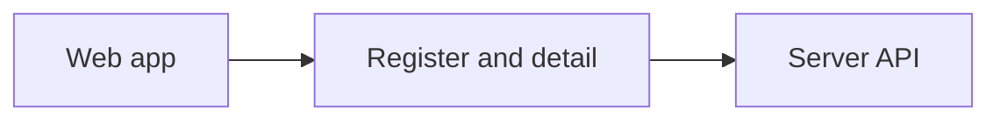

# Integrations register and detail

The web app reads the organisation's integrations from the server. An admin can search the
register, open a server and see what the current API can prove. Missing connection and access
reads say “Not available yet”. The server still owns every saved change.

## Visual comparison

| Reference frame | Capture | What differs and why |
| --- | --- | --- |
| INT-03 | Register rows | There are no catalogue or package rows in the current register API. |
| INT-01 to INT-07 | Search | The labelled search sits below the tabs so the field has a visible name. It has no icon or placeholder. |
| INT-01 | Empty register | The empty message uses a plain panel without a dog-ear. |
| INT-03 | Tools column | The count says “on Allow or Ask” because the API counts modes, not grants. |
| INT-37 | Detail actions | “Manage tools” and “Check discovery status” replace “Manage access” and “More”. The API has no access editor or extra menu yet. |
| INT-37 | Detail facts | Connected and Allowed for say “Not available yet” because those reads do not exist. The Last connection check and Used by sections are not shown. Available says “Not available yet” for a published server because access grants cannot be read. |
| INT-03 | Row actions | There is no “Set up connection” action because connection profiles are not built. |
| INT-94 | Access lost | “Back to workspace” replaces “Go to Overview” because the Overview page is not built. “Your Admin role was changed at 09:14” is omitted because the server supplies no role-change time. |
| INT-07 | Refresh | One “Refresh list” control stays in the header so focus does not move. |
| INT-06 | Detail facts | No people, team names, actor names or invented times appear. |
| INT-06 | Installed fact | The server's own status appears, such as “Needs input · Pending review”, instead of “Draft · Not published”. “Your saved choices stay in this draft” is omitted because saved tool choices are not available to this screen. |
| INT-03 | Register status | Status uses the labels sent by the server, such as “Ready”, instead of “Available to the assistant”. The API does not report the frame's assistant availability label. |
| INT-04 | Register status | Status uses the labels sent by the server, such as “Needs input”, instead of “Draft — review not finished”. The “Review changes” row is not shown because the API has no tools-changed state. |
| INT-06 | Detail refresh | The current facts stay visible, and a status message reports the refresh result. |

## Checks

| Check | Result | Evidence |
| --- | --- | --- |
| Root lint | PASS | All lint steps passed. ESLint reported six warnings in unchanged files. |
| Workspace typecheck | PASS | TypeScript passed in every workspace. |
| Angular production build | PASS | The build completed. It reported stylesheet budget warnings and the existing noVNC CommonJS warning. |
| Angular web tests | PASS | 315 tests passed across 32 files. |
| Event catalogue check | PASS | All 96 event types match the catalogue. |
| Server integrations tests | PASS | All 21 tests passed, including the browser refresh journey. |
| Integrations screen check | PASS | 118 captures at 1280, 390 and 320px with both motion settings. It checks retry and loading states, tab counts, one failure message, the full-row link hit target and access-link text colour. |
| Foundation screen checks | PASS | 56 captures, states, register, keyboard and reduced motion. |
| Drawer and focus checks | PASS | 38 captures, focus, navigation and reduced motion. |
| Organisation shell checks | PASS | 22 captures, navigation, routes and screen moves. |
| Settings screen checks | PASS | 20 captures, shell, routes and phone menu. |
| Workspace screen checks | PASS | 18 captures at 1280, 390 and 320px with reduced motion. |
| Regression mutation checks | PASS | The new refresh, focus, failed-count, single-message and availability assertions failed when their guards were removed. The row hit test failed when the Server cell became its positioned parent. All guards were restored. |
| Full root test suite | NOT RUN | The task asked not to run the full root suite. |
| Dev-stack journey | NOT RUN | No journey was requested. |
| Fresh-install qualification | NOT RUN | This screen change does not qualify a fresh installation. |

The visual record has 118 PNG captures. They are evidence and are not part of the source line count.

The server does not yet publish integrations, read grants, mark tools as reviewed, remove
servers or provide connection profiles. The screen work is therefore partial.
