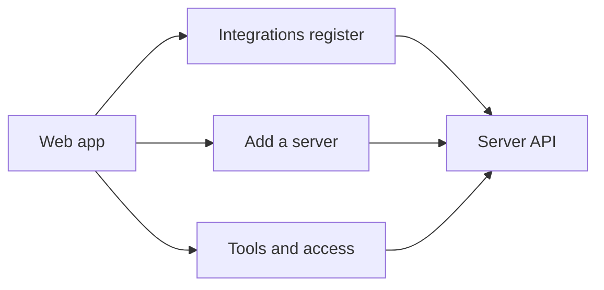

# Integrations screens

The web app shows the organisation's integrations. An admin can search the register, add a
remote MCP server, review its tools and see the facts the server can provide. Missing
connection and access details say “Not available yet”. The server owns every saved change.

## Visual comparison

| Reference frame | Capture | What differs and why |
| --- | --- | --- |
| INT-03 | Register rows | There are no catalogue or package rows in the current register API. |
| INT-01 to INT-07 | Search | The labelled search sits below the tabs so the field has a visible name. It has no icon or placeholder. |
| INT-01 | Empty register | The empty message uses a plain panel without a dog-ear. |
| INT-03 | Tools column | The count says “on Allow or Ask” because the API counts modes, not grants. |
| INT-37 | Detail actions | “Manage tools” and “Check discovery status” replace “Manage access” and “More”. The API has no access editor or extra menu yet. |
| INT-37 | Detail facts | Connected and Allowed for say “Not available yet” because those reads do not exist. The Last connection check and Used by sections are not shown. Available says “Not available yet” for a published server because access grants cannot be read. |
| INT-03 | Row actions | There is no “Set up connection” action because connection profiles are not built. |
| INT-94 | Access lost | “Back to workspace” replaces “Go to Overview” because the Overview page is not built. “Your Admin role was changed at 09:14” is omitted because the server supplies no role-change time. |
| INT-07 | Refresh | One “Refresh list” control stays in the header so focus does not move. |
| INT-06 | Detail facts | No people, team names, actor names or invented times appear. |
| INT-06 | Installed fact | The server's own status appears, such as “Needs input · Pending review”, instead of “Draft · Not published”. “Your saved choices stay in this draft” is omitted because saved tool choices are not available to this screen. |
| INT-03 | Register status | Status uses the labels sent by the server, such as “Ready”, instead of “Available to the assistant”. The API does not report the frame's assistant availability label. |
| INT-04 | Register status | Status uses the labels sent by the server, such as “Needs input”, instead of “Draft — review not finished”. The “Review changes” row is not shown because the API has no tools-changed state. |
| INT-06 | Detail refresh | The current facts stay visible, and a status message reports the refresh result. |
| INT-10 | Source choices | Catalogue and package choices say “Not available yet”. No catalogue listing is shown because neither route exists. |
| INT-10 | Add flow steps | Steps have numbers and labels, without check marks, because the API gives no completion evidence. Connection and Publish say “Not available yet”. |
| INT-30 | Tool actions | Each tool has its own Save button in place of “Review access”. The API saves one mode at a time and has no review or grant command. |
| INT-30 | Tool details | No tool descriptions are shown because the policy response has no description field. |
| INT-30 | Tool Save | “Save” applies a mode only when the server has a validation connection. The API rejects a missing connection id. |
| INT-31 | Access summary | “Nobody can use these tools yet” replaces the frame's access claim because publishing and grants are not available. The Audience section says “Not available yet” in place of people chips and “Review access”. |
| INT-93 | Conflict notice | The notice names no person or time. The conflict response supplies neither, and can also come from a lagging read. |
| INT-96 | Matching status read | “Saved policy matches your change” replaces “Confirmed: applied”. A later read cannot show which command made the modes match. |
| INT-96 | Status result | There is no “Not applied” result because the API has no per-command status read. |
| INT-90 | Invalid save | A warm red notice says nothing changed. The refused tool returns to its saved mode, other unsaved choices stay selected, and there is no command reference because the server refused the change. “Reload tools” reads the saved modes again. |
| INT-93 | Conflict actions | “Review the current modes” and “Discard my edits” replace “Review their change” because the reply names no person. |
| INT-93 | Conflict notice | A warm notice names no person or time because the reply supplies neither. The tool list stays visible below it. |
| INT-95 | Lost save | Check status is the main action. Reload tools appears only after a check still cannot confirm the result or a read fails. The command id stays visible as the reference. The server supplies no time for the lost reply. |
| INT-10 | Add form | Cancel sits beside Continue. Source choices use a bordered group. The steps use numbers instead of circles and connecting lines because the server gives no proof that earlier steps are complete. |
| INT-10 | Discovery result | The discovered tool list stays visible. Continue to tools and access appears when the server needs review; connection setup is not available yet. |
| INT-30 | Tool list | Tools use joined mode choices with a Save button under each one. The policy reply has no server name, so the heading gives the tool count. “Blocked — nobody can use it” replaces “New — starts Block”. The page has no Back button, and the breadcrumb includes Integration details. |
| INT-31 | Mode summary | The summary appears above the tools so it stays visible while each tool is reviewed. |

## Checks

| Check | Result | Evidence |
| --- | --- | --- |
| Root lint | PASS | All lint steps passed. ESLint reported six warnings in unchanged files. |
| Workspace typecheck | PASS | TypeScript passed in every workspace. |
| Angular production build | PASS | The build completed. It reported stylesheet budget warnings and the existing noVNC CommonJS warning. |
| Angular web tests | PASS | 315 tests passed across 32 files. |
| Event catalogue check | PASS | All 96 event types match the catalogue. |
| Server integrations tests | PASS | All 21 tests passed, including the browser refresh journey. |
| Integrations screen check | PASS | 118 captures at 1280, 390 and 320px with both motion settings. It checks retry and loading states, tab counts, one failure message, the full-row link hit target and access-link text colour. |
| Foundation screen checks | PASS | 56 captures, states, register, keyboard and reduced motion. |
| Drawer and focus checks | PASS | 38 captures, focus, navigation and reduced motion. |
| Organisation shell checks | PASS | 22 captures, navigation, routes and screen moves. |
| Settings screen checks | PASS | 20 captures, shell, routes and phone menu. |
| Workspace screen checks | PASS | 18 captures at 1280, 390 and 320px with reduced motion. |
| Regression mutation checks | PASS | The new refresh, focus, failed-count, single-message and availability assertions failed when their guards were removed. The row hit test failed when the Server cell became its positioned parent. All guards were restored. |
| Full root test suite | NOT RUN | The task asked not to run the full root suite. |
| Dev-stack journey | NOT RUN | No journey was requested. |
| Fresh-install qualification | NOT RUN | This screen change does not qualify a fresh installation. |

The visual record has 118 PNG captures. They are evidence and are not part of the source line count.

The server does not yet publish integrations, read grants, mark tools as reviewed, remove
servers or provide connection profiles. The screen work is therefore partial.

## PR B checks (2026-10-06)

| Check | Result | Evidence |
| --- | --- | --- |
| `nice -n 10 npm run lint` | PASS | No errors. ESLint reported nine existing max-lines warnings. |
| `nice -n 10 npm run typecheck` | PASS | TypeScript passed in every workspace. |
| `nice -n 10 npm run build -w apps/web` | PASS | The build completed with existing stylesheet budget and noVNC CommonJS warnings. |
| `nice -n 10 npm run test -w apps/web -- --watch=false` | PASS | 358 tests passed across 34 files. |
| `nice -n 10 npm run check:events` | PASS | All 96 event types match the catalogue. |
| `nice -n 10 npm test -- apps/server/test/integrations.test.ts` | PASS | All 21 integrations tests passed. |
| `nice -n 10 npm run visual:integrations` | PASS | 238 captures at 1280, 390 and 320px with both motion settings. It checks phone controls, keyboard movement, row hit targets and GET-only status checks. |
| `nice -n 10 npm run visual:f1-foundation` | PASS | 56 captures and foundation screen checks. |
| `nice -n 10 npm run visual:f2-drawers` | PASS | 38 captures and drawer and focus checks. |
| `nice -n 10 npm run visual:f3-org-shell` | PASS | 22 captures and organisation shell checks. |
| `nice -n 10 npm run visual:f4-settings` | PASS | 20 captures and settings checks. |
| `nice -n 10 npm run visual:f5-workspace` | PASS | 18 captures and workspace checks. |
| Guard-removal checks | PASS | Twelve temporary guard removals made their related specs fail. Every guard was restored before the final checks. |
| Visual captures and checks | PASS | Chromium captured each listed state at 1280px, 390px and 320px, with both motion settings. The script checks horizontal overflow, phone control height and mode label wrapping. It does not compare pixels with the design frames. No fresh-install journey was run. |
| Full root test suite | NOT RUN | The task asked not to run the full root suite. |
| Dev-stack journey | NOT RUN | No dev-stack journey was requested. |
| Fresh-install qualification | NOT RUN | This change does not qualify a fresh installation. |

The PR changes 3,050 non-generated lines: 2,755 added and 295 removed. This count leaves
out generated screenshots and `visual.json`.

I also removed one protection at a time and ran the spec that covers it. The specs failed
when I removed the pending-save lock, the late-reply check, the missing-connection lock,
choice keeping, the lost-reply action order, the failed-check reload action, status focus,
add-page focus, Enter submission, the new-server draft reset or the saved-choice marker
checks. I restored each protection before running the final checks.

This change adds the remote add flow and tool mode screen. Catalogue admission,
connection profiles, review marking, grants and publishing still need server support.
