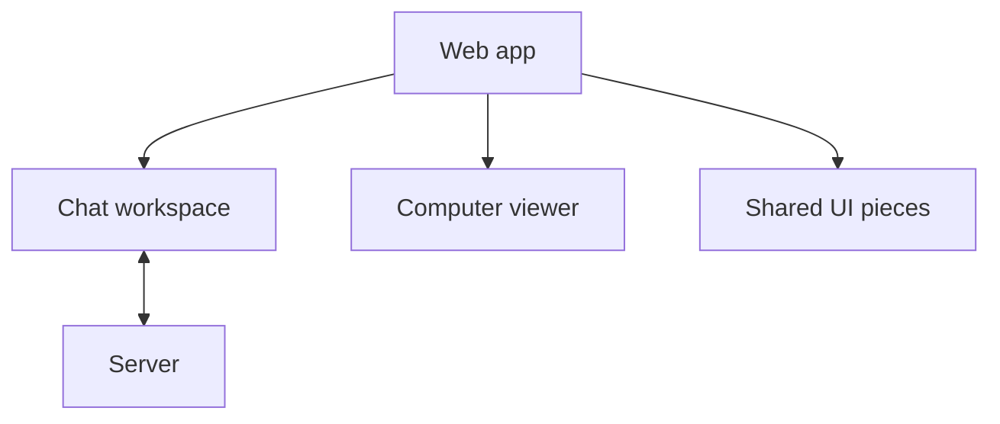

# Screenshot screens

Checked on 6 October 2026 from commit
`581852944faa42b898ab5be9599f2630ea5da917`. The screenshot manifests record this
source commit as well. The browser checks use sample data in Chromium.
They do not qualify a fresh installation.

The chat workspace reads saved screenshots from conversation events. The web
app sends capture requests and shows the same files in the transcript and Files
panel.

The viewer sends one capture request at a time. A saved PNG appears as a
captioned card with the capture time and image size. The Files row shows the
file name above who captured it. The preview shows the image, computer id,
generation number and download link. An unknown result keeps its command id.
The person checks Files before the same request can be sent again.

The screen checks use intercepted requests and sample event rows. They exercise
failure, access and revoked states in a local Chromium browser. No live
dev-stack journey ran, so this receipt is not live qualification.

## Visual comparison

[`visual.json`](visual.json) records 63 captures at 1280px, 390px and 320px,
including reduced-motion captures at 390px. It includes each viewer state with
the sheet open and the workspace with the sheet closed.

| State | Capture | What differs |
| --- | --- | --- |
| Empty | `*empty-*` | The existing Files empty state stays unchanged. |
| Saving | `*saving-*` | Capturing, scanning and saving use one combined state. |
| Saving with a file already listed | `saving-with-file-row-390-no-preference.png` | A separate capture checks the saving message while an earlier screenshot is already in Files. |
| Workspace capture | `*workspace-*`, `*chat-*` | With the viewer closed, desktop shows the transcript, card and Files. On phones, the Files drawer and chat appear in separate captures. |
| Saved | `*saved-*` | Uses “another participant” and replaces friendly computer names with the computer id. |
| Preview | `*preview-*` | Says “Download original file”. Close stays in the header only. |
| Retry | `*failed-*` | “Try again” replaces “Capture again” and reuses the key after a 503. |
| Disconnected | `*disconnected-*`, `*unavailable-*` | Shows both states in the viewer, not the transcript. |
| Rejected | `*rejected-*` | Shows one refusal without a file name or size-limit text. |
| Failed thumbnail | `*thumbnail-failed-*` | The card shows its failed preview state and keeps the thumbnail row in Files. |
| Access check | `*preview-access-check-*` | No “Link expired”; keeps the failed card and asks to check access. |
| Access revoked | `*revoked-*` | Keeps the access alert above “Files unavailable”. It says “You don't have access” and “Nothing from this conversation is shown.” |
| Repeated request | `*repeated-*` | “Send the same request again” reuses the key and leaves one card. |
| Card actions | `*saved-*` | Open preview and Download use full-width rows on desktop instead of side-by-side buttons. |
| Failure wording | `*failed-*`, `*rejected-*` | Failure and scan notices use plain status lines rather than tinted boxes. |
| Preview facts | `*preview-*` | Computer and conversation facts appear as a list rather than a bordered table. |
| Capture status | `*saving-*`, `*failed-*` | The status can appear in the viewer, Files panel and transcript. The transcript copy is quiet while the panel is open. |
| Revoked access wording | `*revoked-*` | This screen says “You don't have access” and “Nothing from this conversation is shown.” The handoff says “You no longer have access” and “Files were cleared from this view.” |

An unreadable 422 reply from a proxy can leave the capture refusal beside the
matching refusal in the transcript. The server sends a file id with its usual
422 reply, so the browser check covers the normal case.

## Checks

Report each check as PASS, FAIL, PARTIAL or NOT RUN. Browser fixtures use sample
data and do not qualify a fresh installation.

| Check | Result | Evidence |
| --- | --- | --- |
| Lint | PASS | `nice -n 10 npm run lint`; six existing warnings and no errors. |
| Typecheck | PASS | `nice -n 10 npm run typecheck`; all workspaces passed. |
| Event catalogue | PASS | `nice -n 10 npm run check:events`; all 96 event types agree. |
| Web build | PASS | `nice -n 10 npm run build -w apps/web`; existing style budget and noVNC notices remain. |
| Live View test build | PASS | `nice -n 10 npm run build:live-view-test -w apps/web`. |
| Angular tests | PASS | `nice -n 10 npm test -w apps/web -- --watch=false`; 284 tests passed. |
| Screenshot visual check | PASS | 63 Chromium captures at 1280px, 390px and 320px; status focus checks and reduced motion. |
| Foundation visual check | PASS | 56 captures. |
| Drawer visual check | PASS | 38 captures. |
| Organisation shell visual check | PASS | 22 captures. |
| Settings visual check | PASS | 20 captures. |
| Workspace visual check | FAIL | The existing “No messages yet” assertion failed; the pass-2 review recorded the same failure on `origin/main`. |
| Chat browser check | PASS | Keyboard, focus, touch targets, streaming, Stop/reload, offline retry and wake state. |
| Root test suite | NOT RUN | Excluded as requested. |
| Live journey and fresh-install check | NOT RUN | No secondary dev stack was claimed. These browser checks use sample data. |
