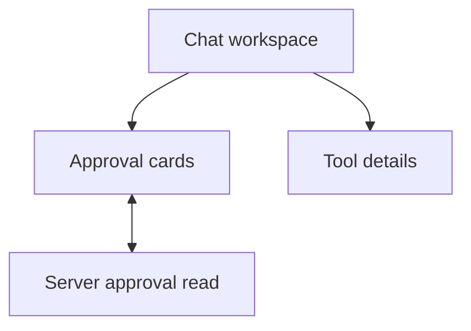

# Tool approvals in chat

The web app shows approval requests in the conversation where the tool call was
made. These screens use the approval details already returned by the server.
They do not add or change approval records.

The requester can read each reviewed field and approve or deny a request. Other
participants see that the requester must decide. Terminal cards show whether an
approval was denied, expired, cancelled, approved but unused, or used once with
no known result. A lost decision reply prompts one status read. The browser does
not send the decision again by itself.

Tool lines open a drawer with the result, recorded time and event reference.
It says that the location, account and attempt history are not available. It does
not show raw arguments, tokens or full tool output.

## Visual comparison

The frames were compared at 1280px and 390px where supplied, and the layouts were
also checked at 320px. The delivered views were captured with normal and reduced
motion. The differences below follow the data the server provides.

| Frame | Result | What the screen shows and why it differs |
| --- | --- | --- |
| WRK-01 | Delivered | Existing empty conversation; captured as a regression check. |
| WRK-02 | Not built | There is no record for an MCP call in progress. The workspace keeps its existing “Folding…” and “Agent working” text. |
| WRK-03 | Adapted | Saved command and failed-turn records appear as quiet transcript buttons. Restricted turns do not report commands. Team turns sent from the workspace run restricted, so they show at most “Reply failed”. |
| WRK-04 | Delivered | A transcript button opens sanitised result, UTC time and event reference details. The location, account and attempt history are not available. |
| WRK-05 | Not built | The server gives no attempt history. |
| WRK-06 | Not built | The server gives no native-consent refusal report or link to tool settings. |
| WRK-07 | Delivered | An Activity entry scrolls to its message, focuses its tool button and highlights that message. |
| WRK-10 | Delivered | A requester sees the full pending review. “Waiting on you” appears in the header but does not speak; the card announces the request once. |
| WRK-11 | Delivered | Details opens a drawer with the same ledger. The server gives no current note, so none is shown. |
| WRK-12 | Not built | The server has no conversation-scoped requester name. This view is reachable only in fixtures, so its full ledger moves to a follow-up. The pending card still says “Only the requester can decide.” |
| WRK-13 | Not built | A review missing a required field fails the GET schema and shows the read-failed state, with decisions paused. |
| WRK-14 | Delivered | Both decisions disable while the POST is in flight, including when a poll returns. |
| WRK-15 | Not built | The server has no tool-server readback or confirmed result. |
| WRK-16 | Adapted | A used approval says it was used once and the result is unknown. Check status reads the same approval. |
| WRK-17 | Delivered | A denied approval says nothing was sent with that approval. |
| WRK-18 | Delivered | An expired approval shows its expiry and says it cannot be revived. |
| WRK-19 | Adapted | Cancelled approvals share one state because the server does not return the cause. |
| WRK-20 | Adapted | The drawer lists possible cancellation causes and says the exact reason is not available. |
| WRK-21 | Delivered | A 428 response offers sign-in for this approval. The requester must press Approve again after signing in. |
| WRK-22 | Delivered | A dropped socket shows one quiet reconnect line after the next ready message. It does not move focus or start another approval read. |
| WRK-30 | Not built | The browser has no safe-retry evidence for an MCP call. |
| WRK-31 | Adapted | Check status re-reads the same approval. The server gives no confirmed effect result. |

The API does not return decision time, time used, a cancellation cause or other
participants’ names. It also gives no tool-server readback. A server refusal with
status 503 can happen before an append as well as after an uncertain append. A
status check that still finds the approval open says when it will close if another
decision attempt fails.

## Checks

The captures use intercepted fixtures. They do not prove a live governed MCP turn.
The full receipt records each command and result in the pull request description.

| Check | Result | Evidence |
| --- | --- | --- |
| Install | PASS | `nice -n 10 npm ci` |
| Lint | PASS | `nice -n 10 npm run lint` |
| Typecheck | PASS | `nice -n 10 npm run typecheck` |
| Root tests | PARTIAL | `nice -n 10 npm run test -- --maxWorkers=1`: 1,948 passed, 43 skipped and 11 failed in six files. Those six files passed alone with a temporary `PG_TEST_URL`: 105 passed, one skipped. |
| Web tests | PASS | `nice -n 10 npm run test -w apps/web -- --watch=false`; 306 tests. |
| Event catalogue | PASS | `nice -n 10 npm run check:events` |
| Web build | PASS | Built by `nice -n 10 npm run visual:p3-5-approvals`. |
| Approval visuals | PASS | `nice -n 10 npm run visual:p3-5-approvals`; 48 captures. WRK-12 is deferred. |
| F2 overlays | PASS | `nice -n 10 npm run visual:f2-drawers`; 38 captures. |
| F5 workspace | PASS | `nice -n 10 npm run visual:f5-workspace`; 18 captures. |
| Chat browser | PASS | `nice -n 10 npm run visual:chat`. |
| P3-18 visuals | PASS | `nice -n 10 npm run visual:p3-18-screens`; 63 captures. |
| Dev-stack journey | NOT RUN | No stack was started. |
| Live governed MCP turn | NOT RUN | The server still has no approval continuation for this screen. |
