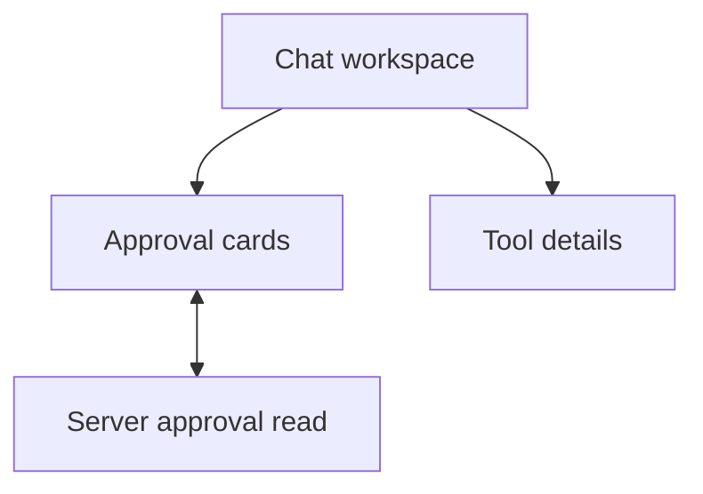

# Tool approvals in chat

The web app shows approval requests in the conversation where the tool call was
made. These screens use the approval details already returned by the server.
They do not add or change approval records.

The person who asked can read each field and approve or deny the request. Other
people see that they cannot decide it. Folded cards show whether a request was
denied, expired, cancelled, approved but unused, or used once with no known
result. If the reply is lost, the page checks the status once. It never sends the
decision again by itself.

Tool lines open a drawer with the result, recorded time and event reference.
It says that the location, account and attempt history are not available. It does
not show raw arguments, tokens or full tool output.

The open drawer follows the latest tool row. If the turn ends before a finish
report arrives, the line says that the result was not confirmed. It does not call
the tool a failure or say that it kept running. Live start and finish updates are
announced once in the polite status message. History replay and streamed text
stay quiet.

## Visual comparison

The frames were compared at 1280px and 390px where supplied, and the layouts were
also checked at 320px. The delivered views were captured with normal and reduced
motion. The differences below follow the data the server provides.

| Frame | Result | What the screen shows and why it differs |
| --- | --- | --- |
| WRK-01 | Delivered | Existing empty conversation; captured as a regression check. |
| WRK-02 | Adapted | A reported governed tool call appears as a running line. The fixture compares it with the 1280px and 390px frame; the server reports no arguments or result while it runs. |
| WRK-03 | Adapted | Finished governed calls, saved command records and failed-turn records appear as quiet transcript buttons. Restricted turns do not report commands. Team turns sent from the workspace run restricted, so they show at most “Reply failed”. |
| WRK-04 | Delivered | A transcript button opens the cleaned result, time on the shared world clock and event reference. The location, account and attempt history are not available. |
| WRK-05 | Not built | The server gives no attempt history. |
| WRK-06 | Not built | The server gives no native-consent refusal report or link to tool settings. |
| WRK-07 | Delivered | An Activity entry scrolls to its message, focuses its tool button and highlights that message. |
| WRK-10 | Delivered | A requester sees the full pending review. “Waiting on you” appears in the header but does not speak; the card announces the request once. |
| WRK-11 | Delivered | Details opens a drawer with the same ledger. The server gives no current note, so none is shown. |
| WRK-12 | Not built | The server has no conversation-scoped requester name. This view is reachable only in fixtures, so its full ledger moves to a follow-up. The pending card still says “Only the requester can decide.” |
| WRK-13 | Not built | An incomplete review gets a 400 error from the server. The page shows that it could not load the approval and pauses decisions. |
| WRK-14 | Delivered | Both decisions stay unavailable while a request is being sent, including when a status read returns. |
| WRK-15 | Not built | The server has no tool-server readback or confirmed result. |
| WRK-16 | Adapted | A used approval says it was used once and the result is unknown. Check status reads the same approval. |
| WRK-17 | Adapted | A denied approval says nothing was sent with it. The page says “by you” or “by the requester” because no other name is available. |
| WRK-18 | Delivered | An expired approval shows its expiry and says it cannot be revived. |
| WRK-19 | Adapted | Cancelled approvals share one state because the server does not return the cause. |
| WRK-20 | Adapted | The drawer lists possible cancellation causes and says the exact reason is not available. |
| WRK-21 | Delivered | A 428 response offers sign-in for this approval. The requester must press Approve again after signing in. |
| WRK-22 | Delivered | After the live connection drops, one quiet line appears when the conversation reconnects. It does not move focus or start another approval read. |
| WRK-30 | Not built | The page has no safe way to show whether repeating a tool action is safe. |
| WRK-31 | Adapted | Check status re-reads the same approval. The server gives no confirmed effect result. |

The server does not report when a decision happened, how long it took, why a
request was cancelled or the names of other participants. It also cannot confirm
what the tool server did. A server error can happen before it records a choice or
leave the result unknown. If a status check still finds the request open, the page
says when it will close if another choice fails.

The page also differs from some frame details. “Waiting on you” sits at the far
right of the title area. The Details control is a button. While a decision is
being sent, the card title changes to “Sending your approval…” and Details stays
available. The reconnect line sits at the left and does not sit above a pending
card. Folded cards do not show a decision time. Their wording names the viewer
when the viewer asked for the approval and says “the requester” for anyone else.

The Stop status is also captured at desktop and phone widths. If the server has
not reported that a turn ended after ten seconds, the workspace says “Stop not
confirmed”, keeps the turn active and offers Stop again.

| State | 1280px | 390px |
| --- | --- | --- |
| Stop not confirmed | [Desktop capture](stop-not-confirmed-1280-no-preference.png) | [Phone capture](stop-not-confirmed-390-no-preference.png) |

## Checks

The captures use sample data. They do not prove a live tool action with real approvals.
The pull request description records the commands and results from the latest
checks.

| Check | Result | Evidence |
| --- | --- | --- |
| Lint | PASS | `nice -n 10 npm run lint`; 14 existing max-lines warnings. |
| Web typecheck | PASS | `nice -n 10 npm run typecheck -w apps/web`. |
| Root tests | NOT RUN | The requested checks excluded the full root suite. |
| Web tests | PASS | `nice -n 10 npm run test -w apps/web -- --watch=false`; 40 files, 614 tests. |
| Event catalogue | PASS | `nice -n 10 npm run check:events`; 96 event types agree. |
| Web build | PASS | `nice -n 10 npm run build -w apps/web`; existing CSS budget and CommonJS warnings. |
| Approval visuals | PASS | `nice -n 10 node scripts/check-p3-5-approvals.mjs`; 88 captures at 1280, 390 and 320 pixels with both motion settings. Includes a 200-character tool name and Stop timeout. |
| F2 overlays | NOT RUN | Not part of the requested review checks. |
| F5 workspace | PASS | `nice -n 10 npm run visual:f5-workspace`; 18 captures. |
| Chat browser | PASS | `nice -n 10 npm run visual:chat`; keyboard, focus, phone, streaming and reconnect checks. |
| P3-18 visuals | NOT RUN | Not part of the requested review checks. |
| Dev-stack journey | NOT RUN | No stack was started. |
| Live tool approval | NOT RUN | These browser checks use sample data; no live tool action was run. |
