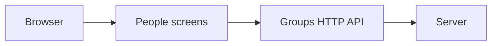

# People & groups

Checked on 5 October 2026 from source commit `dcbeea8`. The browser checks use
sample data and a local Chromium browser. They do not qualify a fresh installation.

The web app reads flat group rows and sends create and membership commands to the
groups API. The server owns group truth.

Owners and admins can see groups, search the loaded names, create a group and open
its members and grants. The screen shows whether the group or each person came from
OpenCrane or an identity provider. Adding people waits for a member list.

## Visual comparison

The captures use 1280px, 390px and 320px widths, with normal and reduced motion.
`visual.json` lists each capture.

| Frame | Capture | Difference from the frame |
| --- | --- | --- |
| PPL-02 | `list-*` | No Invite people action. The active green check is replaced with “Editable here” because there is no dated evidence. |
| PPL-03 | `empty-*`, `no-match-*` | Empty groups and empty search use text and one action, with no illustration. |
| PPL-04 | `loading-*` | Four grain rows show loading. |
| PPL-05 | `stale-*` | The refresh notice says when the list was loaded; it does not suggest the failed read changed data. |
| PPL-06 | `create-duplicate-*`, `unknown-*`, `unknown-not-found-*` | The drawer has no description field. The duplicate-name check uses names already loaded in the browser. |
| PPL-07 | `created-*` | “Open group” replaces “Add members”. The detail says when both records were checked, not when the change happened. |
| PPL-08 | Existing shell menu | The organisation shell supplies the phone menu and returns focus to its button. |
| PPL-10 | `detail-local-*`, `detail-empty-*` | No email, role, Since or More action. “Open group” replaces “Add members” with an unavailable message. Grants shows only `use`; the shared assistant has its own card. GroupDetail has no `changeStatus` input. |
| PPL-12 | `detail-supplied-*` | No provider name, sync time or “How sync works” link. |
| PPL-13 | — | Removal review is added in the second pull request. |
| PPL-14 | — | Removal confirmation uses a check time, not a recorded completion time. |
| PPL-15 | — | The conflict notice leaves out the editor's name and time. |
| PPL-16 | `access-changed-*`, `session-ended-*` | Access loss clears group and member details. Session-ended wording differs from a role change. |

## Checks

`PASS`, `FAIL`, `PARTIAL` and `NOT RUN` describe only checks run for this work.
An unrun check is not evidence that the feature works.

| Check | Result | Evidence |
| --- | --- | --- |
| `npm ci` | PASS | `nice -n 10 npm ci` completed. npm reported 12 existing audit findings. |
| Lint | PASS | `nice -n 10 npm run lint`; no errors and six warnings in existing server and library files. |
| Typecheck | PASS | `nice -n 10 npm run typecheck`; all workspaces. |
| Event catalogue | PASS | `nice -n 10 npm run check:events`; all 95 event types agree. |
| Angular build | PASS | `nice -n 10 npm run build -w apps/web`; existing bundle and noVNC warnings. |
| Angular tests | PASS | `nice -n 10 npm run test -w apps/web -- --watch=false`; 27 files and 171 tests passed. |
| Protocol tests | PASS | `nice -n 10 npx vitest run libs/protocol`; 19 tests passed. |
| F1 visual check | PASS | `nice -n 10 npm run visual:f1-foundation`; 56 captures. |
| F2 visual check | PASS | `nice -n 10 npm run visual:f2-drawers`; 38 captures. |
| F3 visual check | PASS | `nice -n 10 npm run visual:f3-org-shell`; 22 captures. |
| F4 visual check | PASS | `nice -n 10 npm run visual:f4-settings`; 20 captures. |
| F5 visual check | PASS | `nice -n 10 npm run visual:f5-workspace`; 18 captures. |
| People visual check | PASS | `nice -n 10 npm run visual:p4-1-people`; 70 captures at 1280px, 390px and 320px, with normal and reduced motion. |
| Full root suite | NOT RUN | Only browser code, scripts and protocol schemas changed. |
| Dev-stack journey | NOT RUN | No dev stack was started. |
| Fresh-install qualification | NOT RUN | These browser checks use sample data. |
| Backend projection rebuild and access check | NOT RUN | This is live backend qualification. |
