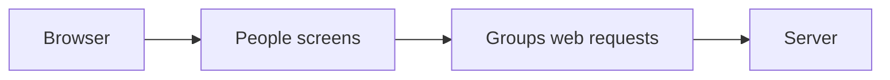

# People & groups browser checks

The website reads group rows and sends group commands to the server. The server owns
the group records. These captures use sample data in Chromium. They do not test a
fresh installation. The checks use source commits `f0a83a4` and `2b8a624`.

## Differences from the design frames

The visual check captures each listed state at 1280px, 390px and 320px with normal
and reduced motion, unless a row says 1280px only. It compares the screens for
PPL-02 to PPL-08 and PPL-10 to PPL-16.

| Frame | Captures | Differences from the frame |
| --- | --- | --- |
| PPL-02 | `list-*` | There is no Invite people action. The green check says “Editable here” because there is no dated evidence. Search takes a full row below the tabs instead of sitting beside them. The page uses the F1 register card, header row and type tokens. |
| PPL-03 | `empty-*`, `no-match-*` | Empty groups and empty search use words and one action. They have no illustration. |
| PPL-04 | `loading-*` | Four grain rows show loading. |
| PPL-05 | `stale-*` | The notice gives the last successful load time. It says a failed read did not change data. |
| PPL-06 | `create-duplicate-*`, `create-unknown-*`, `create-unknown-not-found-*`, `create-unknown-unavailable-*` (1280px only) | There is no description field. Duplicate names are checked against loaded names. An unknown result says which group could not be confirmed and gives the advice once. A not-found result has no extra detail. |
| PPL-07 | `created-*` | “Open group” replaces “Add members”. The detail gives the time when both records were checked, not when the change happened. |
| PPL-08 | `menu-*` | The organisation shell supplies the phone menu and returns focus to its button. |
| PPL-10 | `detail-local-*`, `detail-empty-*`, `detail-not-found-*` | There is no email, role, Since or More action. Three summary cards show the member count and source, shared assistant and grants before the full-width member list. The unavailable Add members message replaces the frame’s Add members action. Grants shows only use grants; the shared assistant has its own card. |
| PPL-12 | `detail-supplied-*` | The page has no provider name, sync time or “How sync works” link. The membership notice is grey. The page has no add-members message. |
| PPL-13 | `remove-review-*` | The review names each grant through this group and says access from other groups stays. Direct grants and private conversations are called out separately. The loss list has one glyph per item. The red Remove button comes before Cancel. |
| PPL-14 | `removing-*`, `removed-*` | Every Remove button is disabled while the change is applying or unknown. “Still applying” appears only after a 200 receipt. |
| PPL-15 | `conflict-*`, `refused-*` | A conflict keeps the member list from before the conflict visible. Refresh is a secondary button. A refused removal uses the new group row when the reread succeeds. |
| PPL-16 | `access-changed-*`, `session-ended-*` (1280px only) | Access loss clears group and member details. Session-ended wording differs from a role change. |

The detail screen does not receive the other group rows. The review therefore says
that access through this group ends and that access from other groups stays; it does
not try to list another group's grants.

## Checks

`PASS`, `FAIL`, `PARTIAL` and `NOT RUN` describe checks run for this work. A check
that was not run is not evidence that the feature works.

| Check | Result | Evidence |
| --- | --- | --- |
| Lint | PASS | `nice -n 10 npm run lint`; seven line-count warnings were reported in other files. |
| Typecheck | PASS | `nice -n 10 npm run typecheck`. |
| Event catalogue | PASS | `nice -n 10 npm run check:events`; all 95 event types agree. |
| Angular build | PASS | `nice -n 10 npm run build -w apps/web`; the bundle, People & groups CSS and noVNC warnings remain. |
| Focused People and API tests | PASS | Report the final run on this branch below. |
| Angular tests | NOT RUN | Report the final run on this branch below. |
| People visual check | NOT RUN | Report the final run on this branch below. |
| F1 visual check | PASS | 56 captures. |
| F2 visual check | PASS | 38 captures. |
| F3 visual check | PASS | 22 captures. |
| F4 visual check | PASS | 20 captures. |
| F5 visual check | PASS | 18 captures at 1280px, 390px and 320px, with reduced motion. |
| Full root suite | NOT RUN | This change is limited to the browser, protocol schemas and visual scripts. |
| Dev-stack journey | NOT RUN | No dev stack was started for these browser checks. |
| Fresh-install qualification | NOT RUN | These captures use sample data. |
| Backend rebuild and access check | NOT RUN | This is live backend qualification. |
