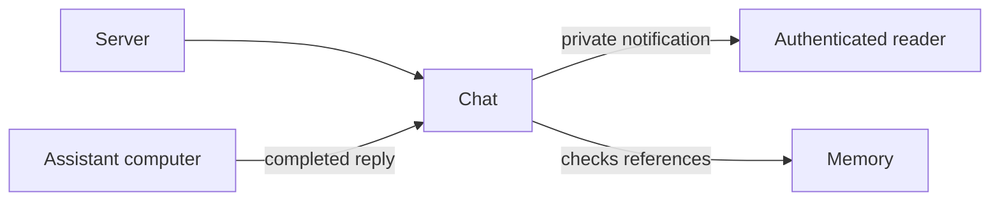

# Private completed replies

## What this is

The server can deliver one completed private reply without saving its words. Only an already connected, authorised reader can receive it.

## Where it fits

The chat bridge receives the reply from the assistant computer.

## What it is responsible for

- Keep reply bytes in bounded server memory until a single delivery attempt.
- Check the saved requester, turn, thread and generations.
- Refuse replies after memory or access changes.

## Processes it handles

The bridge sends a completed reply. The server saves only an unavailable-output
record, checks the current reader and loaded facts, and attempts delivery once.
A lost connection or failed check discards the bytes. Reconnecting cannot recover them.
The server checks for access and memory changes after its last scan, before sending.
Unrelated messages can continue while a valid reply is checked.

Browser display, browser clearance and streamed replies are not built here.
Memory admission remains disabled.

## How to run or test it

Run `nice -n 10 npx vitest run apps/server/test/private-output.test.ts --maxWorkers=1`.

## Where to read more

- [Detailed contract](README.robot.md).
- [Chat responsibilities](../../../apps/server/src/chat/README.md).
