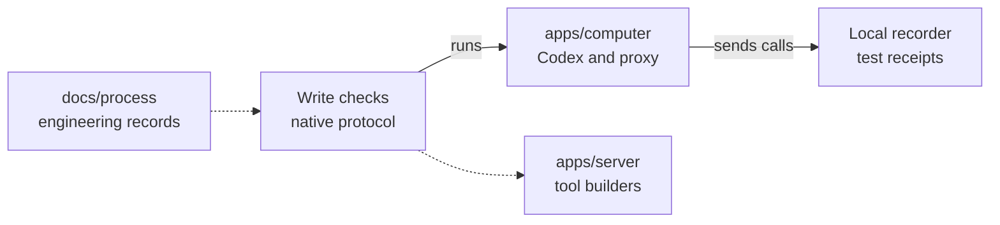

# Personal memory write checks

## What this is

These checks exercise Codex memory writes without enabling them for customers.

## Where it fits

The fixtures use the computer's loader and proxy with the server's tool builders.



## What it is responsible for

- Check remember, Correct and Forget calls and receipt delivery.
- Check refused access, cancellation, lost replies and separate sessions.
- Keep native consent confined to tests.

## Processes it handles

Codex opens a temporary thread, discovers one tool and makes a write call through
the proxy. Checks confirm its arguments and the receipt returned to the model.
Refusal cases must hide the receipt and leave another session working.

## How to run or test it

```sh
nice -n 10 npx vitest run apps/computer/test/private-write-call.test.ts --maxWorkers=1
nice -n 10 node --test scripts/ci/fixture-tests.test.mjs
```

## Where to read more

- [Test details and limits](README.robot.md).
- [Computer responsibilities](../../../apps/computer/README.md).
