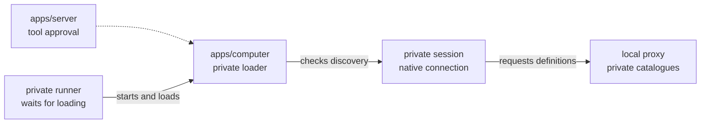

# Private recall loading

## What this is

The computer can load recall on a private thread through its authenticated bridge.
It starts the thread once, then waits for a matching tool list and native discovery.
The server still needs to connect its approval and credential checks to this exchange.

## Where it fits

The runner, session and loader are inside `apps/computer`. The server's tool assembler
will supply approved definitions. The local proxy keeps each private catalogue separate.



## What it is responsible for

- Keep empty reload and loaded-thread checks on the current private process.
- Refuse another start and mismatched thread requests before native RPC.
- Bind the returned thread ID before the loader checks the caller again.
- Match each authenticated load request to its own session and single-use load id.
- Wait for discovery before accepting input or a grant.

Not built yet: server approval delivery, its checks after discovery, and real recall dispatch.

## Processes it handles

A private session starts a native thread and binds its caller to the returned ID.
The runner reports that thread and a fresh load id. A matching bridge request lets the
loader install the recall definition and check discovery. Cancellation or a lost reply
removes access without repeating the request. A second session keeps its own catalogue.

## How to run or test it

```sh
nice -n 10 npx vitest run apps/computer/test/private-recall-runner.test.ts --maxWorkers=1
```

## Where to read more

[README.robot.md](README.robot.md) records the exact scope and remaining work.
[Computer contracts](../../../apps/computer/README.robot.md) describe private callers and loading.
