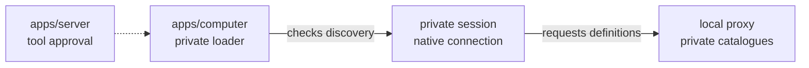

# Private thread discovery

## What this is

This change lets the private session stay open while its tool loader checks discovery.
The loader uses the thread ID returned by the native process. It does not start another
thread to match an expected ID.

## Where it fits

The session and loader are inside `apps/computer`. The server's tool assembler supplies
approved definitions. The local proxy keeps each private catalogue separate.



## What it is responsible for

- Keep empty reload and loaded-thread checks on the current private process.
- Refuse another start and mismatched thread requests before native RPC.
- Bind the returned thread ID before the loader checks the caller again.

## Processes it handles

A private session starts a native thread and binds its caller to the returned ID.
The loader confirms that binding, installs the approved definitions and checks discovery.
Cancellation or a lost reply removes access without repeating the request.

## How to run or test it

```sh
nice -n 10 npx vitest run apps/computer/test/private-recall-preflight.test.ts --maxWorkers=1
```

## Where to read more

[README.robot.md](README.robot.md) records the exact scope and remaining work.
[Computer contracts](../../../apps/computer/README.robot.md) describe private callers and loading.
