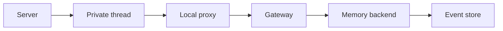

# Remember on a private thread

## What this is

An admitted personal thread can receive Recall and Remember from the saved, reviewed
memory tool list. Remember saves an own-person fact with every loaded reference.
The returned receipt identifies the actual saved revision. Deployment admission stays off.

## Where it fits

The server prepares the tools. The computer checks discovery on its existing private
thread. The gateway and memory backend check each call before saving an event.

## What it is responsible for

The offer keeps the existing membership, caller, grant, qualification and loaded-reference
checks. Discovery reads no facts. Only the offered memory calls may continue on the thread.

## Processes it handles

Remember returns the real receipt after checking access again. If an append reply is lost,
original-command status can find the saved revision without submitting the mutation again.
Two sessions for the same person keep separate catalogues and recall proofs.
Correct, Forget and the complete live journey remain held.

## How to run or test it

The backend tests use disposable services and a scripted native peer, with no model calls.
[README.robot.md](README.robot.md) records the commands, source references and limits.

## Where to read more

The [chat contracts](../../../apps/server/src/chat/README.robot.md) describe preparation.
The [computer contracts](../../../apps/computer/README.robot.md) describe private loading.
