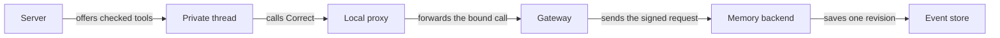

# Correct on a private thread

## What this is

Correct replaces a loaded personal fact and returns its saved receipt.
It keeps every other loaded reference. The old turn cannot release a reply based on
that replaced revision. Deployment admission remains disabled.

## Where it fits

The existing private thread sends Correct through its proxy and gateway.
The memory backend checks the turn and saves one event.

## What it is responsible for

- Keep the correction within the requester's personal memory.
- Check the target revision and every other loaded reference.
- Refuse saved withdrawal before the final append, even if local removal is delayed.

## Processes it handles

A correction saves revision two after revision one. Its receipt contains no fact text.
A lost reply can be resolved through original-command status without submitting again.
Forget and shared writes remain held. Live deployment checks remain unfinished.

## How to run or test it

The backend fixture uses disposable services and a scripted native peer without model calls.
The [test record](README.robot.md) lists commands and untested conditions.

## Where to read more

The [chat contracts](../../../apps/server/src/chat/README.robot.md) describe preparation.
The [memory contracts](../../../apps/server/src/memory/README.robot.md) describe persistence.
