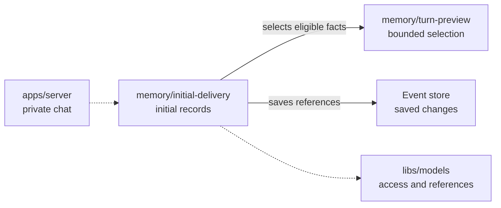

# Initial personal memory records

## What this is

This folder describes how the server records the personal facts selected for a private turn.
A turn is one request and its reply. Recording facts does not send them to a computer.

## Where it fits

The server uses the existing preview and memory readers before saving event records.



## What it is responsible for

- Record preparation and loading separately, with one append for each command.
- Check the exact private turn, current access and all selected references.
- Refuse repeated loading, uncertain saves and changed facts.

Not built yet: sending the selected text to a computer or enabling native memory.

## Processes it handles

The server selects eligible personal facts and records preparation. A separate load
command checks the saved preparation and records the references. Its reply contains
status only. Replaying the events restores accounting but cannot start a turn.

## How to run or test it

Run the focused tests with the disposable PostgreSQL test connection configured:

```sh
nice -n 10 npx vitest run apps/server/test/memory-initial-delivery.test.ts --maxWorkers=1
```

## Where to read more

[The contract and checks](README.robot.md) describe the limits and remaining work.
[The memory folder](../../../apps/server/src/memory/README.md) describes related commands.
