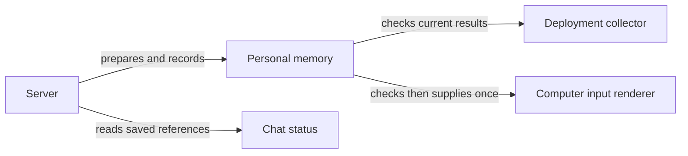

# Initial personal memory delivery

The server keeps the selected personal memories in memory until their references
have been saved. One internal consumer can then receive the exact selected text,
after current access, facts and deployment checks succeed. If validation fails before
delivery, a retry checks everything again and uses the same selected text. Once delivery
begins, even a lost reply cannot permit a resend. Other conversations can keep writing
while these checks run.

The computer input renderer labels the memories as JSON data and keeps them separate
from earlier exchanges and the new message. It refuses oversized input without shortening it.
Starting a native turn with this input and issuing credentials are still separate work.
The [contract and local checks](README.robot.md) describe the limits and remaining work.
