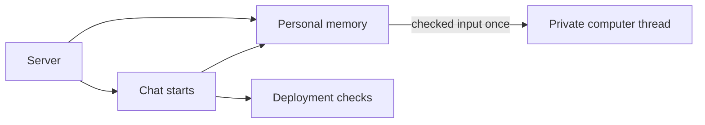

# Personal memory at turn start

## What this is

A personal assistant can start a fresh private turn when the deployment's own checks
prove that memory is permitted. The server saves the selected references before
releasing the input and its short-lived pass. An explicit memory-free choice receives
no earlier exchanges, memory block or offered tools.

## Where it fits

This connects chat starts to the existing personal memory loader and computer runner.

## What it is responsible for

The connection checks qualification again at admission. It combines the member's
permitted earlier exchanges, selected memory and new message without shortening them.
Changes to access, memory or the computer can refuse delivery while the pass is signed.
A lost acknowledgement cannot cause the input to be sent again.

## How it works

Only the internal computer connection receives the input. It remains in memory and
runs once in the fresh private thread. Model spending checks count the complete request.
Native memory tools and delivery of private generated replies still need separate work.
The server continues refusing to save replies from turns with memory evidence.

The [contract and checks](README.robot.md) give the exact limits and remaining qualification.
