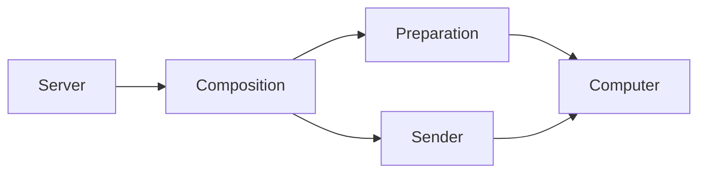

# Checked routine composition

## What this is

This records how the server connects a saved routine occurrence to its private computer
thread. The entry is disabled by default. Tests can explicitly invoke it with a local
scripted computer; automatic execution is not available.

## Where it fits

The server adapter calls the existing preparation and sender functions.



## What it is responsible for

- Check the saved occurrence before waking its assistant's computer.
- Use the thread returned by native preparation for allocation and delivery.
- Keep disabled and replay invocations free of side effects.
- Leave uncertain delivery unknown without sending again.

## Processes it handles

An explicit internal invocation checks the saved routine and current worker ownership.
After wake, existing helpers check access again, prepare the private session and input,
allocate its allowance and admit one sender. The computer receives labelled user instructions.

Recovery reads saved facts. A saved admission grants no new permission to send.
A lost native preparation cannot be replaced with a guessed thread.

## How to run or test it

From the repository root, with the disposable test database configured:

```sh
nice -n 10 npx vitest run apps/server/test/routine-composition.test.ts --maxWorkers=1
```

## Where to read more

[Contracts and checks](README.robot.md) give the exact scope and remaining work.
[The server contract](../../../apps/server/README.robot.md) describes the existing helpers.
