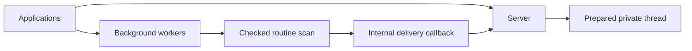

# Checked routine delivery

## What this is

An internal routine scan can pass a checked saved occurrence to a delivery callback.
Automatic execution remains disabled. The integration test explicitly enables delivery.

## Where it fits

The scan belongs to background workers. Its caller supplies delivery without making
workers depend on server code.

## What it is responsible for

Only a confirmed due receipt reaches delivery. Counts and database copies grant no access.
Delivery keeps the original leadership signal and check, and finishes before scan progress
is returned. Unknown delivery refuses the page without a completed continuation.

## Processes it handles

A cold computer wake can outlast the nine-second cutoff for starting another candidate.
The scan waits for that work, then checks leadership again. Saved claims keep their ids
and expiry when retried. Preparation and sending retain their existing access checks.

## How to run or test it

With a disposable PostgreSQL database in `PG_TEST_URL`, run
`nice -n 10 npx vitest run apps/server/test/routine-handoff.test.ts --maxWorkers=1`.

## Where to read more

[Contracts and checks](README.robot.md) record the scope and remaining qualification.
