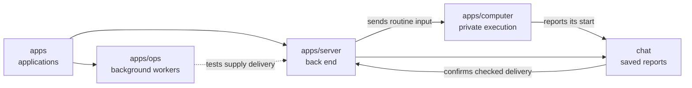

# Routine start confirmation

## What this is

Routine delivery waits for the server to save and acknowledge the matching start.
Writing to the computer connection alone cannot complete the delivery.
Automatic execution remains disabled.

## Where it fits

The server supplies delivery to the background workers' internal routine scan.
Chat handles the computer's reports and confirms the original delivery attempt.

## What it is responsible for

- Waits for one matching saved start and its acknowledgement.
- Ends the wait on refusal, timeout, cancellation or connection loss.
- Keeps uncertain delivery from authorising another send or another allowance.

## Processes it handles

The scan saves a due occurrence, then waits for preparation and checked delivery.
Chat consumes the original start binding once. Delivery succeeds only after the
start and acknowledgement checks finish while the connection and worker remain current.
This confirms the hand-off, not completion of the routine's work.

## How to run or test it

With a disposable PostgreSQL database in `PG_TEST_URL`, run
`nice -n 10 npx vitest run apps/server/test/routine-handoff.test.ts --maxWorkers=1`.

## Where to read more

[Contracts and checks](README.robot.md) describe the limits and remaining work.
