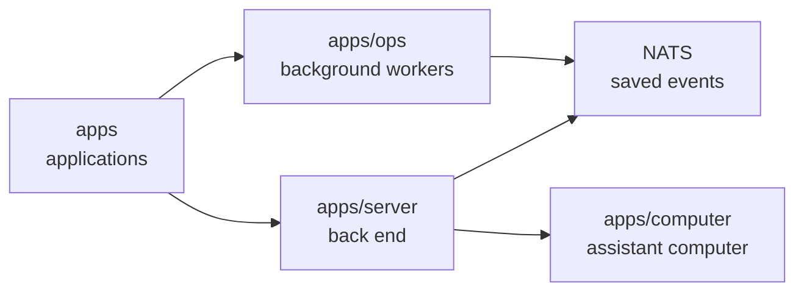

# Routine scheduler delivery gate

## What this is

The routines worker now checks one deployment setting before it starts updating
read tables. The setting defaults off. An enabled worker refuses startup until
checked delivery is connected. It does not start runs.

## Where it fits

The background worker reads saved routine records. The server holds the checked
sender that can deliver a private turn to an assistant computer.

## What it is responsible for

- Leaves disabled and replay workers without any due claim or call.
- Refuses an enabled scan before claiming a slot when delivery is missing.
- Passes a confirmed due occurrence to the existing checked callback when supplied.

## Processes it handles

An enabled call uses the existing routine leader's database lock and waits for
delivery before reporting progress. Production registration and live calls remain
to be built.

## How to run or test it

Use a disposable PostgreSQL database in `PG_TEST_URL`, then run
`nice -n 10 npx vitest run apps/ops/test/routine-dispatch.test.ts --maxWorkers=1`.
The test starts the worker with the setting absent, off, on and invalid.

## Where to read more

[Contracts and checks](README.robot.md) record the limits of this part.
