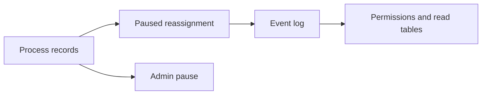

# Reassign paused routines

## What this is

Evidence for the server's internal owner-change command.

## Where it fits

## What it is responsible for

The command changes the owner only after the previous run has ended. It preserves
all other settings and keeps the routine paused. Admins gain no private chat access.

## Processes it handles

It checks the admin and recipient, saves one event and recovers the original receipt
on an identical retry. Existing handlers rebuild ownership and keep old runs intact.

## How to run or test it

The [technical record](README.robot.md) lists checks and remaining limits.

## Where to read more

The [server contract](../../../apps/server/README.robot.md#paused-routine-reassignment)
describes the input and access checks.
