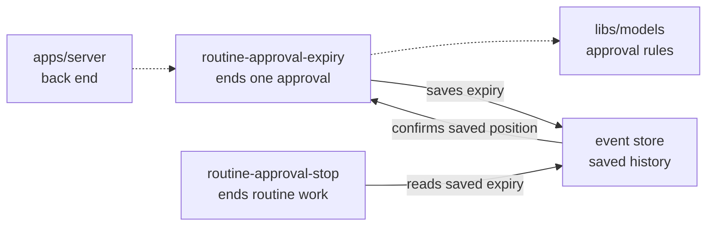

# Expire one routine approval

## What this is

This internal server command ends one routine approval when its saved time runs out.
It works while the owner and computer bridge are offline. It does not open the
private review or send work to a tool.

## Where it fits

The command belongs to `apps/server`, the back end. It uses the approval rules in
`libs/models` and returns a saved event reference for the existing Stop command.



## What it is responsible for

- Check the saved request, owner, occurrence, turn and original expiry time.
- Save expiry once and return the same reference after retry or restart.
- Keep sent or uncertain uses from gaining permission to retry.

Not built yet: finding overdue approvals, scheduled checks and production wiring.
Routine execution remains disabled.

## Processes it handles

A caller supplies one saved request reference. Once its time runs out, the command
checks the routine history and saves expiry. Once the event store confirms the save,
the command returns its reference even if later reads become unavailable.
Another command can then save Stop;
budget cleanup keeps uncertain holds and charges the full late cost.

## How to run or test it

```sh
nice -n 10 npx vitest run apps/server/test/routine-approval-expiry*.test.ts --maxWorkers=1
```

## Where to read more

- [Maintainer details](README.robot.md): exact input, recovery and check results.
- [Server contracts](../../../apps/server/README.robot.md): existing Stop operations.
