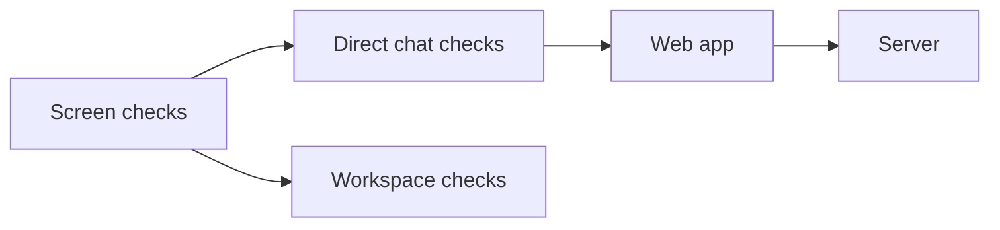

# Direct chat screens

## What this is

These checks cover the screen where two colleagues exchange messages. The captures
use sample browser data. They show how loading, sending, retries and refusals look.

## Where it fits

This folder belongs to the development checks. The web app shows the conversation,
and the server checks access and records each change.



## What it is responsible for

- Shows one colleague, their conversation and human messages.
- Keeps typed text while the first message waits for permissions or a reply.
- Offers a status check and a retry using the original request reference.
- Clears private information when access is refused.
- Checks the desktop and phone layouts, keyboard focus and assistant controls.

## Processes it handles

A person chooses a colleague and types a message. The screen creates the conversation,
waits for its permissions and sends that message. The editor stays locked until the
server confirms it. Each conversation keeps its own draft on this page.

If a reply is lost, the message stays in the editor. Check status reads the original
request reference, a unique value that lets the server recognise the same change.
If no record is available, the screen offers to send that same request again.

If access is refused, the screen clears the names, messages and drafts. A new chat
waiting for its permissions has a separate temporary state and keeps its draft.

## How to run or test it

```sh
nice -n 10 npm test -w apps/web -- --watch=false
nice -n 10 npm run visual:p4-4-screens
```

## Where to read more

- [Detailed checks](README.robot.md): API responses, captures, design differences and results.
- [Web app](../../../apps/web/README.md): where the screen fits in the website.
- [Direct chat API](../../api/direct-chats.md): creation, messages and access checks.
