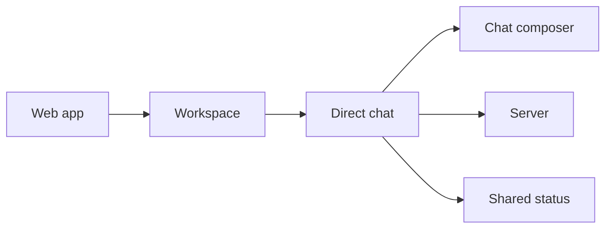

# Direct chat screens

The direct-chat screen lets one person choose a joined colleague and send human text.
The server stores the conversation and message events. It does not start assistant work.
The screen checks an uncertain send with the same command id and clears its private view
when access is refused.

## Frame bindings

| Frame | What the screen shows | Binding and receipt |
| --- | --- | --- |
| THR-05 | New direct conversation, one selected colleague and a local draft | `GET /api/chat/colleagues` returns `memberId` and `displayName`. `POST /api/conversations` is delayed until first send. The selected name is a chip with a Change action instead of the frame's editable recipient box. **PASS:** `direct-chat.spec.ts`, `thr-05-*` browser captures. |
| THR-08 | A person and an assistant cannot be combined | **Not available yet:** the direct picker only selects one colleague and has no assistant choice, so this refusal cannot be reached on the direct screen. The strict creation schema refuses extra recipient fields. **PASS:** schema and server direct-chat checks; there is no fabricated error state. |
| THR-10 | Human messages appear in event order and the screen can reload them | `message.posted` supplies `authorId`, decrypted `text` and `time`; the history response supplies ordered `position`. A successful 200 append is called “Message recorded”. The API has no delivered/read receipt, so the screen does not say “Delivered”. **PASS:** route test and `thr-10-*` captures. |
| THR-11 | A lost reply keeps its message and command reference; Check status reads that command | `POST /api/conversations/:id/messages` and `GET /api/conversations/:id/changes/:commandId`. A missing status row stays unknown; it never sends again. The API has no separate proof that a retry is safe, so there is no Try again action. **PASS:** lost-reply spec and `thr-11-*` captures. |
| THR-12 | Text such as `@agent` remains ordinary human text in direct chat | `message.posted` accepts text only. There is no turn, model, tool or assistant dispatch from this screen. The designed frame is a group chat, so its group notice is not shown here. **PASS:** two-create spec counts zero turn and model requests; server direct-chat tests reject assistant turns. |
| THR-16 | Refused access clears names, draft and transcript | HTTP 401 or refused history/list reads use the access-changed state. Late screen requests are aborted on destroy. **PASS:** revocation assertions and `thr-16-*` captures. |

The screen also shows a conversation list from authorised `mode: direct` rows.
It uses the other `participantIds` entry with the colleague directory to name each row.
A missing display name falls back to the returned member id. Refresh reloads the selected
conversation from the history endpoint.

## Visible differences from the frames

| Difference | Why it differs | Receipt |
| --- | --- | --- |
| The direct screen has its own workspace route at `/workspace/direct`. | It must not create the personal `ChatSession`, which reads assistant context and exposes turn controls. | `direct-chat.spec.ts` asserts no Stop, memory or assistant-working controls and counts zero turn/model requests. |
| The selected colleague is shown as a chip with Change. | The directory API supports searching by name but the direct screen keeps one immutable person selection after the first send. | THR-05 captures and recipient-change interaction spec. |
| The composer only sends text. | The direct-message contract has text only; file and voice commands are not available. | Composer direct mode omits attachment controls. |
| There is no Delivered label or timestamp. | The API records messages but does not expose delivery or read receipts. | Message rows show the event time; the successful append status is “Message recorded”. |
| Unsupported mixed recipients have no red error banner. | The screen has no assistant recipient control, so that invalid combination cannot happen through this screen. | THR-08 binding above. |
| The phone view keeps a back link and a docked composer. | This route does not mount the personal workspace's conversation menu or assistant actions. | Captures at 390px and 320px. |

## Checks

Browser captures use intercepted sample data. They are not a fresh-install journey.
The machine-readable capture list is in [`visual.json`](visual.json).

| Check | Result | Evidence |
| --- | --- | --- |
| Frame review | PASS | All supplied THR-05, THR-08, THR-10, THR-11, THR-12 and THR-16 PNGs reviewed at 1280px and 390px. |
| Visual browser check | PASS | 24 captures at 1280px, 390px and 320px in both motion settings. No turn or model requests. |
| Web unit tests | PASS | `nice -n 10 npm test -w apps/web -- --watch=false`; 425 tests passed. |
| Direct-chat server routes | PASS | `nice -n 10 npx vitest run apps/server/test/direct-chat-http.test.ts apps/server/test/direct-chat.test.ts`; 18 tests passed. |
| Typecheck and event catalogue | PASS | `nice -n 10 npm run typecheck`; `nice -n 10 npm run check:events`. |
| Lint and web build | PASS | `nice -n 10 npm run lint`; `nice -n 10 npm run build -w apps/web`. Existing CSS budget and CommonJS warnings remain. |
| F1–F5 browser checks | PASS | F1 56, F2 38, F3 22, F4 20 and F5 18 captures. F2 also checks the new direct-chat link. |
| Guard-removal checks | PASS | The pending-change, lost-reply, Enter-send and healthy-refresh specs each failed when their guard was removed. |
| Fresh-install direct-chat journey | NOT RUN | The audit found no direct-chat live browser journey. |
