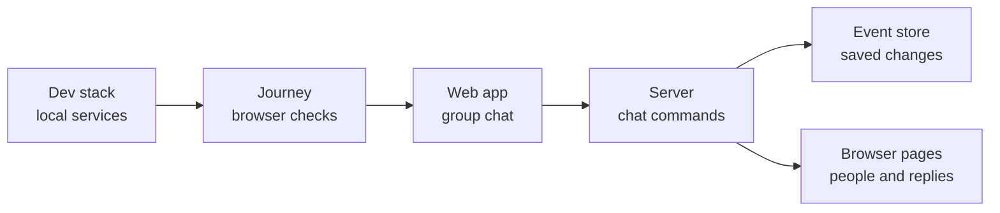

# Group chat journey

## What this is

This page records two fresh runs of the group chat checks on one secondary
development stack. Each row links to pictures from both runs.

## Where it fits

The journey starts the local development stack and checks the group chat through
the same pages people use. The web page talks to the server, which saves changes
to the event store.



## What it is responsible for

- Start the group chat checks from the normal stack journey.
- Save a result and browser pictures for each check.
- Keep product failures in the receipt so they can be fixed separately.

## Processes it handles

A person starts a chat with two colleagues in the To line. The journey checks the
mode before the first message, then checks that the saved conversation stays a group.

The journey adds and removes people, then asks one person to leave. It checks who can
read each message and whether the screen clears after access ends.

## How to run or test it

The stack journey runs these checks during a fresh secondary stack start.

```sh
infra/dev-stack/up.sh --fresh
infra/dev-stack/down.sh --id "$DEV_STACK_ID"
```

## Results

Both runs used main commit `55336ff8`. Each run started with a fresh stack and checked
the page at 1280px and 390px. The saved JSON files list every check and its evidence.

- [First run receipt](screenshots/main337-1/receipt.json)
- [Second run receipt](screenshots/main337-2/receipt.json)

| Check | Run one | Run two | Pictures |
| --- | --- | --- | --- |
| Create a group from To and keep its mode | PASS | PASS | [1 before 1280](screenshots/main337-1/group-chat/group-mode-before-send-1280.png), [1 before 390](screenshots/main337-1/group-chat/group-mode-before-send-390.png), [1 after 1280](screenshots/main337-1/group-chat/group-created-1280.png), [1 after 390](screenshots/main337-1/group-chat/group-created-390.png); [2 before 1280](screenshots/main337-2/group-chat/group-mode-before-send-1280.png), [2 before 390](screenshots/main337-2/group-chat/group-mode-before-send-390.png), [2 after 1280](screenshots/main337-2/group-chat/group-created-1280.png), [2 after 390](screenshots/main337-2/group-chat/group-created-390.png) |
| Send and receive messages without AI, computer or budget activity | PASS | PASS | [1 1280](screenshots/main337-1/group-chat/group-messages-1280.png), [1 390](screenshots/main337-1/group-chat/group-messages-390.png); [2 1280](screenshots/main337-2/group-chat/group-messages-1280.png), [2 390](screenshots/main337-2/group-chat/group-messages-390.png) |
| Add a person and show only messages from their join point | PASS | PASS | [1 1280](screenshots/main337-1/group-chat/group-join-position-1280.png), [1 390](screenshots/main337-1/group-chat/group-join-position-390.png); [2 1280](screenshots/main337-2/group-chat/group-join-position-1280.png), [2 390](screenshots/main337-2/group-chat/group-join-position-390.png) |
| Remove a person and clear their transcript and live updates within two seconds | PASS | PASS | [1 1280](screenshots/main337-1/group-chat/group-removed-cleared-1280.png), [1 390](screenshots/main337-1/group-chat/group-removed-cleared-390.png); [2 1280](screenshots/main337-2/group-chat/group-removed-cleared-1280.png), [2 390](screenshots/main337-2/group-chat/group-removed-cleared-390.png) |
| Leave a conversation, clear that screen and update the other people | PASS | PASS | [1 1280](screenshots/main337-1/group-chat/group-left-cleared-1280.png), [1 390](screenshots/main337-1/group-chat/group-left-cleared-390.png); [2 1280](screenshots/main337-2/group-chat/group-left-cleared-1280.png), [2 390](screenshots/main337-2/group-chat/group-left-cleared-390.png) |
| Show long names, no matches and a refused participant choice | PASS | PASS | [1 picker 1280](screenshots/main337-1/group-chat/group-picker-1280.png), [1 picker 390](screenshots/main337-1/group-chat/group-picker-390.png), [1 refused 1280](screenshots/main337-1/group-chat/group-denied-selection-1280.png), [1 refused 390](screenshots/main337-1/group-chat/group-denied-selection-390.png); [2 picker 1280](screenshots/main337-2/group-chat/group-picker-1280.png), [2 picker 390](screenshots/main337-2/group-chat/group-picker-390.png), [2 refused 1280](screenshots/main337-2/group-chat/group-denied-selection-1280.png), [2 refused 390](screenshots/main337-2/group-chat/group-denied-selection-390.png) |
| Refuse an unsupported choice without saving a draft | PASS | PASS | [1 1280](screenshots/main337-1/group-chat/group-unsupported-combination-1280.png), [1 390](screenshots/main337-1/group-chat/group-unsupported-combination-390.png); [2 1280](screenshots/main337-2/group-chat/group-unsupported-combination-1280.png), [2 390](screenshots/main337-2/group-chat/group-unsupported-combination-390.png) |
| Restart the server, replay saved changes and keep participants and mode | PASS | PASS | [1 1280](screenshots/main337-1/group-chat/group-after-replay-1280.png), [1 390](screenshots/main337-1/group-chat/group-after-replay-390.png); [2 1280](screenshots/main337-2/group-chat/group-after-replay-1280.png), [2 390](screenshots/main337-2/group-chat/group-after-replay-390.png) |

## Where to read more

- [How to run the development stack](../../../infra/dev-stack/README.md)
- [How group chat checks collect evidence](../../../infra/dev-stack/README.robot.md)
- [The group chat page](../../../apps/web/README.md)
