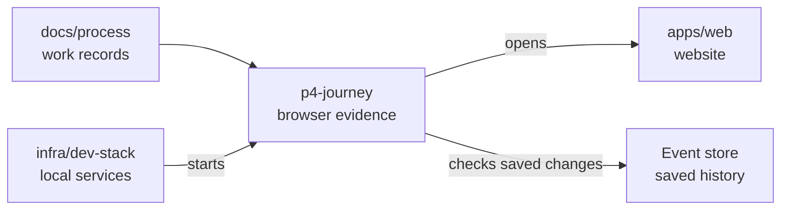

# Fresh organisation journey

## What this is

This folder records what the organisation journey does in a real browser. It uses a claimed
secondary stack and a local model stub, so it makes no paid provider calls. The stack keeps
receipts and screenshots in its private directory while a run is in progress.

## Where it fits

The journey is process evidence. It checks the website, server and event store together.

## What it is responsible for

- Checks groups, member removal, shared assistants, direct chats and provider key saving.
- Saves each result and its screenshots after the run has finished.
- Checks the ownership handover and refuse a last owner’s departure.
- Marks separate member disks and paid provider calls honestly.

## Processes it handles

1. **A secondary stack opens.** The owner and member sign in through Zitadel in separate browser
   sessions. The browser checks the organisation pages at 1280px and 390px.
2. **The results are recorded.** The journey checks what the server saved and what each person can
   see. The model stub counts requests during the direct chat.
3. **A repeat run checks saved data.** It uses new names and conversations, so old records do not
   stand in for the current run.

## How to run or test it

Claim a secondary stack with `infra/dev-stack/claim.sh`, then start it with
`P4_JOURNEY_ATTEMPT=fresh-1 infra/dev-stack/up.sh --fresh`. The named journey runs during
startup after real browser sign-in. Use a new attempt name for each run. The daily fresh check
also gives each run its own name. The dev stack guide describes the claim and release commands.

## Where to read more

- [Journey details](README.robot.md): setup, exact checks and earlier failures.
- [Development stack](../../../infra/dev-stack/README.md): how spare stacks start and stop.

## Live evidence, 23 October 2026

These runs started from main commit `6da660479`. They used one claimed secondary stack,
the separate owner test user and the local model stub. No paid provider call was made.
Each receipt names the exact source commit. The times below measure only the named
organisation browser checks, after the earlier stack checks.

**The second fresh start passed**, with 39 browser checks passed. The complete ownership
handover is proved on two fresh installations. The saved-data repeat remains
**NOT PROVEN**. The earlier group-chat timing failure remains unresolved.

| Run | Source | Browser start–finish (UTC) | Browser time | Full start | Receipt |
| --- | --- | --- | ---: | --- | --- |
| `fresh-1` | `975f73474` | 15:34:54.591–15:37:34.676 | 160.059 s | FAIL | [Receipt](runs-2026-10-23/fresh-1/receipt.json) |
| `fresh-1-fixed` | `c3a72c8c5` | 15:58:00.525–16:00:20.186 | 139.622 s | FAIL | [Receipt](runs-2026-10-23/fresh-1-fixed/receipt.json) |
| `fresh-1-fixed-2` | `d1305b067` | 16:22:28.077–16:25:11.802 | 163.694 s | FAIL | [Receipt](runs-2026-10-23/fresh-1-fixed-2/receipt.json) |
| `repeat-1` | `d1305b067` | Not recorded | Not recorded | FAIL | [Receipt](runs-2026-10-23/repeat-1/receipt.json) |
| `repeat-1-rerun` | `610f345ab` | Not recorded | Not recorded | FAIL | [Receipt](runs-2026-10-23/repeat-1-rerun/receipt.json) |
| `fresh-2` | `610f345ab` | 17:01:58.392–17:04:51.229 | 172.818 s | PASS | [Receipt](runs-2026-10-23/fresh-2/receipt.json) |

The first two failures were journey defects. One status button disappeared between
two browser reads. The next attempt did not use **Check status** after step-down.
Failing-first tests cover both fixes. The third fresh attempt proved the ownership
handover but failed the additional group-chat check: a sender did not display a saved
message within two seconds. Its cause remains unproved; its limit is unchanged.

Both saved-data commands ended with SIGTERM, exit 143. The signal source is unknown.
The first reached ownership and group-chat screens but lost its assertion receipt.
The single rerun ended before the named browser section. Both are **PARTIAL**.
Their individual checks remain **NOT PROVEN**. Captures alone do not establish a pass.

Every check is listed below. A missing assertion is **NOT PROVEN**. **PASS** for
`ownership.transfer` means the complete handover is **PROVEN**: the successor has owner
controls, the previous owner has member access only, and the last owner’s departures
are refused without changing the saved records. Separate member disks remain
**NOT PROVEN**. **PAID-NOT RUN** means the paid provider check was not run.

Runs: A = `fresh-1`; B = `fresh-1-fixed`; C = `fresh-1-fixed-2`; D = `repeat-1`; E = `repeat-1-rerun`; F = `fresh-2`.

| Check | A | B | C | D | E | F |
| --- | --- | --- | --- | --- | --- | --- |
| `providers.paid_model_answer` | PAID-NOT RUN | PAID-NOT RUN | PAID-NOT RUN | PAID-NOT RUN | PAID-NOT RUN | PAID-NOT RUN |
| `shared_assistant.member_disk_isolation` | NOT PROVEN | NOT PROVEN | NOT PROVEN | NOT PROVEN | NOT PROVEN | NOT PROVEN |
| `groups.list` | PASS | PASS | PASS | NOT PROVEN | NOT PROVEN | PASS |
| `groups.create` | PASS | PASS | PASS | NOT PROVEN | NOT PROVEN | PASS |
| `groups.search` | PASS | PASS | PASS | NOT PROVEN | NOT PROVEN | PASS |
| `groups.detail` | PASS | PASS | PASS | NOT PROVEN | NOT PROVEN | PASS |
| `shared_assistant.admin_create` | PASS | PASS | PASS | NOT PROVEN | NOT PROVEN | PASS |
| `shared_assistant.review` | PASS | PASS | PASS | NOT PROVEN | NOT PROVEN | PASS |
| `shared_assistant.create_request` | PASS | PASS | PASS | NOT PROVEN | NOT PROVEN | PASS |
| `shared_assistant.created` | PASS | PASS | PASS | NOT PROVEN | NOT PROVEN | PASS |
| `shared_assistant.computer_ready_for_selection` | PASS | PASS | PASS | NOT PROVEN | NOT PROVEN | PASS |
| `shared_assistant.member_choice` | PASS | PASS | PASS | NOT PROVEN | NOT PROVEN | PASS |
| `shared_assistant.session_recorded` | PASS | PASS | PASS | NOT PROVEN | NOT PROVEN | PASS |
| `shared_assistant.private_chat` | PASS | PASS | PASS | NOT PROVEN | NOT PROVEN | PASS |
| `groups.removal_review` | PASS | PASS | PASS | NOT PROVEN | NOT PROVEN | PASS |
| `groups.remove_member` | PASS | PASS | PASS | NOT PROVEN | NOT PROVEN | PASS |
| `direct_chat.start_390` | PASS | PASS | PASS | NOT PROVEN | NOT PROVEN | PASS |
| `direct_chat.start_1280` | PASS | PASS | PASS | NOT PROVEN | NOT PROVEN | PASS |
| `direct_chat.receive` | PASS | PASS | PASS | NOT PROVEN | NOT PROVEN | PASS |
| `direct_chat.exchange_and_no_agent` | PASS | PASS | PASS | NOT PROVEN | NOT PROVEN | PASS |
| `providers.list` | PASS | PASS | PASS | NOT PROVEN | NOT PROVEN | PASS |
| `providers.key_save` | PASS | PASS | PASS | NOT PROVEN | NOT PROVEN | PASS |
| `providers.key_input_cleared` | PASS | PASS | PASS | NOT PROVEN | NOT PROVEN | PASS |
| `ownership.actor_ready` | PASS | PASS | PASS | NOT PROVEN | NOT PROVEN | PASS |
| `ownership.review` | PASS | PASS | PASS | NOT PROVEN | NOT PROVEN | PASS |
| `ownership.transfer_request` | PASS | PASS | PASS | NOT PROVEN | NOT PROVEN | PASS |
| `ownership.appointment` | NOT PROVEN | PASS | PASS | NOT PROVEN | NOT PROVEN | PASS |
| `ownership.successor_controls` | NOT PROVEN | PASS | PASS | NOT PROVEN | NOT PROVEN | PASS |
| `ownership.step_down_review` | NOT PROVEN | PASS | PASS | NOT PROVEN | NOT PROVEN | PASS |
| `ownership.previous_owner_demoted` | NOT PROVEN | NOT PROVEN | PASS | NOT PROVEN | NOT PROVEN | PASS |
| `ownership.former_owner_member_access` | NOT PROVEN | NOT PROVEN | PASS | NOT PROVEN | NOT PROVEN | PASS |
| `ownership.last_owner_refused` | NOT PROVEN | NOT PROVEN | PASS | NOT PROVEN | NOT PROVEN | PASS |
| `ownership.transfer` | NOT PROVEN | NOT PROVEN | PASS | NOT PROVEN | NOT PROVEN | PASS |
| `group_chat.create_and_lock_mode` | NOT PROVEN | NOT PROVEN | PASS | NOT PROVEN | NOT PROVEN | PASS |
| `group_chat.messages_and_no_activity` | NOT PROVEN | NOT PROVEN | FAIL | NOT PROVEN | NOT PROVEN | PASS |
| `group_chat.add_join_position` | NOT PROVEN | NOT PROVEN | PASS | NOT PROVEN | NOT PROVEN | PASS |
| `group_chat.remove_clears_access` | NOT PROVEN | NOT PROVEN | PASS | NOT PROVEN | NOT PROVEN | PASS |
| `group_chat.leave_clears_access` | NOT PROVEN | NOT PROVEN | PASS | NOT PROVEN | NOT PROVEN | PASS |
| `group_chat.people_picker_states` | NOT PROVEN | NOT PROVEN | PASS | NOT PROVEN | NOT PROVEN | PASS |
| `group_chat.unsupported_combination` | NOT PROVEN | NOT PROVEN | PASS | NOT PROVEN | NOT PROVEN | PASS |
| `group_chat.replay_preserves_group` | NOT PROVEN | NOT PROVEN | PASS | NOT PROVEN | NOT PROVEN | PASS |

[Capture list](runs-2026-10-23/captures.md) links to both screen widths for every
retained picture. All 310 new captures were looked at by eye. Email text and email inputs
are masked. No readable email address appears in the retained captures or receipts.

No product code changed. The script now prepares a real Owner through product commands,
matches the current browser request to its saved ownership event, and reads the status
control safely. It restores the test accounts through product commands for a repeat.
The nightly job keeps its existing groups-only scope.

## Earlier live evidence

The two requested fresh starts passed on commit
`fd7a48add6948c3f93970a0c8ad7816f72247e91`. Their Phase 4 checks took **48.461 seconds** and
**59.039 seconds**. The saved-data repeat is **NOT PROVEN**: later attempts found and fixed two
repeat-only journey issues, but the final attempts stopped before every check passed.

| Attempt | Start | Phase 4 | Time | Receipt |
| --- | --- | --- | ---: | --- |
| `fresh-1` | PASS | PASS | 48.461 s | [Receipt](run-fresh-1.json) |
| `fresh-2` | PASS | PASS | 59.039 s | [Receipt](run-fresh-2.json) |
| `repeat-1` | FAIL | NOT RUN | — | No receipt; the saved grant check expected every model for a shared assistant. |
| `repeat-2` | FAIL | FAIL | 134.171 s | [Receipt](run-repeat-2.json) |
| `recovery-fresh` | FAIL after Phase 4 | PASS | 80.596 s | [Receipt](run-recovery-fresh.json) |
| `repeat-3` | FAIL | NOT RUN | — | No receipt; the earlier chat check stopped on a transport error. |
| `repeat-4` | FAIL | FAIL | 58.636 s | [Receipt](run-repeat-4.json) |
| `recovery-fresh-2` | FAIL | FAIL | 84.342 s | [Receipt](run-recovery-fresh-2.json) |
| `repeat-5` | FAIL | NOT RUN | — | No receipt; the browser reported a network change before Phase 4. |

Each receipt lists every assertion it reached as `PASS`, `FAIL`, `NOT PROVEN` or `PAID / NOT RUN`
and links to its screenshots. The two requested fresh receipts pass the group, shared assistant,
group removal, direct chat, provider list and fake key save checks. `ownership.transfer` and
`shared_assistant.member_disk_isolation` are `NOT PROVEN`. The paid provider answer is `PAID / NOT
RUN`. `providers.key_input_cleared` is `NOT PROVEN` across the fresh runs because the input was
missing from two receipts; it passed in `fresh-1`.

Zitadel setup succeeded on every start. No setup retry or five-minute wait was needed. We checked
all **176** saved screenshots: none is a one-colour image or under 5 KB.

`NOT PROVEN` means the browser could not establish the result. `PAID / NOT RUN` means no paid
provider call was made.
