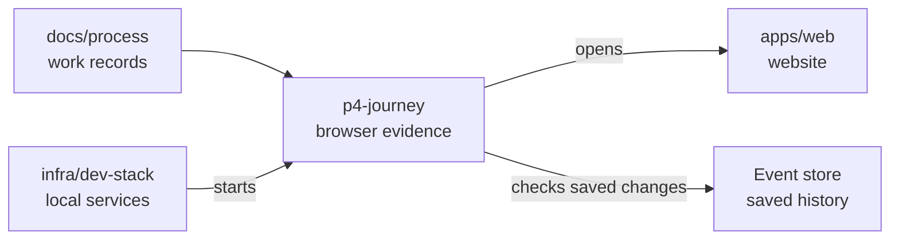

# Fresh organisation journey

## What this is

This folder records what the organisation journey does in a real browser. It uses a claimed
secondary stack and a local model stub, so it makes no paid provider calls. The stack keeps
receipts and screenshots in its private directory while a run is in progress.

## Where it fits

The journey is process evidence. It checks the website, server and event store together.

## What it is responsible for

- Check groups, member removal, shared assistants, direct chats and provider key saving.
- Save each result and its screenshots after the run has finished.
- Mark results that need an Owner account or a paid provider call honestly.

## Processes it handles

1. **A secondary stack opens.** The owner and member sign in through Zitadel in separate browser
   sessions. The browser checks the organisation pages at 1280px and 390px.
2. **The results are recorded.** The journey checks what the server saved and what each person can
   see. The model stub counts requests during the direct chat.
3. **A repeat run checks saved data.** It uses new names and conversations, so old records do not
   stand in for the current run.

## How to run or test it

Claim a secondary stack with `infra/dev-stack/claim.sh`, then start it with
`P4_JOURNEY_ATTEMPT=fresh-1 infra/dev-stack/up.sh --fresh`. The named journey runs during
startup after real browser sign-in. Use a new attempt name for each run. The daily fresh run
does not set this name, so it does not run this journey. The dev stack guide describes the claim
and release commands.

## Live evidence

The two requested fresh starts passed on commit
`fd7a48add6948c3f93970a0c8ad7816f72247e91`. Their Phase 4 checks took **48.461 seconds** and
**59.039 seconds**. The saved-data repeat is **NOT PROVEN**: later attempts found and fixed two
repeat-only journey issues, but the final attempts stopped before every check passed.

| Attempt | Start | Phase 4 | Time | Receipt |
| --- | --- | --- | ---: | --- |
| `fresh-1` | PASS | PASS | 48.461 s | [Receipt](run-fresh-1.json) |
| `fresh-2` | PASS | PASS | 59.039 s | [Receipt](run-fresh-2.json) |
| `repeat-1` | FAIL | NOT RUN | — | No receipt; the saved grant check expected every model for a shared assistant. |
| `repeat-2` | FAIL | FAIL | 134.171 s | [Receipt](run-repeat-2.json) |
| `recovery-fresh` | FAIL after Phase 4 | PASS | 80.596 s | [Receipt](run-recovery-fresh.json) |
| `repeat-3` | FAIL | NOT RUN | — | No receipt; the earlier chat check stopped on a transport error. |
| `repeat-4` | FAIL | FAIL | 58.636 s | [Receipt](run-repeat-4.json) |
| `recovery-fresh-2` | FAIL | FAIL | 84.342 s | [Receipt](run-recovery-fresh-2.json) |
| `repeat-5` | FAIL | NOT RUN | — | No receipt; the browser reported a network change before Phase 4. |

Each receipt lists every assertion it reached as `PASS`, `FAIL`, `NOT PROVEN` or `PAID / NOT RUN`
and links to its screenshots. The two requested fresh receipts pass the group, shared assistant,
group removal, direct chat, provider list and fake key save checks. `ownership.transfer` and
`shared_assistant.member_disk_isolation` are `NOT PROVEN`. The paid provider answer is `PAID / NOT
RUN`. `providers.key_input_cleared` is `NOT PROVEN` across the fresh runs because the input was
missing from two receipts; it passed in `fresh-1`.

Zitadel setup succeeded on every start. No setup retry or five-minute wait was needed. We checked
all **176** saved screenshots: none is a one-colour image or under 5 KB.

`NOT PROVEN` means the browser could not establish the result. `PAID / NOT RUN` means no paid
provider call was made.
