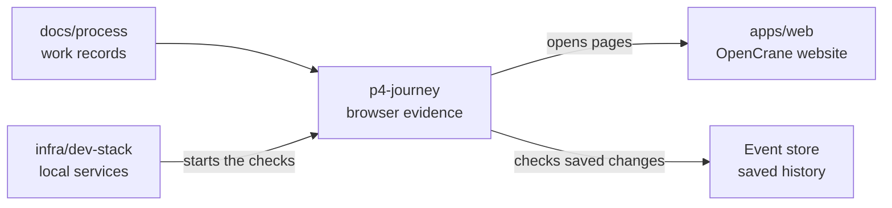

# Fresh organisation journey

## What this is

This folder records what a fresh OpenCrane stack can do in a browser. The checks use local
services and a model stub, so they do not contact a paid provider. Screenshots and one
machine-readable receipt for each run sit beside this page.

## Where it fits

The journey is part of the process evidence. It runs from the development stack and checks the
website, server and event store.

## What it is responsible for

- Record the group, direct chat, shared assistant and provider key browser checks.
- Keep screenshots and a machine-readable result for each run beside this page.
- Mark checks that need an unbuilt feature or a paid provider call honestly.

## Processes it handles

1. **A fresh stack opens.** The owner and member sign in through Zitadel in separate browser
   sessions. The browser checks groups, direct chat, a shared assistant and provider key saving.
2. **The results are saved.** Each checked action records what happened and links to screenshots
   at 1280px and 390px. The stub counts model requests during the direct chat exchange.

## How to run or test it

The dev stack runs this journey as part of a fresh start on a claimed secondary stack. The
[journey details](../../../infra/dev-stack/README.robot.md) describe its settings.

## Where to read more

- [The dev stack](../../../infra/dev-stack/README.md) starts the local services and browser checks.
- [Exact journey details](../../../infra/dev-stack/README.robot.md) lists setup and evidence limits.
- [The event catalogue](../../architecture/events.md) names the events that drive these changes.

## Receipt

The table shows every check from two fresh runs of the same claimed secondary stack. The row
names match entries in the [run 1 receipt](run-1.json) and [run 2 receipt](run-2.json). Each
receipt contains the saved facts and screenshot paths for that check. A screenshot link names
the run and screen width.

`NOT PROVEN` means the check could not establish the result. `PAID / NOT RUN` means a real
provider answer would cost money, so the check was skipped.

| Check | Run 1 | Run 2 | Screenshots |
| --- | --- | --- | --- |
| The Owner opens the groups list. | PASS | PASS | [1 · 1280](run-1/groups-list-1280.png) · [1 · 390](run-1/groups-list-390.png) · [2 · 1280](run-2/groups-list-1280.png) · [2 · 390](run-2/groups-list-390.png) |
| The Owner creates a group and opens its detail page. | PASS | PASS | [1 · 1280](run-1/groups-created-1280.png) · [1 · 390](run-1/groups-created-390.png) · [2 · 1280](run-2/groups-created-1280.png) · [2 · 390](run-2/groups-created-390.png) |
| Searching for the new group finds it. | PASS | PASS | [1 · 1280](run-1/groups-search-1280.png) · [1 · 390](run-1/groups-search-390.png) · [2 · 1280](run-2/groups-search-1280.png) · [2 · 390](run-2/groups-search-390.png) |
| Group detail shows its member and model grant. | PASS | PASS | [1 · 1280](run-1/groups-detail-1280.png) · [1 · 390](run-1/groups-detail-390.png) · [2 · 1280](run-2/groups-detail-1280.png) · [2 · 390](run-2/groups-detail-390.png) |
| The Owner reviews removal of a member. | PASS | PASS | [1 · 1280](run-1/groups-removal-review-1280.png) · [1 · 390](run-1/groups-removal-review-390.png) · [2 · 1280](run-2/groups-removal-review-1280.png) · [2 · 390](run-2/groups-removal-review-390.png) |
| The reviewed member removal completes. | PASS | PASS | [1 · 1280](run-1/groups-removed-1280.png) · [1 · 390](run-1/groups-removed-390.png) · [2 · 1280](run-2/groups-removed-1280.png) · [2 · 390](run-2/groups-removed-390.png) |
| An admin chooses the group, payer and model for a shared assistant. | PASS | PASS | [1 · 1280](run-1/shared-assistant-create-1280.png) · [1 · 390](run-1/shared-assistant-create-390.png) · [2 · 1280](run-2/shared-assistant-create-1280.png) · [2 · 390](run-2/shared-assistant-create-390.png) |
| The assistant review names its fixed payer. | PASS | PASS | [1 · 1280](run-1/shared-assistant-review-1280.png) · [1 · 390](run-1/shared-assistant-review-390.png) · [2 · 1280](run-2/shared-assistant-review-1280.png) · [2 · 390](run-2/shared-assistant-review-390.png) |
| The server accepts the reviewed assistant request. | PASS | PASS | [1 · 1280](run-1/shared-assistant-create-response-1280.png) · [1 · 390](run-1/shared-assistant-create-response-390.png) · [2 · 1280](run-2/shared-assistant-create-response-1280.png) · [2 · 390](run-2/shared-assistant-create-response-390.png) |
| The saved assistant record matches the group and payer in the review. | PASS | PASS | [1 · 1280](run-1/shared-assistant-created-1280.png) · [1 · 390](run-1/shared-assistant-created-390.png) · [2 · 1280](run-2/shared-assistant-created-1280.png) · [2 · 390](run-2/shared-assistant-created-390.png) |
| The shared assistant is ready for the member to choose. | PASS | PASS | [1 · 1280](run-1/shared-assistant-created-1280.png) · [1 · 390](run-1/shared-assistant-created-390.png) · [2 · 1280](run-2/shared-assistant-created-1280.png) · [2 · 390](run-2/shared-assistant-created-390.png) |
| A member chooses the shared assistant for a private chat. | PASS | PASS | [1 · 1280](run-1/shared-assistant-choice-1280.png) · [1 · 390](run-1/shared-assistant-choice-390.png) · [2 · 1280](run-2/shared-assistant-choice-1280.png) · [2 · 390](run-2/shared-assistant-choice-390.png) |
| The server records the member's private session. | PASS | PASS | [1 · 1280](run-1/shared-assistant-session-response-1280.png) · [1 · 390](run-1/shared-assistant-session-response-390.png) · [2 · 1280](run-2/shared-assistant-session-response-1280.png) · [2 · 390](run-2/shared-assistant-session-response-390.png) |
| The private chat opens with the saved assistant and payer. | PASS | PASS | [1 · 1280](run-1/shared-assistant-private-chat-1280.png) · [1 · 390](run-1/shared-assistant-private-chat-390.png) · [2 · 1280](run-2/shared-assistant-private-chat-1280.png) · [2 · 390](run-2/shared-assistant-private-chat-390.png) |
| Separate member disks and browser profiles are in place for shared sessions. | NOT PROVEN | NOT PROVEN | The stack uses one browser profile and one computer disk for these sessions. |
| A member starts a direct chat with a colleague at 390px. | PASS | PASS | [1 · 390](run-1/direct-chat-recipient-390.png) · [2 · 390](run-2/direct-chat-recipient-390.png) |
| A member starts a direct chat with a colleague at 1280px. | PASS | PASS | [1 · 1280](run-1/direct-chat-recipient-1280.png) · [2 · 1280](run-2/direct-chat-recipient-1280.png) |
| The colleague receives the member's direct message. | PASS | PASS | [1 · 1280](run-1/direct-chat-received-1280.png) · [1 · 390](run-1/direct-chat-received-390.png) · [2 · 1280](run-2/direct-chat-received-1280.png) · [2 · 390](run-2/direct-chat-received-390.png) |
| Both people exchange messages; assistant and model request counts stay at zero. | PASS | PASS | [1 · 1280](run-1/direct-chat-exchange-1280.png) · [1 · 390](run-1/direct-chat-exchange-390.png) · [2 · 1280](run-2/direct-chat-exchange-1280.png) · [2 · 390](run-2/direct-chat-exchange-390.png) |
| The fresh stack shows the empty provider list. | PASS | PASS | [1 · 1280](run-1/provider-list-1280.png) · [1 · 390](run-1/provider-list-390.png) · [2 · 1280](run-2/provider-list-1280.png) · [2 · 390](run-2/provider-list-390.png) |
| The fake provider key is saved and cleared without claiming it works. | PASS | PASS | [1 · 1280](run-1/provider-key-saved-1280.png) · [1 · 390](run-1/provider-key-saved-390.png) · [2 · 1280](run-2/provider-key-saved-1280.png) · [2 · 390](run-2/provider-key-saved-390.png) |
| A real provider answer is tested. | PAID / NOT RUN | PAID / NOT RUN | No paid call was made. |
| The signed-in browser account has the Owner role for the transfer. | PASS | PASS | [1 · 1280](run-1/ownership-actor-ready-1280.png) · [1 · 390](run-1/ownership-actor-ready-390.png) · [2 · 1280](run-2/ownership-actor-ready-1280.png) · [2 · 390](run-2/ownership-actor-ready-390.png) |
| The Owner reviews the successor and sees that both people stay Owners. | PASS | PASS | [1 · 1280](run-1/ownership-transfer-review-1280.png) · [1 · 390](run-1/ownership-transfer-review-390.png) · [2 · 1280](run-2/ownership-transfer-review-1280.png) · [2 · 390](run-2/ownership-transfer-review-390.png) |
| The server accepts the reviewed ownership request. | PASS | PASS | [1 · 1280](run-1/ownership-transfer-response-1280.png) · [1 · 390](run-1/ownership-transfer-response-390.png) · [2 · 1280](run-2/ownership-transfer-response-1280.png) · [2 · 390](run-2/ownership-transfer-response-390.png) |
| The second person becomes an Owner and the first Owner stays one. | PASS | PASS | [1 · 1280](run-1/ownership-transfer-result-1280.png) · [1 · 390](run-1/ownership-transfer-result-390.png) · [2 · 1280](run-2/ownership-transfer-result-1280.png) · [2 · 390](run-2/ownership-transfer-result-390.png) |
