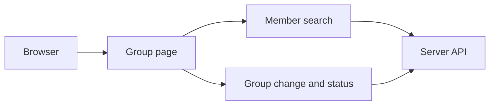

# Add a member from a group page

The browser now lets Owners and Admins search active organisation members and add one to
a local group. The pictures below use intercepted API replies. They do not use a live
organisation. The local group and member names are test examples.

## Comparison with the design pictures

| Design picture | Capture at 1280 and 390 | Difference |
| --- | --- | --- |
| PPL-11 | `search-1280.png`, `search-390.png` | The page keeps its existing summary cards and member list. It has Create shared assistant instead of More. Member rows do not show role or join date. The picker shows only the loaded group and other groups that the server supplied. |
| PPL-14 | `adding-1280.png`, `adding-390.png`; `added-1280.png`, `added-390.png` | These show an addition rather than the picture's removal. The checked time is when the browser confirmed both records, not a recorded completion time. |
| PPL-15 | `conflict-1280.png`, `conflict-390.png` | The server does not supply the other actor or their change time, so the notice cannot name either. The current group stays visible until Refresh. |
| PPL-16 | `access-changed-1280.png`, `access-changed-390.png` | A refused member search clears the group and candidates. The picture also shows a separate identity-service failure, which this capture does not simulate. |

The capture script checks that the page has no horizontal overflow and its visible
buttons and fields have targets of at least 44 pixels at both widths. It requests
reduced motion and serves the built website and API examples inside Playwright.

## Checks

| Check | Result |
| --- | --- |
| Failing-first test commit | PASS |
| Focused web and protocol tests, twice | PASS |
| Event security rules | PASS |
| Typecheck, event catalogue, unused exports and changelog | PASS |
| Lint | PASS |
| Web build and ten screen captures | PASS |
| Full root test suite | NOT RUN |
| Live journey on a fresh installation | NOT RUN |
