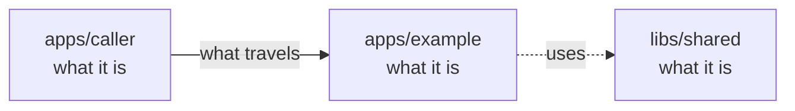

# OpenCrane 2 standards

Standard, 1 October 2026. The first tooling and prompt change is installed; the final section records its scope and evidence. The [review](standards-review.md) records the evidence behind the choices.

Keep the four required checks, one independent adversarial review and fresh-install evidence. Put repeatable rules in tools. Keep instructions about judgement short, and give each rule one home.

## Work and review

Build each whole feature on a development branch with a well-described PR: **Why / Functional outcome / Architecture / Evidence / Not in this PR**. The orchestrator merges after gates, independent review and green CI. Small fixes go inside the feature PR they belong to. A different model reviews; the owner reviews the result each morning.

- Take ready issues with an outcome, acceptance criteria and decisions already made. Read the relevant plan section, not the whole historical record.
- Parallel builders have separate worktrees, installed dependencies and assigned files. One integrator lands their changes serially and checks the combined result. Never borrow another worktree's generated dependencies.
- Aim for at most about 1,500 non-generated added/deleted lines per coherent change. Explain an exception before starting; do not split one responsibility into dependent slivers to satisfy the number.
- One PR per whole feature, with at most two PRs in a stack and no consolidation PRs. No global stack service.
- Use emoji plus a plain sentence for commits; no co-author or AI attribution. No per-package version ceremony before releases need it.

The review loop has **at most two independent passes per change**:

1. Builder runs relevant tests and the required checks, updates changed contracts/docs, then supplies the diff, acceptance criteria and evidence. Reviewer reads the actual code and tests, using a different model from the builder.
2. Reviewer returns one report. Each blocking finding names a concrete trigger, consequence, `file:line`, violated contract and missing/failing proof. Builder fixes substantiated findings. The second pass checks those fixes and any risk they introduce. Batch disputed findings into this pass; do not spawn a verifier for every sentence.

If blockers remain after pass two, hold the change and give the owner the evidence and decision needed in the morning. A round limit never converts a failure into a pass. Resume after that decision or a narrower scope; do not reset the counter by renaming the same change.

Block on a required-check failure, demonstrated incorrect acceptance behaviour, data loss, unauthorised access, secret exposure, an event/architecture contract breach, an incompatible runtime licence, or a materially false/missing public contract. A reproduced high-impact defect blocks regardless of the label assigned by a reviewer. An uncertain security or data-integrity concern needs a focused test or owner decision before landing. Breaches of the code style in [AGENTS.md](../../AGENTS.md#style) in new or changed code are fix findings: the builder fixes them before landing. Other naming preferences and optional wording improvements are non-blocking. Do not demand a finding or an ASK to prove that a review happened.

Review is read-only. It may run isolated tests. It does not deploy, grant permissions or contact users. Specialist knowledge about architecture, UI or gateway security is a section of the same review when the change needs it.

## Code: strict where behaviour depends on it

| Concern | Rule and mechanical check |
| --- | --- |
| Types and modules | Keep Node 22, ESM and NodeNext. Keep `strict`, `noUncheckedIndexedAccess`, `exactOptionalPropertyTypes`, `noImplicitOverride`, `noFallthroughCasesInSwitch`, `verbatimModuleSyntax` and `erasableSyntaxOnly`. Add `noImplicitReturns` and `noEmitOnError` for emitting projects. Every production workspace must participate in typecheck. |
| Runtime imports | Use explicit relative extensions matching the execution model: `.ts` for the current stripped-TypeScript setup; `.js` for emitted JavaScript where appropriate. Let `tsc` and a real startup test verify resolution. Do not copy OC1's extension-stripping script. |
| Typed lint | Keep type-aware recommended ESLint rules; explicitly enforce `no-floating-promises`, `no-misused-promises`, the `no-unsafe-*` rules, `no-explicit-any`, `only-throw-error` and `switch-exhaustiveness-check`. Unknown external data starts as `unknown` and is validated once at entry. |
| Errors | Distinguish rejected input, conflict, unavailable dependency and unexpected failure. Preserve the underlying cause internally; return a stable, sanitised error. No empty catches, silent fallback success or unbounded retries. Each background promise has an error path; retries declare deadline and idempotency behaviour. |
| Readability | Follow the owner's code style in [AGENTS.md](../../AGENTS.md#style): build only what is needed, as verbose, clear code; small atomic named functions; no chaining, inline definitions with logic or nested ternaries; why-comments at invariants and boundaries. Use Prettier output, braces and descriptive names. No underscore taxonomy, one-line import requirement, blanket arrow ban, enum mandate or mandatory paired `.types.ts` file. Keep types with the behaviour unless separating a public contract helps. Formatter enforcement is a separate rollout, not a prerequisite hidden in the first change. |
| Size | ESLint `complexity` maximum 15 and `max-depth` maximum 4; `max-lines` maximum 500 excluding blank/comment lines for hand-written production modules. Start `max-lines-per-function` at a warning of 80. These are proposed limits, not measured optimums. Split by responsibility; do not compress statements to pass. |
| Exceptions | A narrow lint disable explains the actual constraint beside the code; temporary debt links an issue. Reject unused disables. No global date-expiring exception that breaks unrelated work. Generated/vendor code has an explicit tool exclusion and is still checked at its integration boundary. |
| Dependency direction | Dependency-cruiser rejects cycles, imports from libraries into apps, private cross-package imports and service SDK imports outside their adapter. `libs/events` imports no apps or product-domain packages; its schema dependency, Zod, is permitted. Commands depend on event contracts and the append port; projection adapters own projection writes. Encode paths for the packages that actually exist. |
| Unused code | Knip checks unused files, exports and dependencies after configuring genuine runtime/test entrypoints. Delete replaced routes and reachable legacy behaviour during review too: an unused-code tool cannot find everything obsolete. |
| Logging | ESLint `no-console` in services; structured logs with operation, trace and safe entity identifiers. Test redaction of credentials, personal content and upstream error bodies. CLI output and test diagnostics have scoped exceptions. |

The tools support these jobs: [typescript-eslint rule catalogue](https://typescript-eslint.io/rules/), [dependency-cruiser](https://github.com/sverweij/dependency-cruiser), [Knip](https://knip.dev/overview/getting-started), [Prettier](https://prettier.io/docs/install). Pin compatible versions during implementation; do not add custom parsers for rules they already express.

Business invariants stay short and explicit:

- The event store is the only truth. A command performs one conditional append to one stream. No business-state write through another path.
- Projections can be deleted and rebuilt by replay. Replay must not repeat external effects. Reactions that cause effects handle duplicate delivery and ambiguous outcomes explicitly.
- Business rules live in typed TypeScript, never SQL triggers, views or stored procedures. Database constraints support projection integrity, not a second business authority.
- Add or change events in both `libs/events` and `docs/architecture/events.md`; `check:events` checks both directions.
- Money is a safe integer number of EUR cents (`…Cents`); validate ranges and reject fractions/overflow at boundaries.

Security basics are behaviour, not keyword gates: authenticate the caller; authorise every operation and resource; deny by default; test cross-user and cross-silo refusals. Bind approvals to the requester, operation and arguments. Keep short-lived tokens in computers and services, long-lived secrets in the secret store, and only secret ids in events. Validate outbound destinations, bound request size/time/output/spend, use parameterised queries and least-privilege deployment identities. New runtime dependencies must have OSI-approved licences; record the licence at introduction and inspect the shipped image's dependency inventory. Build-only data exceptions follow `AGENTS.md`. Pin dependencies and deployment artefacts; run clean `npm ci` for dependency changes. Keep secret scanning and dependency/security scanning, with findings assessed for the shipped path.

## Tests and evidence

Run `lint`, `typecheck`, `test` and `check:events` before landing, then on `main`. Retain the separate Angular `apps/web` build/test steps while the root commands do not cover them. No red baseline exemptions. If combined-main checks fail, repair or revert that change before landing more work. The four commands must cover their promised workspace scope; a skipped package is not a passing package.

Tests prove the claim: a bug fix includes the failure case; a security change includes a refused operation; persistence includes restart/replay; concurrent writes include a race. Assert durable outcomes, not mock call counts alone. Inject clocks instead of depending on sleeps. Do not add tests that merely repeat an implementation, or test cosmetic changes for ceremony.

Use real, disposable dependencies for service guarantees. Mocks prove local decisions; they cannot prove provider isolation, database rollback, routing, image contents or Kubernetes behaviour. When touching those boundaries, run their integration test before landing. Missing test infrastructure is `NOT RUN`, not success.

Separate **source ready** from **capability done**. Source may land with green checks and an explicit remaining live-qualification issue. The capability is done only after its acceptance journey passes live on a fresh install, as required by `plan.md`. Run fresh-install journeys weekly and when a capability is claimed complete. A readiness probe or rendered chart alone does not qualify a user journey.

Each evidence receipt records: date, source SHA/image digest, environment and whether fresh, command/journey, expected result, observed result, safe log/artifact link, and `PASS`, `FAIL`, `PARTIAL` or `NOT RUN`. Name the untested condition. Keep a short ledger index and link detailed run artefacts; never embed secrets. A successful workflow whose relevant jobs were skipped is `NOT RUN` for that claim.

## Documentation: a usable contract

Update the affected README, event catalogue, API documentation or ADR in the same change as its contract. One document owns each fact; others link to it. Implementers own routine documentation. A documentation agent is optional for substantial writing.

### README standard

Owner decision (5 October 2026): each package README carries one small diagram.

Each package gets a README.md for people. When it needs one, it also gets a README.robot.md for agents.

#### README.md, for people

It is written for a new engineer, or for a manager who is not an engineer. It uses these fixed headings, in this order:

1. `## What this is`: the first sentence is the one-line summary. If the folder has a package.json, use the same words as its `description`. Then add two to four short sentences.
2. `## Where it fits`: which layer the package belongs to (the root README names the layers), who talks to it and what it talks to. Then one small diagram.
3. `## What it is responsible for`: one line per job, each starting with a verb. If part of the job is not built yet, end with a short "Not built yet" list in plain words.
4. `## Processes it handles`: short stories from start to finish, two or three sentences each. For example: "A person uploads a file. The server scans it, stores it and passes it to their computer."
5. `## How to run or test it`: the two or three commands people actually use. For a library, add one short real example of calling it.
6. `## Where to read more`: README.robot.md, related packages, and decisions in `docs/adr`, each linked with a plain description of the decision, not its file title, for example [why NATS JetStream holds the event log](../../docs/adr/0001-event-store-nats-jetstream.md).

Rules for the diagram:

- Use a Mermaid `flowchart` (GitHub draws it) with at most 8 boxes.
- Put the package in the middle. Show its parent layer or main callers, and the packages and services it deals with directly. Leave out anything further away.
- Each box holds the folder or service name, then two to four plain words. Put labels in double quotes and use `<br/>` for a line break.
- A solid arrow is something that happens while the system runs. A dotted arrow points from a package to the shared code it uses, or marks a part that is only planned. Label every solid arrow with a few words. A dotted 'uses' arrow, or an arrow from a folder to a part inside it, may stay unlabelled.
- Check every arrow against the real imports and calls. The drafts in the sub-issues are a head start, not proof.

Writing rules:

- No ticket, issue, board, phase, experiment, handoff or wireframe codes.
- No evidence or receipt links, and no test status codes such as PASS or NOT RUN. Say plainly what works and what does not work yet.
- Use short sentences and everyday words. Explain a technical word in a few words the first time, or link it to GLOSSARY.md.
- Name other parts by their folder (`apps/server`) and say what they are the first time.
- Describe today's code. Mark anything planned as planned.
- Use UK English and the active voice.
- Aim for about 50 to 120 lines. More than 150 lines means some detail belongs in README.robot.md.

Template:

````markdown
# apps/example

## What this is

One plain sentence, the same as the package.json description. Then two to four short
sentences. Explain a technical word the first time, or link it to
[the glossary](../../GLOSSARY.md).

## Where it fits

Which layer it belongs to, who talks to it and what it talks to.



## What it is responsible for

- One line per job, starting with a verb.
- Not built yet: say it plainly, only if true.

## Processes it handles

1. **A person signs in.** Two or three sentences, from what starts it to the result.

## How to run or test it

```sh
npm test -w @opencrane/example
```

## Where to read more

- [README.robot.md](README.robot.md): exact contracts, settings, limits, test detail and history.
- Related packages, and decisions described in plain words.
````

#### README.robot.md, for agents and maintainers

- **What goes in it.** Everything agents need and people do not:
  - ticket and issue ids, handoff and state codes, phase numbers;
  - dated owner decisions;
  - evidence and receipt links, and test status;
  - exact limits and full API contracts;
  - one table of all settings (environment variables);
  - test commands and what each one proves;
  - licence audit notes and implementation detail.
- **Moved, not deleted.** For each package, start with `git mv README.md README.robot.md`, then write a fresh README.md. Git and GitHub show this as a rewritten README.md and a new README.robot.md. To prove nothing was lost, run `git diff -B -M --stat main...HEAD`: each move must show as `…/README.md => …/README.robot.md` with only a few changed lines. Old history is found with `git log -B -M --follow -- <folder>/README.robot.md`. Old section links keep working once the link points at the new file name.
- **First line.** Keep the existing title as the first line. Put one line straight under it that points back: `For people, read [README.md](README.md) first.` (The Markdown check needs a title on the first line.) Fix statements that are plainly wrong, and otherwise keep the content as it is. Tidying the robot file is optional.
- **Only when needed.** If a package has nothing for agents beyond its README.md, it has no robot file.

#### What the standard covers

- Every folder under `apps/`, `libs/`, `infra/` and `tools/` follows the full standard.
- The root README is the system map.
- `docs/design` and `spikes` follow a lighter rule. Each has one index README.md with one diagram. Each folder inside gets a short README.md of about 3 to 15 lines. It says what the folder is, whether live code still uses it, and links to its README.robot.md. Notes copied from the design tool stay word for word in README.robot.md, under one line on top that says what is out of date.
- Not covered: the evidence folders under `docs/process`, `docs/adr/README.md` and `docs/specs`. They are records for agents, not guides.

### The root README: the system map

The root README.md is the front page for the whole system. It:

- explains OpenCrane in a few sentences: every person gets an AI assistant with its own safe computer, and the company sets the rules (models, tools, approvals and spending);
- names the layers that every package README refers to: browser app, back end, background workers, personal computers, event core, shared libraries, infrastructure, developer tools, design notes and early experiments;
- has a folder map with one plain line for every folder;
- has one whole-system diagram of the parts that exist today, with about 12 boxes (the only diagram allowed more than 8);
- walks through one request in plain words;
- says honestly what works today on the dev stack and what is still planned;
- states the open-source licence rule in one line;
- links to GLOSSARY.md, plan.md, CHANGELOG.md, docs/adr and docs/architecture.

The long drawing of the target cluster, and the target parts that do not exist yet, live in `docs/architecture/target.md`, which is clearly marked as planned. There is no root README.robot.md: AGENTS.md serves agents at the root, and the rest of the agent detail lives in plan.md or docs/architecture.

The root `GLOSSARY.md` explains each word the READMEs share in one or two plain sentences: silo, event, read table, reaction, computer, bridge, gateway and so on. Each entry starts by saying what the word is, for example 'A silo is one customer's own private installation of OpenCrane.' Package READMEs link to it instead of each explaining the same words at length.

### Other documentation

Deployable packages also document, in README.robot.md, required configuration/defaults, startup and verification commands, permissions, state ownership and recovery/replay. Explain consequences of dangerous options. Generate repetitive option tables from their schema when it exists. Examples must name existing exports and executable commands; test important examples through normal contract tests.

Every ADR records date/status, the concrete problem, decision and reason, meaningful alternatives, costs/risks, supporting evidence and supersession links. Normally 40–100 lines; longer proof belongs in linked evidence. “Accepted” means a decision was accepted, not that it passed live. Do not write ADRs for routine refactors or scheduling. Supersede decisions with a link instead of deleting a referenced record.

Comments explain a caller obligation, invariant, state meaning, unusual failure, security boundary or non-obvious ordering. For persisted event/state values, say what the value means, what happens next, whether it is terminal and whether changing it breaks stored data. Public APIs document inputs/outputs only where their types do not explain the contract. No required comment on every property, getter, import or private helper; no comment ratio; no hand-maintained `Called by` lists. Write comments to 'Writing for people' in AGENTS.md: plain UK English a newcomer can read, a technical term only when it names something real in the code, and no ticket or phase codes. Start most code comment sentences with a verb. READMEs and glossaries use plain statements that say what a thing is and does. If the reason is unknown, say so and investigate; never invent it.

Examples from OpenCrane 1, snapshot `468742b97`:

| Example | Lesson |
| --- | --- |
| Good: `libs/backend/server/conversations/history/README.md:20`: “A history conflict requires the caller to reload and recheck authority.” | Names the failure and the caller's next action. |
| Bad: `libs/contracts/README.md:17–18` says a call that would 404 fails to compile. | Types check declared paths and static request shapes; the server can still return runtime errors. State that narrower guarantee. |
| Good: `libs/backend/server/iam/membership/main/src/ed25519-fleet-membership-signature-verifier.ts:12–15` explains why the signed digest is recomputed. | Preserve the security reason; it is not obvious from the signature. |
| Bad: `libs/contracts/src/agents/agent-capability-grant.types.ts:105`: `/** Identifies this grant record. */` above `readonly id: string`. | Remove it unless a real id format/scope constraint needs explaining. |

Use [markdownlint](https://github.com/DavidAnson/markdownlint) for headings, lists, fences and duplicate headings. Use [Lychee](https://lychee.cli.rs/) for local file links in required checks and external links on a scheduled run; transient remote failures should not block an unrelated code change. Keep site dead-link checking when there is a website. Use [Vale](https://docs.vale.sh/) as an advisory UK-English/clarity check with a short domain allowlist, not a ban on technical vocabulary. Tools cannot verify that a claim is true: review consequential promises against code and evidence.

## Prompt set to keep

Store one harness-neutral copy under `docs/process/agents/`; harness configuration points to it. Do not maintain separate Claude, Codex and skill copies. Budgets below apply to the instruction text, excluding the supplied task/diff; meet both limits. No automatic recursive specialist fleet.

| Role and destination | OC1 source to copy and slim | Budget | When |
| --- | --- | --- | --- |
| `builder.md` | `.claude/commands/execute-plan.md` | 70 lines / 800 words | Each ready outcome; includes coordinator duties when several builders work. |
| `review.md` | `.claude/agents/review.md`, relevant trust-boundary points from `architecture.md` and `gateway-sentinel.md` | 90 lines / 1,100 words | One adversarial review by a separate model. |
| `review-verifier.md` | `.claude/agents/review-verifier.md` | 25 lines / 300 words | Optional batched disputed claims, within the two-pass limit. |
| `deploy.md` | `.claude/agents/deploy.md` and receipt format from `docs/agents/deploy-ledger.md` | 60 lines / 700 words | Authorised fresh-install qualification; follow the reproducible deploy entrypoint. |
| `docs.md` | `.claude/agents/{comments,readme,website,changelog}.md` | 60 lines / 700 words combined | Substantial docs changes; no compulsory final handoff. |

Record OC1 source commit `468742b97` in the copied prompt headers. Strip obsolete PostgreSQL/KurrentDB authority, Cognee assumptions, model names, permission workarounds, stack checkpoints and style catalogues. The builder and reviewer use the current `AGENTS.md`, this standard and the relevant contract; they do not preload every architecture document.

Dropped from OpenCrane 1:

- Mirrored skills and Stop judges: duplicated rules drifted, including a stale compulsory comments pass.
- Whole-graph PR policing and hourly ancestry checks: no PR stack before the prototype; later depth is capped at two.
- Grep-based formatting and prose compliance tables: established linters do the repeatable work.
- Per-file ownership inventories and SQL business-authority gates: wrong abstraction for rebuildable projections and event-only truth.
- Mandatory diagrams, every-field JSDoc and ASK quotas: they rewarded document shape instead of useful explanations.
  Package READMEs now carry one small diagram (owner decision, 5 October 2026). Large or decorative diagrams stay out.
- Pre-MVP release trains, version-to-version migration machinery and mandatory semantic-search setup: no demonstrated need in the present build loop.
- Standing reaper/observability/specialist passes: use tools and targeted questions inside the one review.

## First implementation change

One coherent tooling-and-prompts change, within about 1,500 non-generated lines. No application refactor and no copying the old gate framework. The implementation scope is:

| Files | Change |
| --- | --- |
| `AGENTS.md`, `plan.md` | State main-until-prototype, two review passes, source-ready versus live-done; link this standard. Keep the short event/licence/secret invariants. |
| `eslint.config.mjs`, `tsconfig.base.json` | Add the typed correctness/size rules and compiler options above; explain existing exclusions. Keep spike isolation explicit. |
| `package.json`, `package-lock.json` | Pin compatible dev tools after checking licences; add `lint:code`, `lint:deps`, `lint:unused`, `lint:docs`, `lint:links`; make `lint` invoke them. Keep the other three required commands. |
| `.dependency-cruiser.cjs`, `knip.json` | Describe the actual workspace graph and legitimate runtime/test entrypoints, without speculative future directories or blanket ignores. |
| `.markdownlint-cli2.jsonc`, `.lychee.toml` | Check maintained Markdown and local links. No line-length gate; narrow exclusions for generated/vendor material. |
| `.github/workflows/ci.yml` | Retain clean install, all four required commands and the existing `apps/web` build/test steps. Install a pinned Lychee release binary with checksum verification before lint; `npm ci` alone does not install it. No success based on an unchanged-branch skip. |
| `apps/web/README.md`, `apps/server/README.md`, `libs/auth/README.md`, `libs/protocol/README.md`, `libs/observability/README.md`, `libs/events/README.md` | Document the six current packages from their actual contracts and runnable commands. Package README presence/content is checked in review; markdownlint alone cannot prove either. |
| `docs/process/agents/builder.md`, `docs/process/agents/review.md`, `docs/process/agents/review-verifier.md`, `docs/process/agents/deploy.md`, `docs/process/agents/docs.md` | Create the five slim prompts within the budgets above; each has one source. |
| `docs/process/standards.md` | Record what was actually enabled and evidence; keep deferred items labelled. |

Validate with clean `npm ci` on Node 22, the same pinned Lychee binary locally and in CI, all four required commands plus the web build/tests, and deliberate temporary violations in a disposable checkout: an unsafe promise, forbidden dependency, unused export and broken Markdown link must fail their owning command. Document that binary's version and local installation instructions here when selected. Restore those probes; do not commit fixture bureaucracy for standard linters. Confirm existing package tests are discovered and exceptions are narrow. Check prompt budgets mechanically. Report command durations as a baseline, not a promised speed-up.

Defer Prettier's formatting rollout (`.prettierrc.json`, `.prettierignore`, pinned dev dependency and `format`/`lint:format` commands), Vale, external-link scheduling, site publication, deployment qualification automation and generated config tables to their owning work. This avoids mixing a repository-wide reformat with the first tooling change. Do not pretend deferred checks are enabled. Before returning to PRs, configure required CI status checks in repository protection; that hosted setting is separate from these files.

## Enabled checks and local setup — 1 October 2026

The first implementation is installed. `lint` now runs code, dependency direction,
unused code, Markdown and offline local-link checks in that order. Spikes and
infrastructure code stay separately qualified. Markdown inputs are root documents,
`docs/**/*.md`, and README.md and README.robot.md files under apps, libs and infra.
Generated builds, dependency trees and vendored material stay outside those inputs. ESLint explicitly excludes dependency/build/cache output, spikes and infra.

Typed lint enforces every `no-unsafe-*` rule plus the named promise, `any`, error and
exhaustiveness rules. Production modules have complexity 15, depth 4 and 500 code lines;
function length warns at 80. Tests are outside size limits, but retain typed correctness.
Services and Node libraries reject console logging. Unused disables are errors; two
partial pino test doubles explain their assertion exceptions beside the affected code.
All six packages typecheck. The root command runs every workspace without `--if-present`,
so a missing workspace script fails the check. `noImplicitReturns` and `noEmitOnError`
are set; Angular keeps its existing bundler module model and now also refuses emission
on type errors.

Dependency-cruiser covers the six existing packages, public entrypoints, cycles,
library-to-app direction, event independence and the OIDC/telemetry SDK adapters.
Knip discovers runtime entrypoints from package exports/scripts and its Angular plugin;
explicit test globs cover root Vitest and Angular specs. Public package exports remain
intentional API entrypoints; unused internal exports, files and dependencies are checked.
No command/projection adapter paths are invented before those implementations exist.

Licences checked before installation via npm metadata, then against installed LICENSE
files: dependency-cruiser **18.5.0 MIT**, Knip **6.39.0 ISC**, markdownlint-cli2
**0.23.3 MIT**. All are exact dev-only pins compatible with Node 22. The lockfile was
regenerated by npm, never edited manually. The graph, strict lint, six READMEs and five
prompts are installed; README completeness still needs review against the actual contract.

The link check runs [Lychee 0.23.0](https://github.com/lycheeverse/lychee/releases/tag/lychee-v0.23.0).
Before running it, `scripts/fetch-lychee.sh` downloads the matching macOS arm64 or Linux
x86-64 release into the ignored `.tools/` directory and verifies its pinned SHA-256.
CI calls the same script, so the version and both checksums have one source. From a clean
clone, install dependencies and run lint normally:

```sh
npm ci
npm run lint
```

The script reuses `.tools/lychee` when it is already the pinned version. Other operating
system and architecture combinations are rejected rather than using an unverified asset.
Required link checks are offline, including local fragments. External URLs are excluded
by offline mode, not claimed valid. Old OC1-only references are labelled as historical
source paths; stale local ADR filenames and Markdown layout were corrected.

### Implementation evidence

Receipt: 2026-10-01, base `2ae76139684b4e48c6ff01e488bb6dadfc1725f0` plus this
uncommitted working tree; Darwin arm64, Node **22.15.0**, clean `npm ci`, verified
Lychee **0.23.0** macOS asset. This is local source evidence, not a fresh silo.
Safe command logs and JSON timings are in `/private/tmp/oc2-standards-evidence/`
on the builder host; the integrator should retain them with the eventual source SHA.

| Command | Result | Baseline seconds |
| --- | --- | --- |
| `npm ci` | PASS, clean install | 7.27 |
| `npm run lint` | PASS, all five checks | 7.00 |
| `npm run typecheck` | PASS, all six workspaces | 4.72 |
| `npm test` | PASS, 33 files / 718 tests | 1.82 |
| `npm run check:events` | PASS, 70 event types agree | 0.16 |
| `npm run build -w apps/web` | PASS | 3.32 |
| `npm run test -w apps/web` | PASS, 2 files / 27 tests | 1.95 |

The four library README examples also ran successfully under Node type stripping.
These are measured local timings, not a speed guarantee. Final lint and root tests
were rerun after the last rule/assertion cleanup; documentation checks cover this receipt.

Failure probes ran in an independently installed disposable copy. Each owning command
first passed there, then failed with the expected diagnostic after its single mutation:

| Mutation | Owning command / observed proof | Seconds |
| --- | --- | --- |
| Unhandled `Promise.resolve` | `lint:code`, exit 1, `no-floating-promises` | 11.27 |
| `any` value used as a callable | `lint:code`, exit 1, `no-unsafe-call` | 5.59 |
| Library imports server | `lint:deps`, exit 3, `libraries-do-not-import-apps` | 0.59 |
| Private auth import | `lint:deps`, exit 1, `public-entry-only-libs-auth` | 0.50 |
| OIDC SDK outside adapter | `lint:deps`, exit 1, `oidc-sdk-in-adapter` | 0.58 |
| Telemetry SDK outside adapter | `lint:deps`, exit 1, `telemetry-sdk-in-adapter` | 0.49 |
| Unused internal export | `lint:unused`, exit 1, `standardsUnused` | 0.44 |
| Duplicate Markdown heading | `lint:docs`, exit 1, `MD024` | 0.39 |
| Missing relative Markdown target | `lint:links`, exit 2, `Cannot find file` | 0.10 |
| 503 code lines in a production file | `lint:code`, exit 1, `max-lines` | 5.41 |
| Console call in server | `lint:code`, exit 1, `no-console` | 4.42 |
| Missing return branch | `typecheck`, exit 2, `Not all code paths return a value` | 4.54 |

All twelve rejection proofs: PASS. Each mutation was restored, and the entire disposable
copy was deleted. No probe fixtures are part of the change. An initial copy omitted
spike link targets; it was discarded and recreated with those targets before probing.

Mechanical prompt budgets (lines / whitespace-separated words): builder **35 / 326**,
review **46 / 452**, verifier **22 / 182**, deploy **33 / 305**, docs **31 / 300**:
all PASS against both limits. The six READMEs are 39–51 lines each.

Independent adversarial review, Linux hosted CI execution and live fresh-silo journeys:
**NOT RUN** by this implementation task; this receipt makes no capability-done claim.
Deferred: Prettier enforcement, Vale, scheduled external links, site publication,
deployment qualification automation, generated configuration tables and hosted branch
protection. None is silently included in these passing gates.
