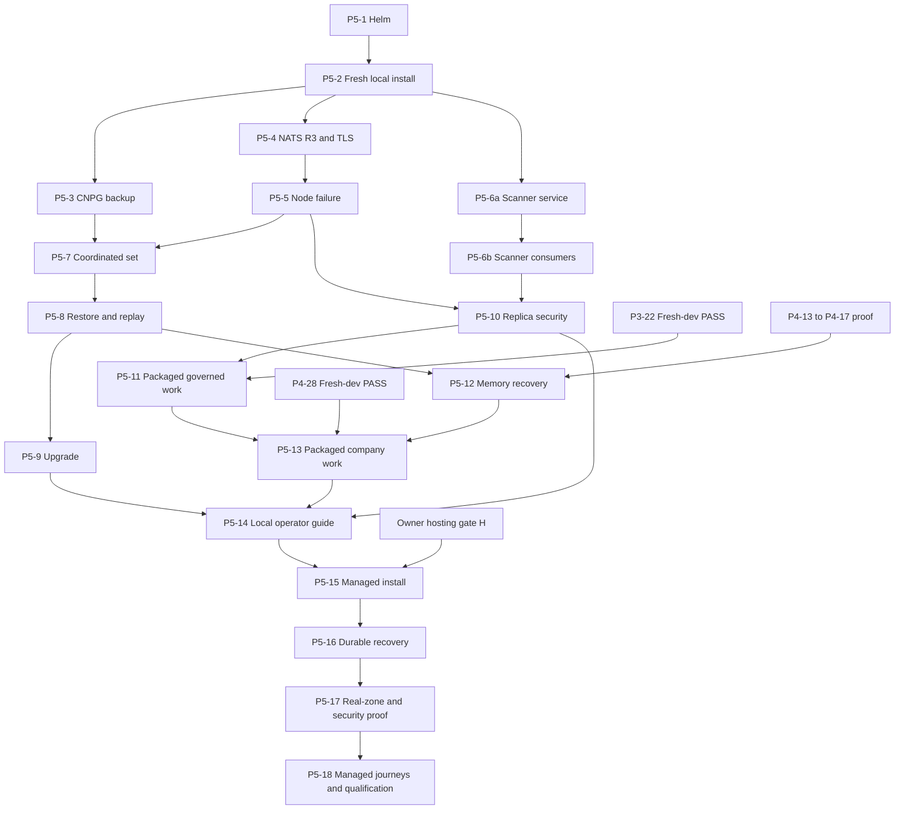

# Phase 5 — Qualification and hardening tickets

Each numbered row is one future whole-feature PR under
[#15](https://github.com/elewa-git/opencrane-new/issues/15), not a new issue created
by this draft. All rows inherit the [spec](spec.md) and [decisions](decisions.md).
Budgets count non-generated additions and deletions, including checks and docs.
Target **at most about 600 changed lines per PR** by reusing current assets. Split
an oversized row into another complete, reviewable outcome before implementation;
never compress code, omit refusal proof or leave a half-feature for consolidation.
At most two stacked PRs; land prerequisites before extending a long chain.

P5-1 is ready immediately. P5-1–P5-14 are local work authorised by the 16 October
default, subject to the dependencies below. P5-15–P5-18 require the owner hosting
gate **H** in [decisions.md](decisions.md#owner-only-hosting-gates). No paid row can
start from a local PASS alone. Product prerequisites name the original tickets;
they are not reimplemented or declared complete here.

## Numbered PR row table

“Failing-first” means capture the stated missing/refused behaviour before changing
implementation, then repeat the same check. It is planned evidence, not a claim
that this documentation task ran a test. Missing infrastructure is NOT RUN.
“Quiesce” means stop writers and wait for pending writes to finish. WAL is
PostgreSQL's write-ahead log; LSN is a position in that log used for recovery.

| PR row | Environment / concrete deliverable | Dependency | Failing-first evidence | Completion evidence | Approx. lines |
| --- | --- | --- | --- | --- | --- |
| P5-1 | Local: minimal locked Helm install, licence inventory and packaged-resource claim ownership/liveness/cleanup | None; ready now on claimed k3d resources | Missing pin/secret or mutable/unreviewed image fails; second worktree cannot claim the same slot after 15 minutes with launcher gone and Helm install alive; foreign cleanup fails; public ingress, LoadBalancer or Funnel fails | Bootstrap/core smoke and OSI/Debian-main inventory pass; tailnet-only user access and private services, loopback-only local browser forwarding; outside-tailnet probe fails; cleanup leaves owner/other installs intact | 550–600 |
| P5-2 | Local: twice-fresh packaged install using P5-1 ownership, liveness and cleanup | P5-1 | Retained silo data, foreign claim or missing/unverified/non-owner test identity refuses acceptance | Two empty installs have distinct ids; verified identity, owner role and sign-in for the privately configured test user, core journey, exposure checks and isolated cleanup pass | 350–500 |
| P5-3 | Local: CNPG PostgreSQL with standby, scheduled backup/WAL and restore to local S3 fixture | P5-2 | Missing object/WAL or denied backup identity prevents a usable restore | CNPG restores all three databases to an empty target; backup ids/LSN, rows and checkpoints agree; revoked storage access fails safely | 500–600 |
| P5-4 | Local: three NATS replicas with persistent placement and TLS routes | P5-2 | R1 stream, co-located peers, untrusted route certificate and unauthorised publish are rejected | Three nodes/peers and R3 stream recorded; TLS/client-account denials and conditional append/replay pass | 450–600 |
| P5-5 | Local: single-node NATS failure and rejoin drill | P5-4 | Drop the leader during acknowledged/racing appends; checker detects a missing or reordered event | Surviving quorum accepts writes; acknowledged ids/positions survive; stale expected position fails; returning peer catches up | 350–500 |
| P5-6a | Local: shared scanner HTTPS wrapper, scoped caller tokens and verified loaded-database manifest | P5-2 | Untrusted TLS/caller, wrong silo/purpose/bytes, forged clean result or stale/altered database is refused | Real clean/EICAR service checks bind bytes and identity; database age/expiry, bounded cleanup and rotation pass | 450–600 |
| P5-6b | Local: upload and image consumers use separate authenticated proof | P5-6a | Copied/wrong-request result, changed bytes, cross-silo or upload-as-image proof, expired database and outage cannot admit content | Two-silo real upload/image checks, typed upload 503, valid fresh recovery and separate image gates pass | 450–600 |
| P5-7 | Local: coordinated backup set for events, PostgreSQL, objects and computer volumes | P5-3, P5-5 | Active writer, mismatched generation or missing component prevents set completion | Quiesced set has event positions, database recovery point, checksums, volume ownership and safe key references; normal admission resumes | 450–600 |
| P5-8 | Local: empty-target coordinated restore and projection comparison | P5-7 | Corrupt event snapshot, ahead checkpoint, missing volume/key or mixed set refuses to serve | Restore/replay reaches recorded positions; rows, rights, files, audit and cents match; zero repeated effects | 450–600 |
| P5-9 | Local: pinned upgrade, interrupted upgrade and safe recovery drill | P5-8 | Incompatible schema rollback or incomplete pre-upgrade set refuses recovery | Compatible rollback or fresh restore works; event order, projections, files and access match before/after | 350–550 |
| P5-10 | Local: cross-replica realtime and packaged gateway/live-view isolation | P5-5, P5-6b | Reconnect to another server exposes a gap, duplicate, stale right or viewer input; refused traffic never reaches upstream | Two replicas recover positions; revocation, outage, viewer/control and network denials pass with real services/browser | 450–600 |
| P5-11 | Local: full P3-22 on independently fresh packaged installs | P5-10, P3-22 complete fresh-dev PASS and its feature dependencies | Repeat inherited failures on package; missing real Odoo/Codex/browser evidence stays NOT RUN | Twice-fresh full P3-22 and every Phase 3 refusal row, real rights/effects, 1280/390 evidence | 350–550 |
| P5-12 | Local: memory and company-state recovery drill | P5-8, delivered P4-13–P4-17 with their isolation/deletion proof | Stale keys, forgotten derived fact, replayed routine/model call or disk canary blocks reopening | Restore/replay preserves tombstones, scoped search, rights and no-disk boundary; zero model/tool/routine effects | 350–550 |
| P5-13 | Local: full P4-28 on independently fresh packaged installs | P5-11, P5-12, P4-28 complete fresh-dev PASS and all its feature dependencies | Repeat inherited refusals; substituted harness, missing feature or partial screen evidence cannot pass | Twice-fresh full P4-28 and every Phase 4 refusal row, Phase 2/3 regressions, 1280/390 evidence | 350–550 |
| P5-14 | Local: operator install/recovery guide and local qualification index | P5-9, P5-10, P5-13 | Operator following only the guide cannot recover, or a receipt wrongly implies hosted completion | Repeated local drill follows guide; all local rows indexed by status; hosted blockers and Critical/High findings explicit | 250–400 |
| P5-15 | Hosted: fresh managed install from the same locked umbrella | P5-14, H: approved cluster, durable storage, credentials, resource/spending caps and failure scope | Missing gVisor/CSI/encryption/resource or wrong OIDC organisation fails; public ingress, LoadBalancer or Funnel fails; absent/unverified/non-owner test identity fails | Tailnet-only user access and private services; outside-tailnet probe fails; verified identity, owner role and sign-in for the privately configured test user and core path pass within caps; storage, versions and isolated cleanup recorded | 350–550 |
| P5-16 | Hosted: durable coordinated backup, off-machine restore and upgrade drill | P5-15, H including retention, key recovery and RPO/RTO | Original cluster unavailable, lost/corrupt object, revoked identity or old key set prevents unsafe reopening | Empty independent target recovers within approved targets without source disks; event/projection/file checks and upgrade recovery pass | 400–600 |
| P5-17 | Hosted: approved real-zone failure, replica security and scanner isolation | P5-16, H including named zones and permitted disruption | Real approved node/zone loss or scanner outage cannot weaken policy or admit stale authority | Actual placement/failure receipts prove only the tested domains; R3/CNPG recovery, live sockets and fail-closed service checks pass | 400–600 |
| P5-18 | Hosted: complete fresh packaged P3-22/P4-28 and release qualification record | P5-17, P3-22/P4-28 acceptance, H and existing live-provider allowance | Any missing journey, unsafe restore or open Critical/High finding blocks completion | Each source journey twice fresh at 1280/390; all hosted/refusal/restore evidence linked; no open Critical/High; complete status ledger | 350–550 |

## Dependency graph

Edges point from prerequisite to dependent. All internal edges go to a larger row
number (P5-6a precedes P5-6b), so the graph has no cycles. Product tickets remain
outside Phase 5: none
of their dev-stack acceptance depends on a Phase 5 row. Gate H is an owner input,
not a task that waits for managed acceptance.

## Local acceptance detail

### P5-1 and P5-2 — Install what is already built

The first row packages current services and core smoke without waiting for Phase 4
completion. Reuse existing image/Dockerfile and prerequisite assets; list any
not-yet-packaged role explicitly. Later rows replace temporary local prerequisite
bindings with CNPG/R3 settings. A chart render alone is not completion evidence.
The installed chart must not conceal a missing service with a mock or a permissive
readiness probe. No plaintext secrets in Helm values, rendered output or receipts.

Fresh means empty silo events, projections, jobs, OpenFGA data, objects and volumes;
bootstrap uses the existing identity contract. Every fresh and restored test
environment, local or managed, includes the privately configured owner test user as a verified owner test
user. Assert trusted issuer/subject and verified email, the event-backed owner role,
and successful real browser sign-in to that silo at 1280/390. Missing, unverified,
non-owner or unable-to-sign-in accounts fail acceptance. Use existing identity and
bootstrap flows, never an email-based production access bypass. Record reused
external accounts and cluster prerequisites separately. Claim-owned teardown
removes only that install.
Each later journey repeats this process twice, not just twice against one install.

P5-1 delivers ownership before its first live Helm install. Extend
`infra/dev-stack/stack.ts`'s host-process/Compose checks with recorded cluster,
namespace, Helm release and resource UIDs bound to the worktree/slot. A launcher
exit or the 15-minute grace expiry cannot free a live packaged install. Unknown
Kubernetes state fails closed as busy. A second worktree's attempt to claim that
same slot must fail while the first Helm install is alive after both conditions;
returning a different free slot is allowed. Cleanup verifies those ownership ids,
refuses foreign resources and leaves owner/other-slot resources and volumes intact.
Prove normal and failed-install cleanup, then reclaim only after owned resources
are gone. P5-1 budgets about 280 lines for reused chart/pins/inventory, 180 for
claim/liveness/cleanup and 140 for refusal checks/docs (600 total). P5-2 adds the
twice-fresh runner and data checks; it is not a prerequisite for safe P5-1 claims.

Both P5-1 and P5-15 require tailnet-only user access and private service endpoints.
Local browser testing uses loopback-only forwarding. Inspect rendered/live
resources and listeners: no public ingress, LoadBalancer or Funnel. Probe from
outside the tailnet and require failure; a signed-in internal smoke test alone
cannot pass exposure acceptance. Repeat these checks on fresh and restored targets.

### P5-3 — PostgreSQL recovery

Use the accepted CNPG operator and existing PostgreSQL chart assets, with pinned
backup helpers. Exercise real scheduled base backup and WAL archiving to the local
fixture, then recovery to a named point. Check `opencrane`, `jobs` and `openfga`,
including transactionally stored projection checkpoints. Fail on absent WAL,
wrong credentials, damaged objects and incomplete recovery. Record standby promotion
and client reconnection. This database-only proof does not replace P5-7/P5-8.

### P5-4 and P5-5 — Three copies and a failed node

Record storage placement, peer/leader identity, R3 stream configuration, retention
and TLS route verification. Retain existing NATS account permissions: computers,
browsers and gateway cannot publish events. Refuse plaintext routes and foreign,
expired or untrusted certificates. Set disruption controls appropriate to quorum.
Stop one qualification node without touching the owner cluster; race conditional
appends, reconnect clients and compare acknowledged event ids and per-subject order.
Unknown acknowledgements are reconciled by ids/positions, never assumed absent.
Loss of quorum must fail safely; local nodes are not independent physical zones.

### P5-6a and P5-6b — Shared service and separate consumer proof

Implement the [shared scanner contract](spec.md#shared-scanner-contract). Today
`scanner.ts` uses unauthenticated TCP and returns only clean/infected; `routes.ts`
trusts it. Image checks in `hosted-admission.ts` do not provide upload receipts.
P5-6a adds the HTTPS wrapper, dedicated short-lived token issuance/verification,
trusted issuer-to-silo mapping and verified loaded signature manifest. Keep clamd
private to the service. Budget 220 lines for the wrapper, 140 for identity/manifest
work and 240 for real-service refusals, packaging and docs (600 total).

P5-6b changes `apps/server/src/files/scanner.ts`, `main.ts` wiring and `routes.ts`
to send and validate exact bytes/silo/file/request bindings before admission. Wire
the image worker separately to the existing image event and independent signature,
vulnerability and licence gates. Budget 180 lines for upload wiring, 160 for image
binding and 260 for two-silo integration/refusal checks and docs (600 total).

Run real clean/EICAR bytes through the shared service and consumer paths. Reject
untrusted service certificates, wrong/expired caller tokens, wrong issuer/silo,
forged `stream: OK`, changed bytes/digest, copied or wrong-request results, an
upload result presented as image proof and incomplete image coverage. Prove stale,
future-dated or altered database metadata fails; restarting an old image cannot
refresh its age. Verify both consumers refuse expiry during a scan. Exercise
outage, typed upload 503, recovery with a reviewed fresh database, per-request
cleanup and token/key rotation. No client-supplied success releases bytes. Keep
customer content inside our infrastructure; add no external scanning API, general
scan queue, database or new cryptography. Split again before implementation if the
complete outcome exceeds its budget; never remove authentication or negative proof.

### P5-7, P5-8 and P5-9 — Recover one consistent system

Use every step of the [backup contract](spec.md#backup-restore-and-upgrade-contract).
Seed accepted writes, pending approvals, held reservations and known files before
backup. Compare event identities/positions, read tables, rights and bytes after
restore and upgrade. Reject partial sets before starting readers or writers.
Disable outbound effects during replay and count actual upstream calls as zero.
Use current checkpoint/replay tooling, not direct SQL repairs or a new backup
controller. Report local snapshot/encryption gaps separately from byte-copy proof.

### P5-10 — Replicas preserve access and live delivery

Keep at least two decision-service, OpenFGA and budget-service replicas with
disruption budgets and priority; the budget actor remains one active writer.
Reconnect a browser to another server and prove ordered history/live delivery
without gaps or duplicates using internal NATS subjects, never browser event-log
access. Kill a replica during a reservation and verify one charge. Real gateway
outage, stale IAM, wrong Origin, revoked membership, direct Kasm access and viewer
input all refuse safely. Preserve requester-only takeover with all threads paused.
Long-history reads and ordinary new activity must not time out authority checks
or evict an authorised viewer. Capture browser outcomes at 1280/390.

### P5-11 — Preserve all governed-work acceptance

Run P3-22 unchanged, including install/review/publish/grant/connect, actual Odoo
Community read and one approved write with requester attribution/readback, denied
write, automatic first-write policy and two concurrent profiles. Keep OAuth
refresh/revoke, bearer rotation, startup-only scale-to-zero, drift/re-review and
uncertain-effect resolution. Exercise screenshot/reopen, participant view and
control denial, audited requester takeover, package/Git and browser egress.
Run every Phase 3 refusal set, global/group/assistant budget races and exhaustion,
streamed settlement/rollover, replay and Pod replacement. Real Odoo, gateway,
OpenFGA, pinned Codex/gVisor and browser evidence remain mandatory.

### P5-12 and P5-13 — Preserve memory and company acceptance

P5-12 adds restore conditions to the existing memory proof; it does not deliver
memory tools. Restore correction/forget after a merge with current deleted-key
state. Count zero model/tool/routine calls during replay and verify no resurrected
fact or private memory canary in persistent volumes, rollouts, compaction, outbox,
logs or another requester's context. Missing isolation proof keeps memory disabled.

P5-13 runs P4-28 unchanged: onboarding/invites, flat groups, shared assistants,
human direct/group chat without AI effects, child/follow-up/reviewed publication,
delegation/root exhaustion, all memory tools/search/pins, dreaming, company-account
routine/Ask, admin revocation/owner transfer and restart. Use two people, two
groups, a child-only invitee and another silo. Prove approval-free group writes,
personal/group isolation, two-second revocations, last-owner safety, zero replay
calls and every refusal row. Retain Phase 2 and full Phase 3 regressions. Missing
feature delivery remains an explicit product blocker, not a smaller PASS journey.

### P5-14 — An operator can repeat the local proof

Document prerequisites, versions, secret ids, claimed-resource caps, install,
backup, restore, upgrade, rollback limits and cleanup. Link exact executable
commands added by their owning rows and safe artefacts; do not invent working
commands in advance. Include snapshot limitations and local versus hosted results.
Run the guide on an owned disposable target; update both README files and their
diagram where a package's responsibility or connections change.

## Hosted acceptance detail

P5-15–P5-18 inherit all local contracts and gate H; local evidence never substitutes
for them. Only the owner supplies provider/account, cluster/domain, durable object
storage and key custody, scoped credentials, resource/spending caps and authorised
failure scope. Name actual zones and prove placement before disrupting a zone.
If only one zone is supplied, real-zone evidence remains NOT RUN and the broader
claim stays blocked. Do not simulate zone labels and call them provider evidence.

P5-16 restores to a clean independent target while original cluster/disks are
unavailable, using durable object storage and approved recovery of necessary keys.
Record actual loss/time against owner RPO/RTO, encrypted storage and CSI snapshots,
retention and access refusals. Repeat the upgrade/interruption path there too.
P5-17 repeats single-node and approved zone failure, CNPG promotion, cross-replica
realtime, gateway/live-view denials and shared-scanner outage/isolation in hosting.
P5-18 runs **each** full product journey twice from independently fresh managed
installs, with 1280/390 screenshots/accessibility and all refusal evidence. It
closes qualification only when all managed and restore gates pass and no open
Critical/High finding remains. No row authorises merging or spending by itself.

## Evidence and landing

Each implementation PR includes its failing-first observation, completion receipt,
line count, required source/web checks and explicit outstanding live issue. Run
checks under `nice -n 10` and avoid full suites during live-view qualification.
Report PASS/FAIL/PARTIAL/NOT RUN per environment. Source-ready and capability-done
have the [standard meanings](../../process/standards.md#tests-and-evidence).
This spec task runs documentation gates only; it starts no stack or product test.
