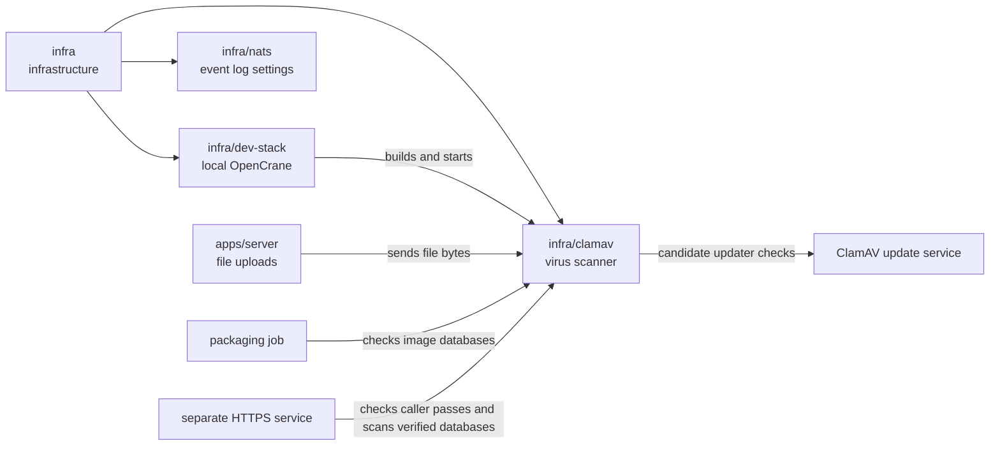

# Upload scanner

## What this is

This package runs [ClamAV](../../GLOSSARY.md#clamav-virus-scanner), a virus scanner,
for files uploaded to OpenCrane. The server sends each file to the scanner and
accepts it only after an explicit clean result.

## Where it fits

This is infrastructure beside the development stack and event log settings.
[apps/server](../../apps/server/README.md), the back end, checks uploads with this
scanner before saving them in [MinIO](../../GLOSSARY.md#minio-file-storage).



## What it is responsible for

- Runs one fixed, reviewed version of ClamAV and its virus list, so neither changes without review.
- Runs without downloading programs or virus definitions at startup.
- Sets limits for file size, scan size and archive depth.
- Leaves out RAR scanning because its plug-ins are not open source; uploads also refuse RAR files.
- Prepares updated virus definitions separately for review, with hashes and verified dates.
- Checks that a packaged image contains exactly the reviewed virus definitions.
- Offers a separate launcher that keeps those files read-only and stops at database expiry.
- Scans bounded file bytes through that launcher and returns the loaded database facts.
- Checks service passes before receiving upload bytes through a separate HTTPS wrapper.
- Keeps the original scanner code from the earlier version of OpenCrane, with its licence, for reference.

## Processes it handles

1. **A person uploads a file.** The server keeps the file in memory while sending
   its bytes to ClamAV. It saves the file in MinIO only if the scan is clean.
2. **The scan finds a virus or cannot finish.** The server refuses the file and leaves it out of storage.
3. **An operator updates the virus list.** The refresh script prepares a separate
   candidate and records when the complete virus list was checked successfully.
   The running scanner keeps its current list until a reviewed image replaces it.
4. **A packaging job checks an image.** The release verifier inspects its virus
   definitions without network access and records the image and manifest hashes.
5. **The separate launcher starts a scanner.** It checks the approved files again,
   starts only that set, and stops it 24 hours after its verified update check.
6. **A trusted process requests a scan.** The launcher copies the bounded bytes, checks
   their hash and size, and sends them to its own daemon. It checks database age
   and the running container before and after the scan. Results last at most two minutes.

## How to run or test it

The development stack builds and starts the scanner. Upload tests use the same
image in a temporary container. Refresh prepares files for review and does not change
an already running scanner. Its `signatures.json` file records database versions,
build dates, hashes and the successful update-check time. Unchanged files keep their
original build dates. A failed refresh removes the previous candidate record.
This file is evidence for review; it does not authorise uploads or image admission.

The release verifier takes this reviewed file, its separately approved SHA-256
hash and an immutable image reference. It records success only after checking
the image's actual files and removing its temporary containers. The complete
update check must be within 24 hours, even when the files themselves are older.
Neither JSON file grants trust or admits an upload. The verifier does not deploy
an image or refresh a running scanner. Commands and limits are in
[README.robot.md](README.robot.md#packaging-evidence).

The separate launcher keeps ClamAV inside its own container, with no host port
or database mount. ClamAV uses a bounded, memory-only temporary directory for
scan work. It does not run FreshClam or offer a reload command. Its
readiness check refuses expired databases; restarting never makes them newer.
Startup shares one time limit across all Docker calls, so a slow Docker service
cannot give each step a fresh allowance. Cleanup has its own limit.
Each scan shares one minute across its checks and byte transfer. Failed or cancelled
scans immediately retire the handle and stop its containers, including other pending scans.
The failed request waits for container cleanup, even if its Docker client never closes.
This confirms that a remote scan has stopped before the ownership record is removed.
Failed removal keeps that record and blocks reuse. No file bytes or raw scanner
replies are saved or returned.
The separate HTTPS wrapper checks the caller's service, silo and request before
asking for file bytes. Its response binds the result to that file and connection.
A copied result grants nothing. Caller expiry and database expiry are checked again
before replying. Deployed issuance and upload consumers are not connected yet.

If updater cleanup fails, the directory stays locked to prevent another updater
from changing the same files. An operator must confirm the updater has stopped
before removing the lock, as described in [README.robot.md](README.robot.md).

```sh
infra/dev-stack/up.sh
nice -n 10 npm test -- apps/server/test/upload.test.ts
infra/clamav/refresh.sh /absolute/scratch/candidate-signatures
```

## Folders

| Folder | What it does |
| --- | --- |
| [upstream](upstream/README.md) | Keeps the earlier scanner code and its licence for reference. |

## Where to read more

- [README.robot.md](README.robot.md): image details and virus list updates.
- [Reviewed image licences](LICENCES.md): notices for parts bundled in the image.
- [apps/server](../../apps/server/README.md): the upload feature.
- [Upload API](../../docs/architecture/upload-api.md): request and response rules.
