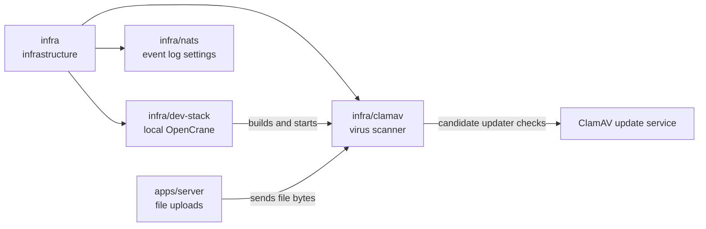

# Upload scanner

## What this is

This package runs [ClamAV](../../GLOSSARY.md#clamav-virus-scanner), a virus scanner,
for files uploaded to OpenCrane. The server sends each file to the scanner and
accepts it only after an explicit clean result.

## Where it fits

This is infrastructure beside the development stack and event log settings.
[apps/server](../../apps/server/README.md), the back end, checks uploads with this
scanner before saving them in [MinIO](../../GLOSSARY.md#minio-file-storage).



## What it is responsible for

- Runs one fixed, reviewed version of ClamAV and its virus list, so neither changes without review.
- Runs without downloading programs or virus definitions at startup.
- Sets limits for file size, scan size and archive depth.
- Leaves out RAR scanning because its plug-ins are not open source; uploads also refuse RAR files.
- Prepares updated virus definitions separately for review, with hashes and verified dates.
- Keeps the original scanner code from the earlier version of OpenCrane, with its licence, for reference.

## Processes it handles

1. **A person uploads a file.** The server keeps the file in memory while sending
   its bytes to ClamAV. It saves the file in MinIO only if the scan is clean.
2. **The scan finds a virus or cannot finish.** The server refuses the file and leaves it out of storage.
3. **An operator updates the virus list.** The refresh script prepares a separate
   candidate and records when the complete virus list was checked successfully.
   The running scanner keeps its current list until a reviewed image replaces it.

## How to run or test it

The development stack builds and starts the scanner. Upload tests use the same
image in a temporary container. Refresh prepares files for review and does not change
an already running scanner. Its `signatures.json` file records database versions,
build dates, hashes and the successful update-check time. Unchanged files keep their
original build dates. A failed refresh removes the previous candidate record.
This file is evidence for review; it does not authorise uploads or image admission.

```sh
infra/dev-stack/up.sh
nice -n 10 npm test -- apps/server/test/upload.test.ts
infra/clamav/refresh.sh /absolute/scratch/candidate-signatures
```

## Folders

| Folder | What it does |
| --- | --- |
| [upstream](upstream/README.md) | Keeps the earlier scanner code and its licence for reference. |

## Where to read more

- [README.robot.md](README.robot.md): image details and virus list updates.
- [Reviewed image licences](LICENCES.md): notices for parts bundled in the image.
- [apps/server](../../apps/server/README.md): the upload feature.
- [Upload API](../../docs/architecture/upload-api.md): request and response rules.
