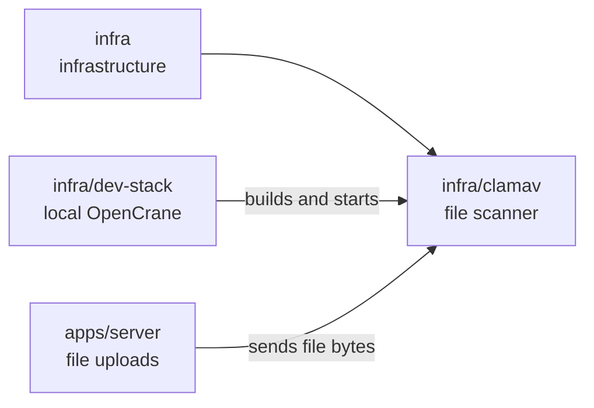

# infra/clamav

## What this is

A ClamAV container that scans files uploaded to OpenCrane. ClamAV is a virus scanner.
The server sends the file bytes to the scanner and accepts a file only after a clear clean
result. The server accepts only a short list of file types, and RAR archives are not on it.
The image also leaves out RAR scanning, because that part's licence is not open source.

## Where it fits

This is part of the infrastructure layer. `apps/server`, the back end that handles file
uploads, sends each file to the scanner. The development stack builds and starts it.



## What it is responsible for

- Run a pinned ClamAV image with fixed virus definitions.
- Remove the RAR plug-ins, because their licence is not open source.
- Keep the original scanner code copied from OpenCrane 1, with its licence, for reference.
- Run without downloading files or virus definitions at startup.
- Set limits for file size, scan size and archive depth.
- Prepare updated virus definitions as a separate candidate for review.

## Processes it handles

1. **A person uploads a file.** The server streams its bytes to ClamAV. The server accepts
   the file only when the scanner reports that it is clean.
2. **The scanner cannot finish or finds a virus.** The server refuses the file. Until a scan
   passes, an upload waits in a separate holding area in MinIO, and the dev stack deletes
   anything left there after one day.
3. **An operator updates virus definitions.** `refresh.sh` builds a separate candidate
   set. The running scanner keeps its current definitions until a reviewed image replaces
   it.

## How to run or test it

The development stack builds and starts the scanner. Tests build the same image and run it
in a disposable container.

```sh
infra/dev-stack/up.sh
npx vitest run apps/server/test/upload.test.ts
infra/clamav/refresh.sh /absolute/scratch/candidate-signatures
```

## Where to read more

- [README.robot.md](README.robot.md): image details and the definition update process.
- [Reviewed image licences](LICENCES.md): notices for parts bundled in the scanner image.
- [apps/server](../../apps/server/README.md): the upload feature that calls the scanner.
- [Upload API](../../docs/architecture/upload-api.md): the upload request and response rules.
