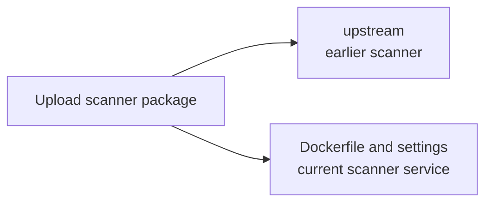

# Earlier upload scanner

This folder keeps a copy of the upload scanner from the earlier OpenCrane product.
It is a reference for how to run a virus check and interpret its result. The current
product uses a separate scanner connection in the server.

## What it is responsible for

- Keeps the earlier scanner code with its original licence notice.
- Shows how the earlier scanner ran a file check without a command shell.
- Shows how it stopped a scan after a time limit or cancellation.
- Treats only the scanner's explicit clean result as permission to accept a file.

## Main files

| File | What it does |
| --- | --- |
| `clamscan.ts` | Runs the earlier command-line scanner and reads its result. |
| `LICENCE` | Keeps the original open-source licence notice with the copied code. |

## How it connects

The [upload scanner package](../README.md) runs
[ClamAV](../../../GLOSSARY.md#clamav-virus-scanner), a virus scanner.
The current [server scanner](../../../apps/server/src/files/scanner.ts) sends file
contents to that running service. It does not import this reference code.

## Not done here

This folder does not build the running scanner or supply its virus list.
