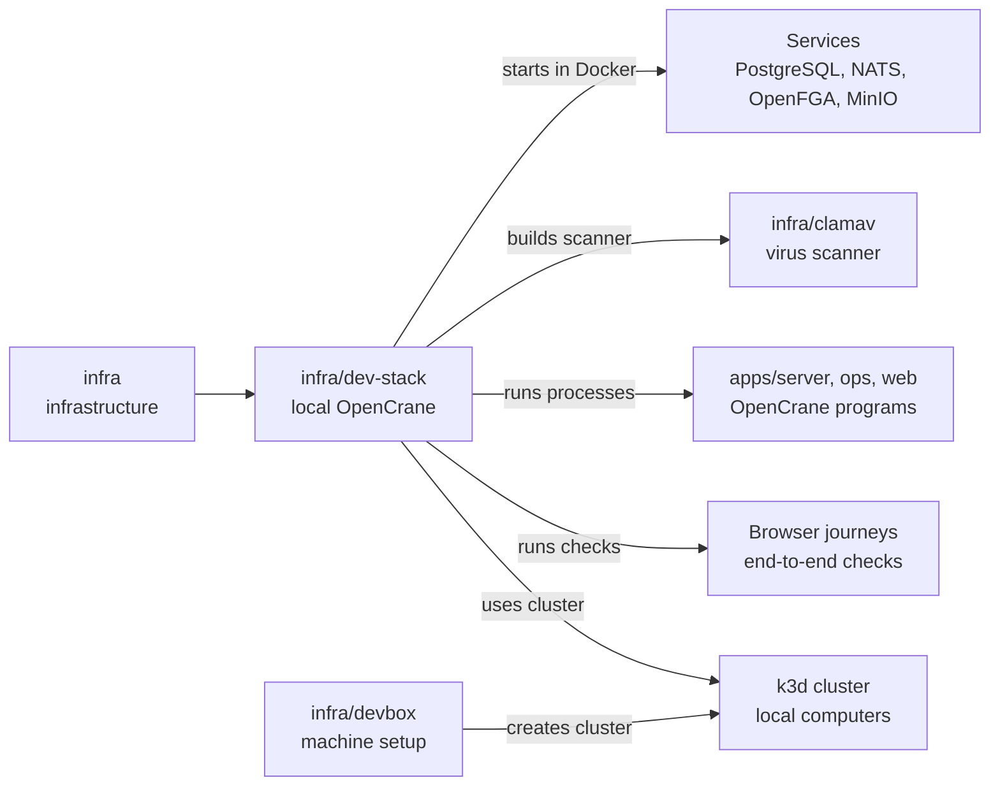

# infra/dev-stack

## What this is

A set of scripts that starts a full local copy of OpenCrane for development and testing.
It brings the services and apps together on a developer machine. It can also run browser
checks from sign-in through chat and file upload.

## Where it fits

This is part of the infrastructure layer. Docker Compose runs its services in containers.
The stack starts OpenCrane apps against them. It uses the
[Kubernetes cluster](../../GLOSSARY.md#kubernetes) prepared by [`infra/devbox`](../devbox/README.md).



## What it is responsible for

- Start and stop the local services and OpenCrane processes.
- Create private local credentials for the services.
- Set up sign-in for the development users.
- Prepare the local Kubernetes cluster so that the server can start a sandboxed computer for each member.
- Run a local stand-in for the AI model, so checks cost nothing and give the same answer every time.
- Run browser checks against real local services.
- Keep up to three separate development stacks on one machine.

## Processes it handles

1. **A developer starts OpenCrane.** The scripts start the databases and services, then
   start the server, workers and website. The usual start also runs the core browser check.
2. **A developer checks a change.** A browser signs in, sends a chat message and checks
   that the reply remains after a reload. Other checks cover uploads, approvals, budgets
   and the computer screen.
3. **A developer runs a separate stack.** `claim.sh` reserves one of two spare test stacks, numbered 1 and 2.
   Its services use separate data and ports, and `down.sh --id` removes that stack and
   releases its id.

## How to run or test it

The local machine needs Docker and Node 22. The owner's main stack is reached over Tailscale,
a private network between the owner's own devices, so it needs a signed-in Tailscale session.
The two numbered test stacks are reached only from the machine itself.
The [developer box](../devbox/README.md) sets up the local Kubernetes cluster.

```sh
infra/dev-stack/up.sh
infra/dev-stack/status.sh
infra/dev-stack/down.sh
```

`up.sh --fresh` replaces this stack's local data and credentials.

## Where to read more

- [README.robot.md](README.robot.md): exact settings, limits, credentials and test details.
- [infra/devbox](../devbox/README.md): the local cluster used for computers.
- [infra/nats](../nats/README.md): the event log's connection rules.
- [infra/clamav](../clamav/README.md): the file scanner used by uploads.
- [Why NATS JetStream holds the event log](../../docs/adr/0001-event-store-nats-jetstream.md).
