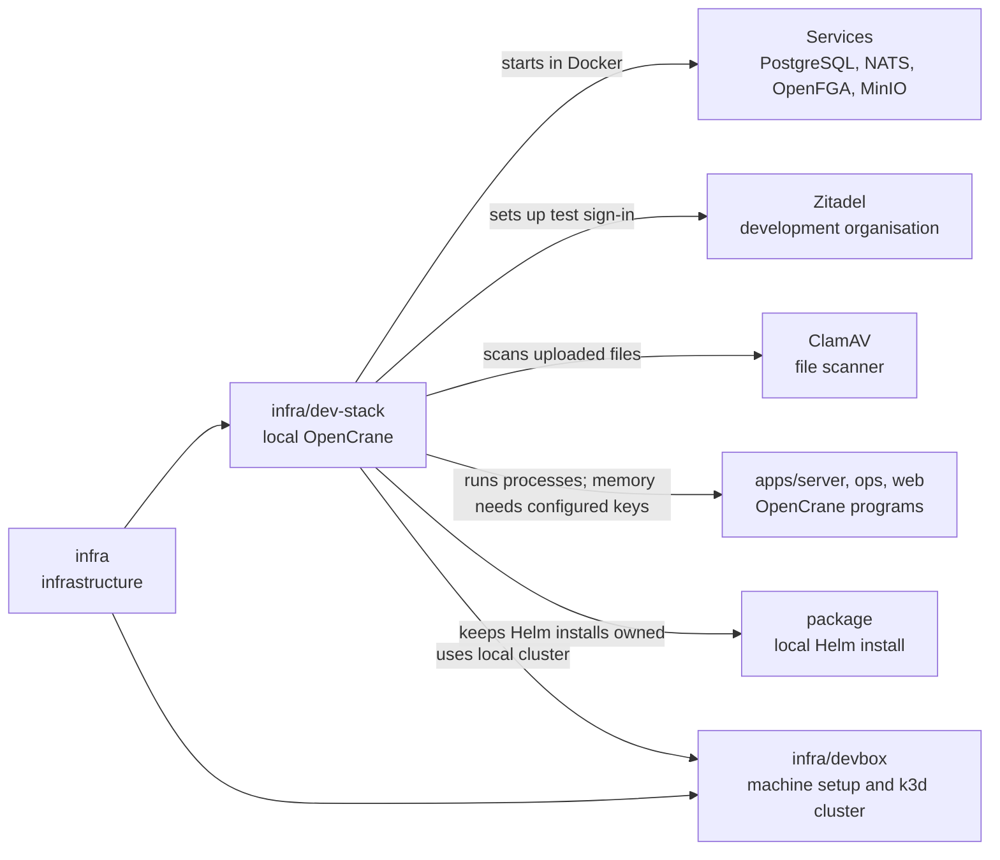

# infra/dev-stack

## What this is

A set of scripts that starts a full local copy of OpenCrane for development and testing.
It brings the services and apps together on a developer machine. It can also run browser
checks from sign-in through chat, file upload and organisation features.

## Where it fits

This is part of the infrastructure layer. Docker Compose runs its services in containers.
The stack starts OpenCrane apps against them. It uses the
[Kubernetes cluster](../../GLOSSARY.md#kubernetes) prepared by [`infra/devbox`](../devbox/README.md).



## What it is responsible for

- Start and stop the local services and OpenCrane processes.
  Memory reads need an existing private key directory configured at startup.
- Create private local credentials for the services.
- Set up four sign-in test users for each spare stack. Check that the sign-in apps
  include email claims in their signed tokens.
- Prepare the local Kubernetes cluster so that the server can start a sandboxed computer for each member.
- Run a local stand-in for the AI model, so checks cost nothing and give the same answer every time.
- Run browser checks against real local services. The approval journey is currently skipped.
- Check group chats from the To line, participant access, direct chats, shared assistants and
  provider key saving in a fresh stack.
- Keep one extra computer place so a saved-data repeat can start a new shared assistant.
- Measure reply arrival, process memory and open files during live-view checks.
- Keep up to three separate development stacks on one machine.
- Run a fresh stub-based check each day in a secondary stack and save its result outside the repository.

## Processes it handles

The models process gets a separate control port for checking loaded configuration.
The stack never forwards it. The approval journey is skipped while publication
and call checks are being connected.

1. **A developer starts OpenCrane.** The scripts start the databases and services, then
   start the server, workers and website. The usual start also runs the core browser check.
   Computers update in place after their next pause and keep their home files.
   Admission checks allow only the checked image and settings.
2. **A developer checks a change.** A browser signs in, sends a chat message and checks
   that the reply remains after a reload. Other checks cover uploads, budgets
   and the computer screen. The organisation checks also cover groups, direct chats, shared
   assistants and saving a provider key. Group chat checks cover the mode before the first
   message, who can read each message, quiet ordinary sends, and access clearing after a
   person leaves. Budget checks restore the test limits even if a browser step fails.
3. **A developer runs a separate stack.** `claim.sh` reserves one of two spare test stacks, numbered 1 and 2.
   Its services use separate data and ports, and `down.sh --id` removes that stack and
   releases its id.
4. **The daily check runs.** A user timer updates a detached checkout of `main`, then starts
   `up.sh --fresh` in a claimed spare stack. The local model stub keeps it free of paid model
   calls. A result line and any failure evidence go in the user's home directory.

## Secondary stack slots

`claim.sh` gives this worktree one of the two spare slots. Its private owner file records
the worktree, the claiming process id and the start time. A later claim reuses the same
slot for this worktree. A claim stays reserved for at least 15 minutes so the stack
has time to start. After that, another worktree can reclaim it if the claiming process
has ended and no stack processes, containers or package namespace are running.
Kubernetes errors keep a package slot busy. `status.sh` reports `free`
for an unused slot and does not create its owner file. `down.sh` also leaves an unused
slot alone.
The spare slot runs either the Compose stack or the local Helm package. Package
preparation refuses a running Compose stack. If Kubernetes is unavailable during
cleanup, `down.sh` stops Compose and keeps any package owner record for a later retry.
Without a package or computer setup record, teardown needs no Kubernetes connection.
A started Compose stack still removes its recorded computer resources.

## How to run or test it

The local machine needs Docker and Node 22. The owner's main stack is reached over Tailscale,
a private network between the owner's own devices, so it needs a signed-in Tailscale session.
The two numbered test stacks are reached only from the machine itself.
The [developer box](../devbox/README.md) sets up the local Kubernetes cluster.

```sh
infra/dev-stack/up.sh
infra/dev-stack/status.sh
infra/dev-stack/down.sh
```

`up.sh --fresh` replaces this stack's local data and credentials. For a spare stack,
it also clears this worktree's website build cache so changed packages are rebuilt.

The daily timer runs at 03:17 UTC. Before each run, its launcher updates the detached
`~/dev/daily-fresh` checkout to the latest `main` and installs packages only when the lock
file changes. It claims a spare stack, starts it fresh with the local model stub, and removes
that stack when the run ends. If both spare stacks are busy, it records that it skipped the
run. Results and saved failure files go in `~/.opencrane/daily-fresh/`, outside the repository.

Run `infra/dev-stack/install-daily-fresh-timer.sh` to install or update the user timer.

## Where to read more

- [README.robot.md](README.robot.md): exact settings, limits, credentials and test details.
- [infra/devbox](../devbox/README.md): the local cluster used for computers.
- [infra/nats](../nats/README.md): the event log's connection rules.
- [infra/clamav](../clamav/README.md): the file scanner used by uploads.
- [Why NATS JetStream holds the event log](../../docs/adr/0001-event-store-nats-jetstream.md).
