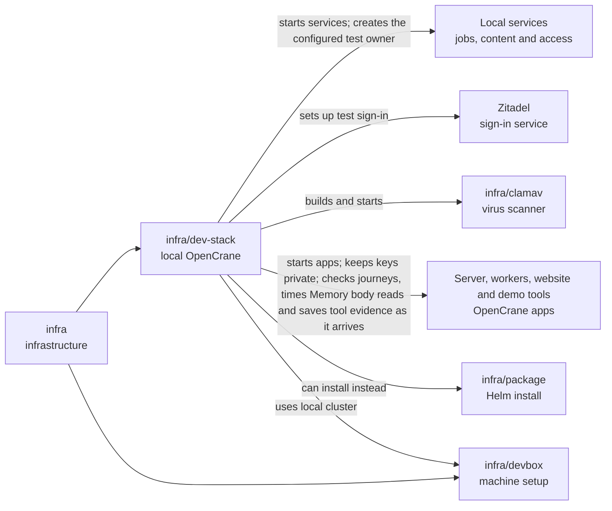

# Development stack

## What this is

This package starts a full local copy of OpenCrane for development and testing.
It brings the apps and services together and checks product journeys such as
signing in, chatting, uploading files and changing organisation settings.

## Where it fits

This is infrastructure that connects the apps to their local services. Docker
Compose runs services in [containers](../../GLOSSARY.md#container-and-pod).
[infra/devbox](../devbox/README.md) prepares the local Kubernetes system where
assistant computers run.



The services include [PostgreSQL](../../GLOSSARY.md#postgresql-database) for read
tables and a separate jobs database, [NATS](../../GLOSSARY.md#nats) for the event log,
[OpenFGA](../../GLOSSARY.md#openfga-permissions-service) for permissions and
[MinIO](../../GLOSSARY.md#minio-file-storage) for files.
[Zitadel](../../GLOSSARY.md#zitadel-sign-in-service) provides test sign-in.

The dispatcher uses the server's read-only content connection to coordinate gateway
configuration changes. Its background jobs keep their own database.

## What it is responsible for

The personal Memory browser helper records the first reply status before reading
its body. A body that does not finish fails after ten seconds, leaving that status
available for diagnosis.

- Starts and stops local services and apps with private local credentials.
- Waits for the website to answer before starting browser checks.
- Prepares Kubernetes so background workers can start one
  [computer](../../GLOSSARY.md#computer) per assistant, including shared group assistants.
- Sets up test sign-in and a free stand-in AI provider; real providers need an explicit choice.
  The stand-in also runs on its own for computer startup checks.
- Runs browser checks for chat, files, people, groups, shared assistants and spending.
  Checks money in admin Change history and keeps it out of member action history.
  Scrolls waiting approvals into view before saving desktop and phone pictures.
  Saves a private picture if the spending editor fails to load.
- Checks ownership handover and refuses a last owner’s departure in manual named journeys.
- Waits for each new rehearsal reply to finish, checks its facts and checks the saved
  text after a reload. Uses separate messages and invitations for each screen width and
  attempt, and saves step pictures before recording success.
- Keeps two spare test stacks separate from the owner's copy and from each other.
- Checks sign-in, personal memory reads, saves, correction and forgetting on an empty installation.
  Checks supplied memory receipts and records incomplete journeys honestly.
  Keeps failed attempts separate from later read-only checks.
- Provides demo preparation and screen measurements, while refusing automated coding
  jobs that try to run the owner's commands.
- Checks the demo tool server through local TLS. Requires saved tool definitions and
  linked approval and dispatch records in event-log order.
  A disposable computer also checks that the free model can call a published read
  tool and answer with its result in the same chat turn.
  A guarded test launch keeps the full server and models processes and connects both
  to one local demo server. It shares only the slot claim and demo socket with models;
  personal and memory keys stay outside that container.
  The collector saves each reply from the demo quote checks and each original event
  before continuing. Closing the browser keeps the saved evidence. The receipt states
  which browser steps were checked.

## Processes it handles

1. **A fresh stack connects the AI.** Startup connects a free stand-in provider as
   the owner would through the product's settings APIs. It checks the provider and
   switches it on before chat checks run. Startup waits up to five minutes for the
   website to answer and stops if its process exits.
2. **A developer checks a change.** A browser signs in, sends a message and checks
   the saved reply after reloading. Other journeys cover files, spending, the screen
   and organisation settings; the approval journey remains skipped.
3. **A developer runs a separate stack.** A
   [claim](../../GLOSSARY.md#slot-spare-dev-stack) reserves one of two spare copies.
   Each has its own ports, data and separate private key directories for surveys and
   memory. Restart keeps those keys. Models and computers cannot read those directories;
   cleanup removes only that claimed copy.
4. **The daily check runs.** A timer updates a separate checkout of the main branch,
   starts a fresh spare stack with the free model and runs the browser journeys.
   It saves the result and private failure logs outside the repository, then removes
   that stack. If both spare stacks are busy, it records a skipped run.

## How to run or test it

The development owner email is configured in a private file outside the repository.
The [operator notes](README.robot.md#private-owner-email) explain that setting.

The machine needs Docker, Node 22 and the cluster prepared by
[infra/devbox](../devbox/README.md). These commands claim and use a spare stack:

`npm run typecheck` checks the TypeScript in this folder as well as the apps and libraries.
`npm run typecheck:dev-stack` checks this folder on its own.

```sh
DEV_STACK_ID=$(infra/dev-stack/claim.sh) || exit 1
export DEV_STACK_ID
infra/dev-stack/up.sh --fresh
infra/dev-stack/status.sh
infra/dev-stack/down.sh
```

A fresh start replaces that stack's local data and credentials. A new spare stack
prepares its survey and memory directories automatically. Existing installations need
a stopped-services upgrade when their reaction subscriptions change. Detailed prerequisites,
real-provider choices and daily timer settings are in the operator notes.

## Folders

| Folder | What it does |
| --- | --- |
| [systemd](systemd/README.md) | Schedules the daily check on a fresh spare stack. |

## Where to read more

- [README.robot.md](README.robot.md): settings, stack ownership, commands and detailed checks.
- [Demo guide](../../docs/process/demo/README.md): demo preparation and current limits.
- [infra/package](../package/README.md): the local Helm installation trial.
- [infra/nats](../nats/README.md): event log connection rules.
- [infra/clamav](../clamav/README.md): upload scanning.
