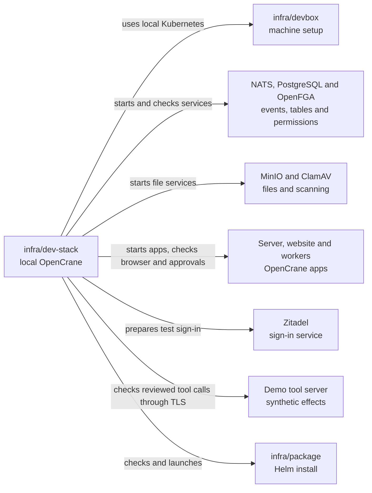

# Development stack

## What this is

This package starts a full local copy of OpenCrane for development and testing.
It brings the apps and services together and checks product journeys.
The checks use a browser to sign in, chat and reload saved replies.
Developers can also check files, spending and organisation settings.
The focused tool approval driver asks the free model to use a reviewed demo tool
in a long chat, through the published connection and guarded local TLS transport.
It seeds earlier messages in small batches and checks projection progress between them.
It checks browser approval, one use and Stop refusing an already approved request.
The demo records the received request body. The saved approval use identifies the
gateway's decision.

## Where it fits

This package belongs to infrastructure. Docker Compose runs the local services;
[infra/devbox](../devbox/README.md) prepares Kubernetes for assistant computers.
The launcher starts the apps with their service connections and private settings.
[Zitadel](../../GLOSSARY.md#zitadel-sign-in-service) provides test sign-in.



## What it is responsible for

- Start and stop local services and apps with private credentials.
- Keep two spare test stacks separate from each other and the owner's stack.
- Check listener addresses, PostgreSQL TCP readiness, upload scanning and worker
  readiness before browser checks.
- Prepare test sign-in and a free stand-in AI provider.
- Preserve private survey and memory keys across restarts; chats need no key storage.
- Apply safe background subscription changes while services are stopped.
- Run browser journeys and keep screenshots and original results.
- Check the claimed stack and protected target before private memory collection.
- Check package hosts, record any explicit local risk exception and remove only owned resources.
- Provide guarded demo checks and a daily fresh-stack check.

Not built yet:

- Qualify native private memory through ordinary browser checks alone.
- Enable the package's blocked database recovery and three-peer event-log options.

## Processes it handles

1. **A developer claims a stack.** A claim reserves one of two spare copies.
   Each copy has its own ports, data and private keys. Cleanup removes only that copy.

1. **A fresh stack starts.** Startup prepares services, sign-in and the free AI
   provider, then starts the apps. It waits for the website and dispatcher before
   running the core browser journey by default. A focused approval run can start
   the services first and run its browser checks after the demo is ready. The status
   command shows recovery attempts for event delivery, acknowledgements and computer
   watcher reads.

1. **A developer checks a change.** The browser signs in, sends a message and checks
   the saved reply after reloading. Separate journeys cover files, spending,
   desktop viewing and organisation settings. The core journey finishes its browser
<<<<<<< HEAD
   checks and closes the browser before rebuilding the read tables.

1. **An unsafe command is requested.** The launcher refuses automated coding jobs
=======
   checks and closes the browser before rebuilding the read tables. The static
   website closes a failed desktop connection without interrupting other requests.
4. **An unsafe command is requested.** The launcher refuses automated coding jobs
>>>>>>> 326f126b9 (🔧 Close failed WebSocket connections without stopping the website)
   that try to run owner commands or use real providers. Fresh journeys use a claimed
   spare stack and the free stand-in model.

1. **The daily check runs.** A timer starts a fresh spare stack from a separate main
   checkout, runs browser checks and saves results. It removes its stack afterwards;
   if both slots are busy, it records that the run was skipped.

## How to run or test it

The machine needs Docker, Node 22 and the cluster prepared by
[infra/devbox](../devbox/README.md). Configure the
[private owner setting](README.robot.md#private-owner-email) before starting.
From the repository root, claim a spare stack and use its returned id:

```sh
DEV_STACK_ID=$(infra/dev-stack/claim.sh) || exit 1
export DEV_STACK_ID
infra/dev-stack/up.sh --fresh
infra/dev-stack/status.sh
infra/dev-stack/down.sh
```

A fresh start replaces that stack's data and credentials. Always stop the claimed
stack when finished, including after a failure.
[README.robot.md](README.robot.md#starting-and-stopping-the-stack) explains readiness,
restart behaviour and focused tests. Type checks run with
`nice -n 10 npm run typecheck:dev-stack`.

## Where to read more

- [README.robot.md](README.robot.md): settings, folders, ownership and detailed checks.
- [Local operator guide](README.robot.md#local-operator-guide): commands and recovery limits.
- [infra/package](../package/README.md): the Helm installation trial.
- [infra/nats](../nats/README.md): event-log connections.
- [infra/clamav](../clamav/README.md): upload scanning.
