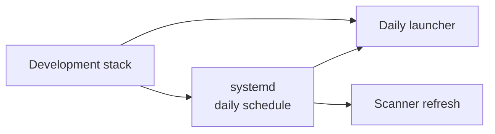

# Host schedules

This folder sets the daily schedule for checking a fresh copy of OpenCrane on the
developer machine. It tells the machine's user service manager when to start the
check and which launcher to run. The check uses a spare test stack. A separate
timer refreshes the scanner in an installed package.

## What it is responsible for

- Schedules one check each day at 03:17 UTC.
- Runs the check as a user service with low scheduling priority.
- Starts the installed launcher from its own working folder.
- Leaves missed runs skipped when the timer was not running at the scheduled time.
- Checks for a new approved scanner at midnight and noon UTC for each enabled slot.

## Main files

| File | What it does |
| --- | --- |
| `opencrane-daily-fresh.timer` | Sets the daily time and names the service to start. |
| `opencrane-daily-fresh.service` | Sets the launch command and the folder it runs from. |
| `opencrane-scanner-refresh@.timer` | Sets the scanner refresh times for a slot. |
| `opencrane-scanner-refresh@.service` | Runs the refresh from the worktree that owns the slot. |

## How it connects

The [development stack](../README.md) includes an
[installer](../install-daily-fresh-timer.sh) that copies these files into the user's
systemd settings. systemd is the Linux service manager. The
[launcher](../daily-fresh-run.sh) updates a separate checkout before the
[daily check](../daily-fresh.sh) claims a spare stack and tests the product.
The [scanner installer](../install-scanner-refresh-timer.sh) enables the refresh
timer for the running package.

## Not done here

These files do not contain the browser tests or decide which spare stack is free.
