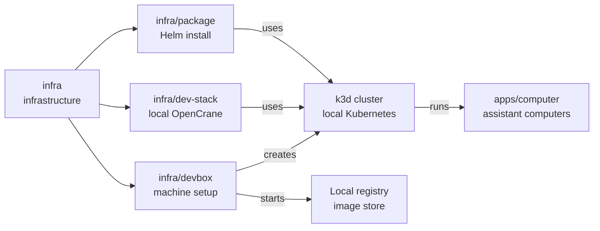

# Developer machine setup

## What this is

This package prepares an Ubuntu machine for local OpenCrane development.
It installs the tools and small Kubernetes system where each assistant's private
computer runs, including computers for shared group assistants.

## Where it fits

This is infrastructure used before [infra/dev-stack](../dev-stack/README.md)
starts the rest of OpenCrane. It uses k3d, a way to run a small
[Kubernetes](../../GLOSSARY.md#kubernetes) system on one machine.
[gVisor](../../GLOSSARY.md#gvisor) adds a security layer around each
[computer](../../GLOSSARY.md#computer).



## What it is responsible for

- Installs fixed versions of the tools and checks their downloads have not been tampered with.
- Creates the local Kubernetes system with gVisor and Agent Sandbox, which manages computers.
- Starts a local store for container images.
- Installs a [MinIO](../../GLOSSARY.md#minio-file-storage) file store in the cluster.
  Current upload handling uses the dev stack's separate MinIO; this copy is unused.
- Adds an 8 GB swap file, which lets the machine use disk space when memory runs short.
- Checks that the cluster can only be controlled from this machine, not from the network.

## Processes it handles

1. **A developer prepares a machine.** Setup downloads and checks the tools,
   creates the local cluster and checks that image downloads and gVisor work.
2. **A developer runs setup again.** It reuses installed tools and the existing
   cluster. It stops if the cluster or image store can be reached from outside this machine.
3. **A developer removes the cluster.** Separate k3d commands delete the cluster
   and image store. Deleting the cluster also removes its MinIO data.

## How to run or test it

Setup runs from the repository root on an x86-64 Ubuntu machine with Docker and
passwordless `sudo`. The operator notes explain what remains after removal.

```sh
./infra/devbox/setup.sh
k3d cluster delete ocn
k3d registry delete ocn-registry
```

## Where to read more

- [README.robot.md](README.robot.md): tool versions, image settings and network checks.
- [infra/dev-stack](../dev-stack/README.md): the local product copy that uses this machine.
- [apps/computer](../../apps/computer/README.md): the computers this cluster runs.
