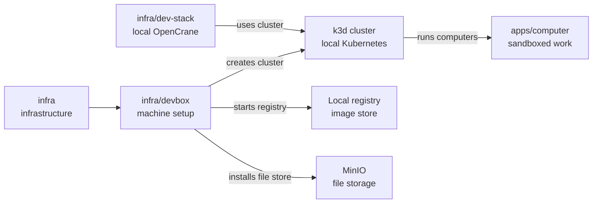

# infra/devbox

## What this is

A setup script that prepares an Ubuntu machine for local OpenCrane development.
It installs the tools and local Kubernetes cluster used to run sandboxed computers.
It also starts a local image registry (a store for container images) and a MinIO file store
inside the cluster. The dev stack keeps uploads in its own MinIO, so nothing uses this one yet.

## Where it fits

This is part of the infrastructure layer. It prepares a developer's machine before
[`infra/dev-stack`](../dev-stack/README.md) starts the rest of OpenCrane.
[Kubernetes](../../GLOSSARY.md#kubernetes) runs the sandboxed computers.
[gVisor](../../GLOSSARY.md#gvisor) adds a security layer around the programs inside them.



## What it is responsible for

- Install tools that run a local Kubernetes cluster, with gVisor as an extra security layer.
- Create a local Kubernetes cluster named `ocn` with gVisor for sandboxed computers.
- Install Agent Sandbox, which manages sandboxed computers in the cluster.
- Start a local image registry and a MinIO file store inside the cluster.
  The dev stack keeps uploads in a separate MinIO, so nothing uses this one yet.
- Add an 8 GB swap file to give the machine extra memory when needed.
- Check that the Kubernetes API is bound only to the local machine.

## Processes it handles

1. **A developer prepares a machine.** `setup.sh` downloads pinned tools and checks their
   checksums. It creates the cluster and proves that the registry and gVisor work.
2. **A developer runs setup again.** The script reuses installed tools and the existing
   cluster. It stops if the cluster or the registry can be reached from outside this machine.
3. **A developer removes the local cluster.** The developer deletes the cluster and
   registry with k3d. The setup script itself never deletes them.

## How to run or test it

The setup command runs from the repository root on an x86-64 Ubuntu machine with Docker
and passwordless `sudo`. k3d creates the local cluster and registry.

```sh
./infra/devbox/setup.sh
k3d cluster delete ocn
k3d registry delete ocn-registry
```

Deleting the cluster also deletes the files kept in its MinIO.

## Where to read more

- [README.robot.md](README.robot.md): pinned versions, image digests and network checks.
- [infra/dev-stack](../dev-stack/README.md): the local OpenCrane stack that uses this box.
- [apps/computer](../../apps/computer/README.md): the sandboxed computers this cluster runs.
- [Glossary](../../GLOSSARY.md): plain meanings of Kubernetes, containers and other terms.
