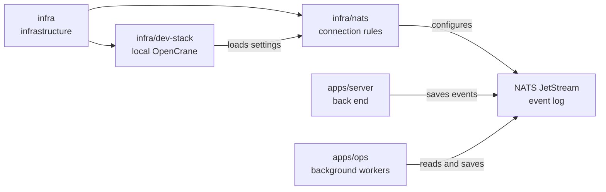

# Event log settings

## What this is

OpenCrane saves every change, such as a member joining or a message being sent, in
one shared record called the [event log](../../GLOSSARY.md#event-log-event-store).
[NATS](../../GLOSSARY.md#nats) keeps this record and passes new entries to background
programs. This folder holds its settings for encrypted connections and limited access.

## Where it fits

This is infrastructure loaded by [infra/dev-stack](../dev-stack/README.md).
The back end saves events; workers read them to build tables and run background jobs.
Workers that save a result use the same command identity as the server.



## What it is responsible for

- Turns on JetStream, the part of NATS that stores events.
- Encrypts connections and checks each program's certificate, a digital ID card.
- Gives programs separate keys with limited rights. The command key, used by the
  server and reactions that save results, is the only one that may add events.
- Lets table-building workers read events and lets the dispatcher confirm delivery.
- Keeps assistant computers and the AI gateway out of the event log.
- Loads public keys when NATS starts. The settings file holds no private keys.

## Processes it handles

1. **The server saves a change.** It connects with the command key and adds an event
   to the log. This identity can also read events and manage the log's readers.
2. **Workers update data or run jobs.** Table-building workers read events to update
   PostgreSQL. The dispatcher confirms delivery as it hands events to background jobs.
3. **A computer tries to connect.** Its identity has no event log access, so it
   cannot read or write events.

## How to run or test it

The development stack loads these settings when it starts NATS. Security tests
start a real NATS server and check that each key can do only its own job.

```sh
infra/dev-stack/up.sh
nice -n 10 npm test -- libs/event-store/test/security.test.ts
```

## Where to read more

- [NATS settings](nats.conf): connection and account rules.
- [infra/dev-stack](../dev-stack/README.md): the local NATS service.
- [Read tables](../../GLOSSARY.md#read-table-projection): how workers build data from events.
- [Dispatcher](../../GLOSSARY.md#dispatcher): how background work starts.
- [Why NATS JetStream holds the event log](../../docs/adr/0001-event-store-nats-jetstream.md).
