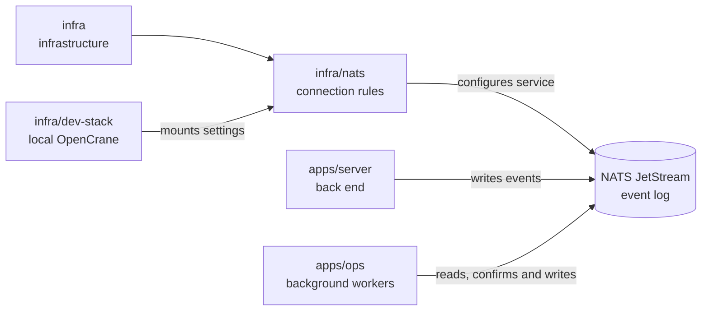

# infra/nats

## What this is

The NATS settings file that controls how OpenCrane programs connect to the event log.
NATS JetStream stores events and passes them to background programs. The settings require
encrypted connections and give each program only the access it needs.

## Where it fits

This is part of the infrastructure layer and supports the event log. The server, and the
background programs when they record a result, write events with the one key that may write.
[Projection workers](../../GLOSSARY.md#read-table-projection) build read tables from events,
and the [dispatcher](../../GLOSSARY.md#dispatcher) starts background reactions to them.



## What it is responsible for

- Turn on JetStream, the part of NATS that stores events.
- Require encrypted connections and checked client certificates.
- Give the server, projection workers and dispatcher separate access rights.
- Keep sandboxed computers and the AI gateway out of the event log.
- Read each program's public key from environment variables. Private keys never go in this
  file.

## Processes it handles

1. **The server records a change.** It connects with the command key, the only key allowed
   to write events, and adds an event to the log. The same key can also read events back and
   manage the log's readers.
2. **Workers update data or run background work.** Projection workers read events to
   update PostgreSQL tables. The dispatcher reads its events and confirms them as it
   hands work to background reactions.
3. **A computer tries to connect.** The computer identity has no NATS access, so the
   connection cannot read or write events.

## How to run or test it

The file is mounted by the development stack. It is not a standalone service. The security
tests start a real NATS server with this file and check that each key can do only its own job.

```sh
infra/dev-stack/up.sh
npx vitest run libs/event-store/test/security.test.ts
```

## Where to read more

- [NATS settings](nats.conf): the connection and account rules.
- [infra/dev-stack](../dev-stack/README.md): the local NATS service.
- [Read table (projection)](../../GLOSSARY.md#read-table-projection): how workers make
  tables from events.
- [Dispatcher](../../GLOSSARY.md#dispatcher): how background work starts from events.
- [Why NATS JetStream holds the event log](../../docs/adr/0001-event-store-nats-jetstream.md).
