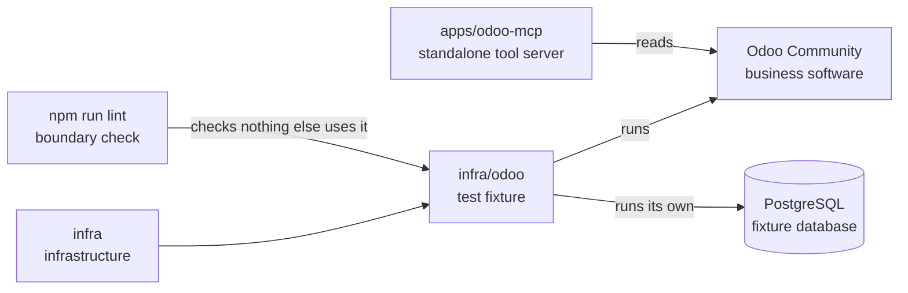

# infra/odoo

## What this is

A local copy of Odoo Community filled with made-up business records for testing access
rules. Odoo is business software for work such as sales, stock and accounts. The standalone
[Odoo tool server](../../apps/odoo-mcp/README.md) describes its tools and reads draft orders. It lets us test how OpenCrane will use a company's
Odoo with each person's own rights, without touching real company data.

## Where it fits

This is a separate test fixture in the infrastructure layer. It has its own database and
does not connect to the development stack. The Odoo tool server can read its existing records.



## What it is responsible for

- Build and run Odoo and its separate PostgreSQL database in containers.
- Create fake sales orders and ordinary writer and reader test accounts.
- Check that Odoo allows or refuses changes for the right account.
- Keep the service available only on the local machine.
- Check that other code does not depend on the fixture's container images.
- Not built yet: the product chat connection to Odoo.

## Processes it handles

1. **A developer starts the fixture.** The scripts build the images, create the database
   and add the fake orders. Odoo is then available at `http://127.0.0.1:18069`.
2. **A developer checks access.** `checks.py` signs in as the writer and the reader. It
   confirms that refused changes leave the records alone and that allowed changes name the
   writer. The full journey, `journey.py`, also wipes and rebuilds the fixture twice.
3. **A developer resets the fixture.** Reset removes its database and file data, recreates
   the fake orders and issues new test keys. Stop and start keep the existing data.

## How to run or test it

These commands run on the Linux developer machine with Docker Compose and Python 3:

```sh
infra/odoo/start.sh
python3 infra/odoo/checks.py
python3 infra/odoo/journey.py   # wipes the fixture's data
infra/odoo/stop.sh
```

## Where to read more

- [README.robot.md](README.robot.md): fixture accounts, private files, network rules and image pins.
- [Reviewed runtime licences](licences.md): the licences for Odoo and the fixture.
- [Planned Odoo access using each person's own rights](../../plan.md#per-user-mcp-credentials-eg-per-user-odoo).
- [Glossary](../../GLOSSARY.md): plain meanings of containers and other shared terms.
