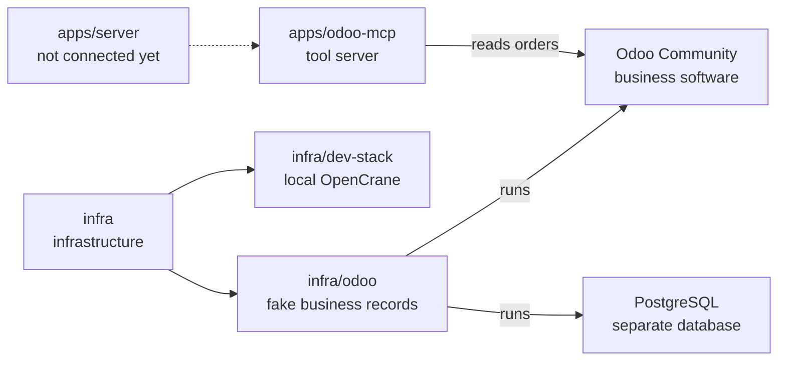

# Local Odoo test setup

## What this is

This package runs a local copy of Odoo Community with made-up sales orders and
accounts. Odoo is business software for sales, stock and accounts; this copy lets
developers check each account's rights without touching real company data.

## Where it fits

This is a fixture, a ready-made test setup with fake data, in the infrastructure
layer. It has its own database and runs separately from the development stack.
The [Odoo tool server](../../apps/odoo-mcp/README.md), a small program that lets an
AI assistant look things up through [MCP](../../GLOSSARY.md#mcp-server-tool-server),
can read draft orders here. OpenCrane's chat does not connect to Odoo yet.



## What it is responsible for

- Runs Odoo and its separate PostgreSQL database in containers.
- Creates fake sales orders and ordinary writer and reader test accounts.
- Checks that Odoo allows or refuses changes for the right account.
- Keeps the service available only on this machine.
- Checks that other packages do not depend on these test images.

## Processes it handles

1. **A developer starts the fixture.** The scripts build the images, create the
   database and add fake orders. Odoo becomes available at `http://127.0.0.1:18069`.
2. **A developer checks access.** Checks sign in as the writer and reader and confirm
   that refused changes leave records alone. Allowed changes identify the writer.
3. **A developer resets the fixture.** Reset removes its database and files, recreates
   the fake orders and issues new API keys for the test accounts. Stop and start keep data.

## How to run or test it

These commands need the Linux developer machine, Docker Compose and Python 3.
The journey command wipes and rebuilds the fixture twice.

```sh
infra/odoo/start.sh
python3 infra/odoo/checks.py
python3 infra/odoo/journey.py
infra/odoo/stop.sh
```

## Where to read more

- [README.robot.md](README.robot.md): accounts, private files, network rules and image versions.
- [Reviewed runtime licences](licences.md): licences for Odoo and this test setup.
- [Planned Odoo access using each person's rights](../../plan.md#per-user-mcp-credentials-eg-per-user-odoo).
