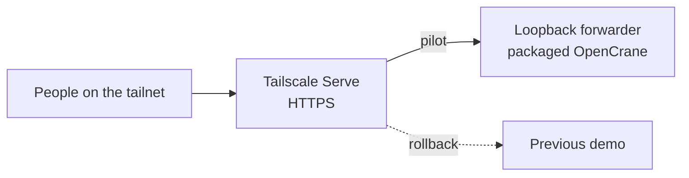

# Pilot operator guide

The owner or orchestrator runs this guide on the pilot box. The packaged
installation becomes the demo at the existing Tailscale address. It starts with
its own data. Keep the old demo available until you have checked the pilot and
can switch the address back.

The rehearsal result is scheduled backup FAIL at verify, zero completed sets,
restore NOT RUN. Switch-over is allowed for testing with disposable data.
Real data waits for slice 2 to pass backup and restore.

## Prepare and install

1. Record the demo's current Serve target and how to bring it back. Confirm
   that the pilot name is the box's own `.ts.net` name and that HTTPS and access
   to this device are enabled for the invited people on the tailnet.
2. Choose the revision for the rehearsal. Check that CI has approved its app
   and scanner images. Use a separate claimed slot and keep its
   installation and backups out of routine development cleanup.
3. Prepare the [private values and sign-in files](README.robot.md#pilot-switch-over).
   Select provider mode, use the tailnet name for sign-in and keep the nightly
   02:00 UTC backup. Prepare the empty recovery install later, when you have a
   complete backup to restore.
4. Run the existing package commands. Check the installation and start the
   loopback forwarder. The checked switch command confirms the package
   address, both sign-in redirects and the old demo route before it changes
   Tailscale Serve. Serve is the only way in. **Never use Tailscale Funnel.**
5. From a tailnet client, open the pilot in a clean browser. Check that HTTPS
   is trusted and that another client off the tailnet cannot reach the site.
   Open `/claim`, sign in with the first owner's account and enter the
   one-time token in the form. Open **People & groups → Owners**. Refresh the
   page until the first owner appears before opening Settings. The claim
   confirmation can arrive before the permissions are ready.

## Connect the provider and invite people

1. In **Settings → Models**, add an OpenAI connection. Enter its key in the
   form, approve the quoted test and wait for it to pass. Enable the chat
   model, select it as the chat default, pause new calls and switch on member
   chats. Use the agreed pilot spending limits before sharing access.
2. Give each invited person tailnet access first. In **People → Invite people**,
   enter the address the person uses to sign in. Choose **Member** and
   **Provision** for their personal assistant. Send the invitation link
   privately. OpenCrane leaves sending the link to you.
3. Invite the separate owner test account using the address in the private
   handoff. Have that person accept in a separate browser session. In People,
   open their member record and copy the member ID from the page address.
   In **Owners → Appoint an owner**, enter that ID, review and confirm.
   Use **Check status** if the appointment is still applying. Check that
   both owners are listed and that the new owner can sign in.
4. Ask an invited member to send a message and see a completed reply on
   desktop at 1280 px and on a phone at 390 px. Record the result before
   opening the pilot to the rest of the group.

## Back up and restore

The next slice covers recording a completed nightly backup, saving it off the
box and restoring it into an empty installation. The
[backup and recovery commands](README.robot.md#pilot-backup-and-recovery-commands)
show how to identify the separate recovery installation. The backup excludes
provider credentials and assistant computer homes.

## Roll back to the demo

If sign-in, access or a reply fails, stop sending invitations and follow the
[rollback commands](README.robot.md#roll-back-the-pilot-route). Keep the
pilot available for testing after the known backup failure. After rollback,
confirm that the demo signs in and answers from the tailnet. The two installations have
separate histories. Keep the pilot test data for follow-up.

## Known gaps

- **No swap.** With swap disabled, RAM is the limit on this box. The host
  check still requires safe swap and crash-dump settings. Record any use of
  the existing local exception if the actual settings differ.
- **Tailnet only.** Each person needs a device allowed to reach this box on
  the tailnet and a separate OpenCrane sign-in.
- **Single box.** A host failure stops the pilot. Recovery depends on the
  complete copy held away from the machine.
