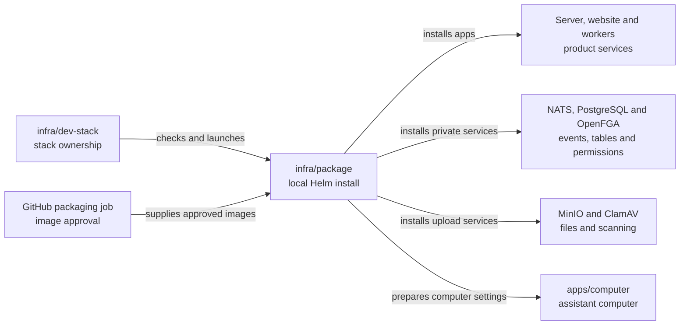

# Local Helm package

## What this is

This package installs OpenCrane on a developer's local Kubernetes system.
It uses [Helm](../../GLOSSARY.md#helm) to install the apps and services together.
Developers use it to check the approach intended for customer installations.
The customer installer is still planned.

## Where it fits

This package belongs to infrastructure, beside
[infra/dev-stack](../dev-stack/README.md) and [infra/devbox](../devbox/README.md).
It runs only in a claimed [spare stack](../../GLOSSARY.md#slot-spare-dev-stack).
The development stack manages ownership; this package installs and checks the product
in the recorded Kubernetes cluster.



## What it is responsible for

- Install the apps, core services, file store and private upload scanner together.
- Require reviewed images, matching source and accepted runtime licences.
- Keep private settings in named Secrets and refuse public network exposure.
- Check ownership and the recorded cluster before installation, forwarding or cleanup.
- Prepare databases, the event log, sign-in and a first owner for local testing.
- Set the installation's public organisation name.
- Give assistant computers the private gateway address and short-lived passes.
- Save scheduled backups of events, databases and uploaded files together.
- Provide bounded capture and restore helpers that check data before recovery.
- Remove only the install owned by the claimed stack, including after interruption.

Not built yet:

- Install on a customer's system.
- Enable the optional PostgreSQL standby, database backup and recovery previews.
- Admit the three-peer event-log option with the shipped image review.
- Restore retained computer homes onto live mounted volumes or prove full recovery.

## Processes it handles

1. **A developer prepares an install.** They claim a spare stack and stop its ordinary
   local services. Preparation records ownership and creates private settings for
   the package in the chosen cluster.
2. **The package starts.** Image and settings checks run before Helm installs anything.
   A setup job prepares the databases, event log and first owner; workers start an
   assistant's computer when needed.
3. **A developer opens the website.** A local port forward connects their browser
   to the private website. A missing or changed cluster target stops forwarding.
4. **A person uploads a file.** The server scans it before saving and sending it
   to the assistant. Infected files and files without a verified scan stay unavailable.
5. **A backup runs.** The job stops writes, drains read tables and saves matching
   events, databases and files. It publishes a complete backup only after the stopped
   services are ready again; a failed restart keeps maintenance active.
6. **A developer checks or removes an install.** Fresh-install checks use new storage
   and verify chat and unauthenticated refusal. Cleanup checks ownership before
   removing only that stack's package.

## How to run or test it

Run the chart checks from the repository root. The render check needs Helm:

```sh
nice -n 10 node --experimental-strip-types --test infra/package/chart.test.mjs
nice -n 10 node --test infra/package/chart-render.test.mjs
```

For a running install, follow the [operator commands](README.robot.md) to claim a
spare stack, prepare private values, start Helm, forward the website and clean up.
That guide also explains image approval and the private development owner setting.
A fresh install replaces the selected install's data.

## Where to read more

- [README.robot.md](README.robot.md): settings, folders, image review and recovery contracts.
- [Local operator guide](README.robot.md#local-operator-guide): commands and recovery limits.
- [infra/dev-stack](../dev-stack/README.md): spare stack claims and the other local install path.
- [infra/clamav](../clamav/README.md): upload scanning.
- [Planned customer installation](../../docs/architecture/target.md): intended deployment.
