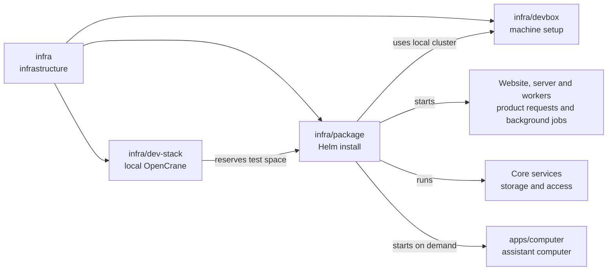

# Local Helm package

## What this is

This package installs a copy of OpenCrane on the developer machine's small
Kubernetes system, to try the approach intended for future customer installations.
It uses Helm, a tool that installs a set of Kubernetes programs together, so
developers can check the product before the customer installer is built.

## Where it fits

This is infrastructure beside [infra/dev-stack](../dev-stack/README.md) and
[infra/devbox](../devbox/README.md). It runs only in one of the two
[spare dev stacks](../../GLOSSARY.md#slot-spare-dev-stack), never the owner's copy.
Both install paths use the local [Kubernetes](../../GLOSSARY.md#kubernetes) cluster,
which runs programs in [Pods](../../GLOSSARY.md#container-and-pod).



The install runs a fake AI model for testing and creates its first owner through
saved [events](../../GLOSSARY.md#event). Workers start a computer when the owner
first chats. Computers belong to assistants, including shared group assistants,
and remain the same across chats. File storage and virus scanning are outside this package.

## What it is responsible for

- Installs the website, server, workers and core services together with [Helm](../../GLOSSARY.md#helm).
- Uses fixed, reviewed images and checks their licences before installation.
- Keeps the install in the test space [claimed](../../GLOSSARY.md#claim) by this worktree.
- Refuses missing private settings and public network access.
- Gives computers the private gateway address and short-lived access passes.
- Removes only this worktree's install, including after an interrupted launcher.

## Processes it handles

1. **A developer claims a spare stack.** Preparation checks that its Docker Compose
   stack is stopped, then creates a separate space in Kubernetes for the package.
2. **The package starts.** Helm starts the apps and services. A short setup job
   prepares the databases and first owner; workers start the assistant's computer as needed.
3. **A developer opens the website.** A local port forward connects the private
   website to a browser on this machine.
4. **A developer stops the package.** Cleanup checks ownership and removes only
   this developer's install, even after a crash.
5. **A developer checks fresh installs.** A check installs the package twice from
   scratch and confirms the second install starts empty and chat still works.

## How to run or test it

The [operator notes](README.robot.md) explain the image review and private settings
needed before installation. After a claim, the returned stack number selects the install:

```sh
DEV_STACK_ID=$(infra/dev-stack/claim.sh) || exit 1
export DEV_STACK_ID
infra/dev-stack/run.sh package-prepare --id "$DEV_STACK_ID"
node --experimental-strip-types infra/package/prepare.ts /private/values.json
infra/dev-stack/run.sh package-up --id "$DEV_STACK_ID" --values /private/values.json
infra/package/forward.sh
infra/dev-stack/run.sh package-down --id "$DEV_STACK_ID"
infra/dev-stack/down.sh --id "$DEV_STACK_ID"
```

## Folders

| Folder | What it does |
| --- | --- |
| [chart](chart/README.md) | Describes the local installation and its required settings. |
| [chart/templates](chart/templates/README.md) | Describes the programs, storage and network rules to install. |

## Where to read more

- [README.robot.md](README.robot.md): settings, image review, commands and current limits.
- [infra/dev-stack](../dev-stack/README.md): the other local install path and stack claims.
- [Planned customer installation](../../docs/architecture/target.md): the intended customer setup.
