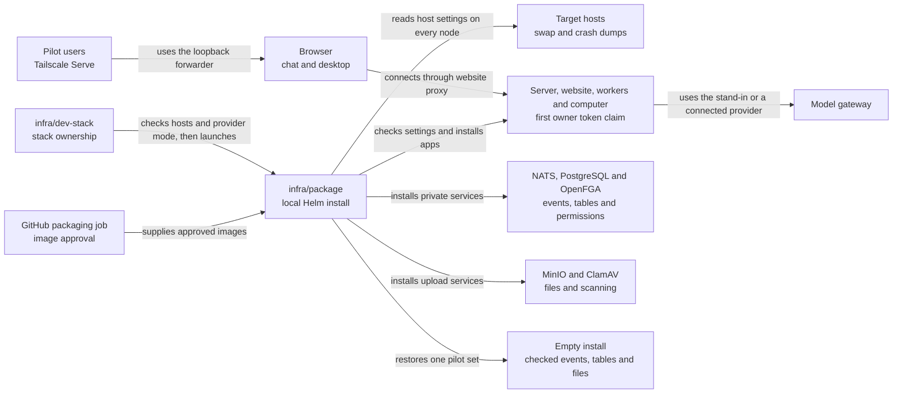

# Local Helm package

## What this is

This package installs OpenCrane on a developer's local Kubernetes system.
It uses [Helm](../../GLOSSARY.md#helm) to install the apps and services together.
Developers use it to check the approach intended for customer installations.
The pilot operator uses it to run the demo on one tailnet device.
The customer installer is still planned.

## Where it fits

This package belongs to infrastructure, beside
[infra/dev-stack](../dev-stack/README.md) and [infra/devbox](../devbox/README.md).
It runs only in a claimed [spare stack](../../GLOSSARY.md#slot-spare-dev-stack).
The development stack manages ownership; this package installs and checks the product
in the recorded Kubernetes cluster.



## What it is responsible for

- Install the apps, core services, file store and private upload scanner together.
- Require reviewed images, matching source and accepted runtime licences.
- Refuse unsafe host swap and crash dumps before Helm runs on any target node.
- Keep private settings in named Secrets and check production sign-in before installation.
- Keep package listeners private and let Tailscale Serve carry pilot HTTPS.
- Check ownership and the recorded cluster before installation, forwarding or cleanup.
- Prepare databases, the event log and development sign-in.
- Let the first person claim ownership with a one-time token in public-address mode.
- Choose the stand-in model or private storage for a provider connected in Settings.
- Set the installation's public organisation name.
- Give assistant computers the private gateway address and short-lived passes.
- Save scheduled backups of events, databases and uploaded files together.
- Restore one complete pilot backup into empty storage, then open authenticated reading.
- Remove only the install owned by the claimed stack, including after interruption.

Not built yet:

- Install on a customer's system.
- Enable the optional PostgreSQL standby, database backup and recovery previews.
- Admit the three-peer event-log option with the shipped image review.
- Restore retained computer homes onto live mounted volumes or prove full recovery.

## Processes it handles

1. **A developer prepares an install.** They claim a spare stack and stop its ordinary
   local services. Preparation records ownership and creates private settings for
   the package in the chosen cluster.
2. **The package starts.** Host, image and settings checks run before Helm installs anything.
   A setup job prepares the databases and event log. Private development installs
   create the test owner; public-address mode waits for a signed-in person to claim
   ownership with a one-time token. Workers start an assistant's computer when needed.
   The worker that sends saved events to reactions can use a full CPU when work arrives together.
3. **An owner connects a model provider.** With `models.mode: provider`, they save
   its key in Settings, run the quoted test, select the chat model and switch on.
   Members can then get real replies. The default install keeps the stand-in.
   Fleet tasks can use provider mode with the restricted free stand-in.
   When the provider-mode server is updated, it stops before its replacement starts.
4. **A developer opens the website.** A local port forward connects their browser
   to the private website. A closed desktop connection leaves other requests available.
   A missing or changed cluster target stops forwarding.
5. **A person uploads a file.** The server scans it before saving and sending it
   to the assistant. Infected files and files without a verified scan stay unavailable.
6. **A backup runs.** The job stops writes, drains read tables and saves matching
   events, databases and files. It publishes a complete backup only after the stopped
   services are ready again; a failed restart keeps maintenance active.
7. **A developer restores a pilot.** A separate empty installation checks the matching
   backup, rebuilds tables and permissions, and restores files. Reading opens only
   after verification. Workers and effects remain stopped.
8. **A developer checks or removes an install.** Fresh-install checks use new storage
   and verify chat and unauthenticated refusal. Cleanup checks ownership before
   removing only that stack's package.
   Provider journey results name the failed step and its expected condition safely.

## How to run or test it

Run the chart checks from the repository root. The render check needs Helm, tar and the original chart in Git history:

```sh
nice -n 10 node --experimental-strip-types --test infra/package/chart.test.mjs
nice -n 10 node --test infra/package/chart-render.test.mjs
```

For a running install, follow the [operator commands](README.robot.md) to claim a
spare stack, prepare private values, start Helm, forward the website and clean up.
That guide also explains image approval, production sign-in checks and the one-time
owner claim. Preparation reports a safe reason code for a missing values filename or
conflicting filename arguments. Public-address mode currently creates no public listener.
A fresh install replaces the selected install's data.
Sign-in checks save a safe failure code and step, and a screenshot with form values hidden.

Each host must have swap off, or plain encrypted swap with a fresh random key at
each boot. Host crash dumps must be off or never persisted: this preflight accepts
an empty `kernel.core_pattern` with `kernel.core_uses_pid=0`, and refuses every
reporter pipe and file pattern. The checks only read host settings. The explicit
[dev-box override](README.robot.md#host-disk-protection) records the accepted risk;
it is off by default and cannot authorise a remote host. The same guide gives the
exact settings and commands to rerun the production F1 and F2 disk probes.

## Where to read more

- [README.robot.md](README.robot.md): settings, folders, image review and recovery contracts.
- [Pilot operator guide](PILOT.md): prepare, check and roll back the tailnet pilot.
- [Local operator guide](README.robot.md#local-operator-guide): commands and recovery limits.
- [infra/dev-stack](../dev-stack/README.md): spare stack claims and the other local install path.
- [infra/clamav](../clamav/README.md): upload scanning.
- [Planned customer installation](../../docs/architecture/target.md): intended deployment.
